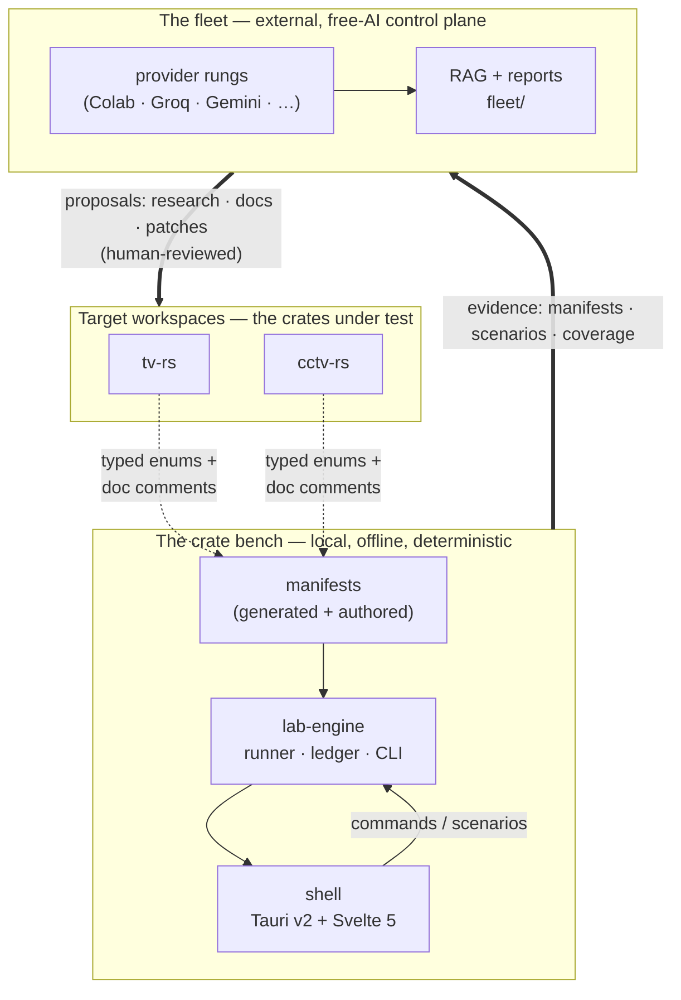
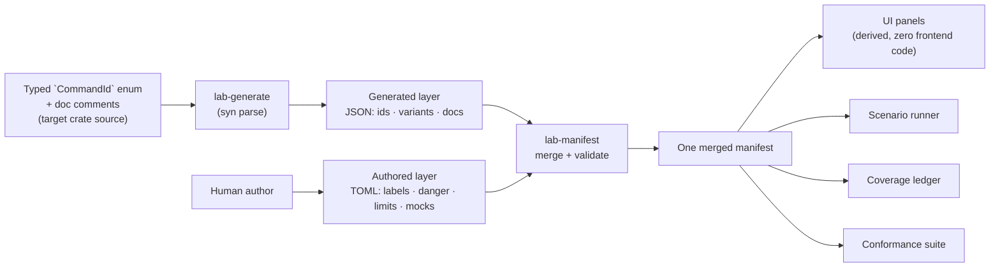
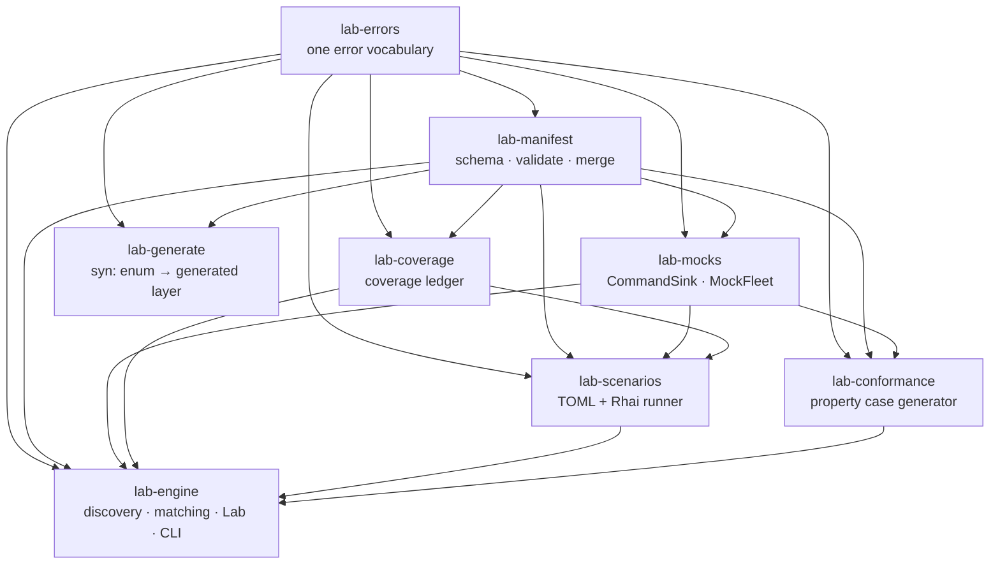
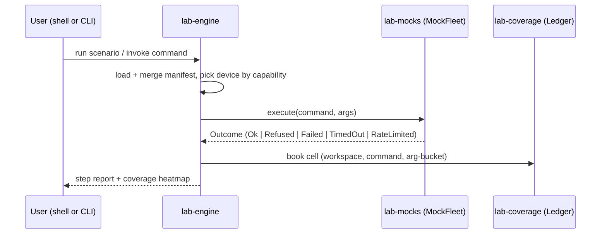

# 01 · Architecture

The whole-system view: the two planes of cratelab, the manifest-driven spine they share, the layering of the bench crates, the design invariants that hold across every component, and where the fleet attaches.

> **cratelab docs** · SPDX `MIT` · security: this file must never contain credentials, tokens, private-repo content, or absolute user paths.

**Status:** reference · **Last verified:** 2026-11-04 · **Related:** [00-index](00-index.md), [02-manifest](02-manifest.md), [03-cli-and-workflows](03-cli-and-workflows.md), [04-shell-and-ui](04-shell-and-ui.md), [06-crate-intelligence](06-crate-intelligence.md), [07-fleet-overview](07-fleet-overview.md)

## 1. Two planes, one premise

cratelab is one repository serving two distinct planes. Keeping them separate is the organising principle of the whole codebase.

- **The crate bench** (`crates/lab-*`, `shell/`) is cratelab's own implementation: it loads manifests, drives a mock fleet, runs scenarios, records coverage, and executes property conformance. It is offline and deterministic by default.
- **The fleet** (`fleet/`, the shell's fleet views) is the worker layer: free-AI provider rungs that read the bench's evidence and produce reviewable artefacts about the *target* crates. It never writes features and never merges.

The arrow between them is one-directional in authority: the bench **produces evidence**, the fleet **produces proposals**, and a human disposes. See [07-fleet-overview](07-fleet-overview.md) and [06-crate-intelligence](06-crate-intelligence.md).

## 2. The manifest spine

Every capability in the system descends from one artefact: the **manifest**. It is not a map of an API — it is a behavioural contract. The full schema lives in [02-manifest](02-manifest.md); the architectural rule is:

> **Generated proposes, authored disposes.**

- The **generated layer** is machine-produced from the crate's typed enum. It can be regenerated at any time.
- The **authored layer** is hand-written: labels, danger levels, limits, mock bindings, `why` rationale.
- The two are matched by `id` **or** by `variant`, so pretty authored ids (`tv.power.off`) coexist with generated ids (`tv.power_off`).
- `lab-manifest` validates and merges them, reporting **all** problems rather than the first.

This single artefact is the reason adding a crate adds *zero* frontend code: the UI is a renderer over the merged manifest, not an author of it.

## 3. Bench layering

The bench is eight crates with a strict, mostly-acyclic dependency direction. The verified graph and per-crate responsibilities are in [06-crate-intelligence](06-crate-intelligence.md); the architectural summary:

`lab-errors` is the root: every other crate depends on it and nothing depends on the crates above it. `lab-generate` is an **authoring tool**, not a runtime dependency — it has no dependents inside the workspace and sits off to the side of the runtime path.

## 4. Runtime data flow

The outcome set is the crux: a **capability refusal is a first-class outcome** (severity `Info`, exit code 0) and counts as coverage, never as a red error. The `CommandSink` port that `lab-mocks` implements today is the same port a real hardware facade implements later — scenarios never know the difference.

## 5. Design invariants

These hold across every crate, the shell, and the fleet. They are the contract any new component must respect.

| Invariant | Meaning |
|---|---|
| **Refusals are data** | A capability refusal is a typed outcome (`LabError::Capability`), severity `Info`, exit 0 — counted, not crashed on. |
| **Zero panic** | No `unwrap()` / `panic!` on any path a manifest or script can influence. Conformance makes this executable. |
| **Mock-first** | The same `CommandSink` port serves the mock fleet and a real facade; hardware lands behind an explicit toggle. |
| **Deterministic chaos** | Failure injection is counter-based, never RNG, so a failing run replays identically. |
| **Sandboxed scripts** | Rhai runs with bounded operations, bounded strings and no I/O. |
| **One error vocabulary** | Everything branches on `LabError` + `Remedy`, nothing else. |
| **The UI is a renderer** | Adding a crate adds zero frontend code; the UI is derived from the manifest. |
| **Generated proposes, authored disposes** | Machine output is advisory; a human commits the semantic layer. |

## 6. The shell in the system

`shell/` is a Tauri v2 desktop application built on **Svelte 5 runes** with **Bun** as the package manager. It is a **standalone Cargo workspace**, deliberately *not* a member of the root workspace, so that `cargo test --workspace` stays green on machines without webkit2gtk / Tauri system dependencies.

The shell holds the lab behind a single `LabState { lab: Mutex<Lab> }` and exposes a typed IPC surface (commands, scenarios, coverage, fleet settings) to the Svelte frontend. Secret values never leave Rust — the UI only ever sees a boolean `configured`. See [04-shell-and-ui](04-shell-and-ui.md).

## 7. Where the fleet attaches

The fleet is a **proposer** layered over the bench's evidence. It has its own governance boundary, enforced in `fleet/config.json`:

- `github_writes: false` and `target_writes: false` — the fleet cannot push to GitHub or write to the target repos.
- `forbidden_paths` — the paths it may never modify.
- Every provider call requires an explicit preview and confirmation; credentials live in an ignored `fleet/.env` and are referenced by name only.

The bench supplies the *facts* (manifests, scenarios, coverage); the fleet supplies *judgement proposals*. [07-fleet-overview](07-fleet-overview.md) covers the rungs and roles; [10-fleet-workflows](10-fleet-workflows.md) covers the cycles; [12-operations](12-operations.md) covers running it safely.

## 8. Consolidation notes

- Merged the architecture material that was previously split across the blueprint PDF, the stale `architecture.html` narrative, the playbook and the technical-implementation build sheet into one verified description.
- Kept the two-plane split explicit — an earlier draft documented the bench and the fleet as if they were one system.
- The crate dependency graph is the corrected version from [06-crate-intelligence](06-crate-intelligence.md) (the pre-correction graph omitted three `lab-errors` edges and mis-stated `lab-generate`'s runtime position).
- Design invariants were collected from the root README and the concept plan; the wording now matches the code's actual behaviour (e.g. refusals as `Info` / exit 0).
