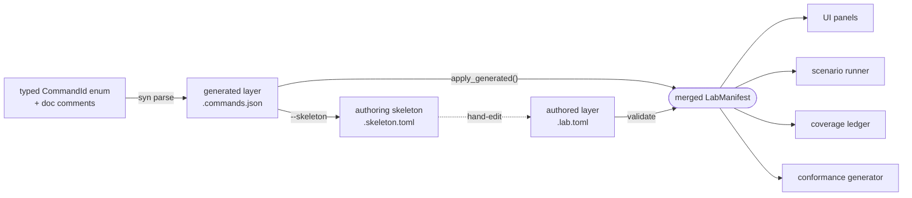

# 02 · The manifest contract
The lab manifest is the single artifact that drives the UI, the runner, the ledger and the conformance suite.

> **cratelab docs** · SPDX `MIT` · security: this file must never contain credentials, tokens, private-repo content, or absolute user paths.

**Status:** reference · **Last verified:** 2026-11-04 · **Related:** [00-index](00-index.md) · [01-architecture](01-architecture.md) · [03-cli-and-workflows](03-cli-and-workflows.md) · [06-crate-intelligence](06-crate-intelligence.md) · [architecture.html](architecture.html) · [lifecycle.html](lifecycle.html) · [manifest-lifecycle.png](manifest-lifecycle.png)

## 1. Purpose and position

A *lab manifest* is the per-workspace declaration that turns a set of published crates into a testable, UI-generatable surface. Everything downstream is derived from it: command panels, the scenario runner's command lookup, the coverage heatmap rows, and the type-directed conformance generator. The authoritative implementation is `crates/lab-manifest/src/lib.rs`; the runtime vocabulary it borrows (`LabErrorKind`, `MappingRule`) is in `crates/lab-errors/src/lib.rs`.

The manifest is produced in **two layers** and merged:

| Layer | Produced by | Carries |
|---|---|---|
| **Generated** | `lab-generate` (`syn`) over the workspace's typed `CommandId` enum + doc comments → JSON | stable `id`s, `variant`, `doc`, argument shapes (`ArgSpec`) |
| **Authored** | hand-written `*.lab.toml` per workspace | labels, danger, timeouts, rate limits, servers, limits, quirks, mock script bindings |

The merge rule is **"generated proposes, authored disposes"**: any command present in both keeps the authored metadata and gains the generated `source_enum` / `help` provenance. Matching is by `id` **or** by `variant`, so pretty authored ids (`tv.power.off`) coexist with generated ids (`tv.power_off`) as long as the authored entry pins `variant = "PowerOff"`.



## 2. Schema as implemented

`SUPPORTED_SCHEMA_VERSION = 1` (`crates/lab-manifest/src/lib.rs:22`). Every struct below carries `#[serde(deny_unknown_fields)]` unless noted.

### 2.1 Root

| Field | Type | Required | Notes |
|---|---|---|---|
| `schema_version` | `u32` | yes | must equal `1` |
| `workspace` | `WorkspaceRef` | yes | `[workspace]` |
| `errors` | `ErrorsSection` | no (default) | `[errors]` |
| `device_classes` | `Vec<DeviceClass>` | no | `[[device_classes]]` |
| `commands` | `Vec<CommandSpec>` | no | `[[commands]]` |
| `events` | `Vec<EventSpec>` | no | `[[events]]` |
| `servers` | `Vec<ServerSpec>` | no | `[[servers]]` |
| `limits` | `Vec<LimitSpec>` | no | `[[limits]]` |
| `quirks` | `Option<QuirksRef>` | no | `[quirks]` |

### 2.2 `[workspace]` — `WorkspaceRef`

All six fields required, all `String`: `name`, `prefix`, `repo`, `facade`, `core`, `version`. `prefix` is the id namespace (first segment of every command/event id); `facade` is the crate users depend on; `core` is the device-model crate that owns types + error taxonomy.

### 2.3 `[errors]` — `ErrorsSection`

| Field | Type | Required |
|---|---|---|
| `source` | `Option<String>` | no (documentation-only; `to_mapping()` defaults it to `"unknown"`) |
| `mapping` | `Vec<MappingRule>` | no |

`MappingRule` (defined in `lab-errors`): `matches: String`, `to: LabErrorKind`, `retryable: Option<bool>`, `note: Option<String>`. `matches` is compared case-insensitively against the source error's variant/kind; a trailing `*` enables prefix matching. First match wins by declaration order.

### 2.4 `[[device_classes]]` — `DeviceClass`

| Field | Type | Required |
|---|---|---|
| `id` | `String` | yes |
| `mock_backend` | `String` | yes (path/label, e.g. `"tv-rs-core mock backend"`) |
| `capability_source` | `String` | yes (trait name, e.g. `"DeviceHandle"`) |
| `capabilities` | `Vec<String>` | no |

### 2.5 `[[commands]]` — `CommandSpec`

| Field | Type | Default | Notes |
|---|---|---|---|
| `id` | `String` | — | dotted, namespaced, stable: `tv.power.off` |
| `label` | `String` | — | human label; the generator `humanize()`s the variant when absent |
| `kind` | `CommandKind` | `action` | `action` \| `query` \| `config` |
| `danger` | `Danger` | `safe` | `safe` \| `attention` \| `destructive` |
| `source_enum` | `Option<String>` | `None` | e.g. `"tv_rs_core::CommandId::PowerOff"`; filled by the generator |
| `variant` | `Option<String>` | `None` | Rust variant bridge, e.g. `"PowerOff"` |
| `args` | `Vec<ArgSpec>` | `[]` | see below |
| `timeout_ms` | `u64` | `8000` | |
| `rate_limit` | `Option<RateLimit>` | `None` | `{ per_second: f64, burst: u32 = 1 }` |
| `emits` | `Vec<String>` | `[]` | every id must exist in `[[events]]` |
| `conformance` | `Option<ConformanceTier>` | `None` (→ `should`) | `must` \| `should` \| `may` |
| `invariants` | `Vec<Invariant>` | `[]` | only `idempotent` today |
| `mock` | `Option<String>` | `None` | mock behaviour script path (see §5) |
| `help` | `Option<String>` | `None` | |

Helper methods: `requires_confirm()` (`danger == destructive`), `tier()` (declared tier or `should`), `has_invariant(inv)`.

### 2.6 `ArgSpec` (inside a command's `args`)

| Field | Type | Default | Notes |
|---|---|---|---|
| `name` | `String` | — | |
| `type` | `ArgType` | — | **required** (serde `rename` is implicit via the field's raw ident `r#type`) |
| `required` | `bool` | `true` | |
| `options` | `Vec<String>` | `[]` | only meaningful for `enum` |
| `default` | `Option<serde_json::Value>` | `None` | |
| `help` | `Option<String>` | `None` | |
| `example` | `Option<serde_json::Value>` | `None` | UI pre-fill, editable, non-authoritative |
| `min` / `max` | `Option<f64>` | `None` | inclusive numeric bounds for `int`/`float` |
| `min_len` / `max_len` | `Option<usize>` | `None` | byte-length bounds for string-shaped types |

**`ArgType` variants (exact set):** `str`, `int`, `float`, `bool`, `enum`, `ipv4`, `mac`, `url`, `path`, `json`.

The declared type is also the argument's *generator*: `lab-conformance` reads these fields to emit in-range, boundary and hostile inputs, so the zero-panic rule is executable rather than a promise.

### 2.7 `[[events]]` — `EventSpec`

| Field | Type | Required | Notes |
|---|---|---|---|
| `id` | `String` | yes | must start with `prefix.` |
| `source` | `EventSource` | yes | `poll` \| `gena` \| `websocket` \| `mqtt` \| `bus` |
| `payload` | `String` | yes | payload type name, e.g. `"PowerState"` |
| `confidence` | `Option<Confidence>` | no | `reported` (read back) \| `inferred` (probed) |
| `help` | `Option<String>` | no | |

### 2.8 `[[servers]]` — `ServerSpec`

| Field | Type | Required | Notes |
|---|---|---|---|
| `id` | `String` | yes | |
| `crate` | `String` | yes | serde `rename = "crate"` over the Rust field `crate_name` |
| `default_port` | `u16` | yes | |
| `health_path` | `Option<String>` | no | readiness-probe route |
| `routes` | `Vec<String>` | no | |

### 2.9 `[[limits]]` — `LimitSpec`

| Field | Type | Required | Notes |
|---|---|---|---|
| `id` | `String` | yes | |
| `kind` | `LimitKind` | yes | `budget` \| `rate` \| `pool` \| `concurrency` |
| `applies_to` | `String` | yes | crate/component |
| `description` | `Option<String>` | no | |

### 2.10 `[quirks]` — `QuirksRef`

`file: String` and `feature: String`, both required.

## 3. Validation rules actually enforced

Two distinct mechanisms:

- **`deny_unknown_fields`** — a serde/TOML parse-level rejection. An unknown key fails during `toml::from_str` inside `LabManifest::from_toml_str`, surfaced as `LabError::Manifest`. This is why a typo'd step/field fails loudly instead of being silently ignored.
- **`LabManifest::validate()`** — structural checks run after parse and after every merge. It **collects all problems into a `Vec` and joins them with `"; "`** in a single `LabError::Manifest`, so it reports every defect, not just the first.

| Rule | Condition | Message shape |
|---|---|---|
| Schema version | `schema_version != 1` | `schema_version {n} not supported (lab speaks 1)` |
| Duplicate command id | id inserted twice into a `BTreeSet` | `duplicate command id '{id}'` |
| Command prefix | `!id.starts_with("{prefix}.")` | `command id '{id}' must start with workspace prefix '{prefix}.'` |
| Enum needs options | `type == enum` and `options` empty | `command '{id}': enum arg '{name}' has no options` |
| min ≤ max | `min > max` | `command '{id}': arg '{name}' has min {lo} above max {hi}` |
| min_len ≤ max_len | `min_len > max_len` | `command '{id}': arg '{name}' has min_len {lo} above max_len {hi}` |
| enum not numeric-bounded | `type == enum` and (`min` or `max` set) | `command '{id}': arg '{name}' is an enum; bound it with 'options', not 'min'/'max'` |
| Known emit | `emits` id not in events | `command '{id}' emits unknown event '{e}'` |
| Event prefix | event id lacks `prefix.` | `event id '{id}' must start with workspace prefix '{prefix}.'` |
| Duplicate device class | class-id set length ≠ vec length (only checked when non-empty) | `duplicate device class id` |

**Not enforced (verified gaps):** `validate()` does **not** require `rate_limit.per_second > 0`; a zero value makes the mock `TokenBucket` saturate its retry delay to `u64::MAX` rather than being rejected.

`apply_generated()` adds one more rule: every generated command id must start with `"workspace.prefix."`, otherwise `generated id '{id}' does not use prefix '{p}'`.

## 4. Worked example — `manifests/tv-rs.lab.toml`

Real values from the authored file (abbreviated to one command of each shape; events/servers/limits shown in full where short).

```toml
schema_version = 1

[workspace]
name = "tv-rs"
prefix = "tv"
repo = "https://github.com/Zakarialabib/tv-rs"
facade = "tv-rs"
core = "tv-rs-core"
version = "0.6.0"

[errors]
source = "tv-rs-core::Error"
[[errors.mapping]]
matches = "Capability*"
to = "capability"
retryable = false
note = "per-vendor capability sets refuse before any socket is opened"
[[errors.mapping]]
matches = "Pairing*"
to = "auth"
retryable = false
note = "Samsung token / LG client-key pairing problems"
[[errors.mapping]]
matches = "Timeout*"
to = "timeout"
[[errors.mapping]]
matches = "Transport*"
to = "transport"
retryable = true

[[device_classes]]
id = "tv"
mock_backend = "tv-rs-core mock backend (feature mock-backend)"
capability_source = "DeviceHandle"
capabilities = ["power", "volume", "key", "launch"]

[[device_classes]]
id = "dlna"
mock_backend = "tv-rs-core mock backend"
capability_source = "DeviceHandle"
capabilities = ["media"]

[[device_classes]]
id = "lfd"
mock_backend = "tv-rs-core mock backend"
capability_source = "DeviceHandle"
capabilities = ["power", "volume", "panel"]

[[commands]]
id = "tv.power.wake"
label = "Wake (WoL)"
kind = "action"
danger = "safe"
variant = "Wake"
args = [{ name = "mac", type = "mac", help = "Target MAC address", example = "AA-BB-CC-DD-EE-FF" }]
timeout_ms = 3000
conformance = "must"
invariants = ["idempotent"]
emits = ["tv.power.changed"]
help = "Wake-on-LAN magic packet; works with no control protocol at all."

[[commands]]
id = "tv.power.off"
label = "Power off"
kind = "action"
danger = "destructive"
variant = "PowerOff"
args = [
  { name = "ip", type = "ipv4", example = "192.168.1.40" },
  { name = "vendor", type = "enum", options = ["samsung", "lg", "roku", "mdc"] },
]
timeout_ms = 8000
rate_limit = { per_second = 1, burst = 2 }
conformance = "must"
emits = ["tv.power.changed"]

[[events]]
id = "tv.power.changed"
source = "poll"
payload = "PowerState"
confidence = "reported"
help = "The agent polls; there is no vendor push channel yet."

[[servers]]
id = "tv.media.hls"
crate = "tv-rs-media"
default_port = 8123
health_path = "/health"
routes = [
  "GET /v/{file} — HTTP 206 Partial Content for seeking",
  "GET /index.m3u8 — HLS playlist",
]

[[limits]]
id = "tv.ws.frames"
kind = "budget"
applies_to = "tv-rs-transport"
description = "Budgeted WebSocket frame reader caps per-connection frame budget."

[quirks]
file = "quirks/default.toml"
feature = "quirks"
```

Fact summary for `tv-rs.lab.toml`: 10 commands, 5 events, 1 server, 4 limits, 3 device classes, 4 error-mapping rules. The `dlna` class carries only `media`, so `tv.media.push` is routed at a DLNA device while `tv.panel.orientation` is routed at an `lfd` device (only `lfd` carries `panel`). `tv.panel.orientation` is the manifest's own refusal-by-capability demonstration: the `tv` class lacks `panel`, so it is refused before any I/O.

## 5. Contrast excerpt — `manifests/cctv-rs.lab.toml`

Same vocabulary, different workspace — the point being that one lab speaks both without a second UI or runner.

```toml
schema_version = 1

[workspace]
name = "cctv-rs"
prefix = "cctv"
repo = "https://github.com/Zakarialabib/cctv-rs"
facade = "cctv-rs"
core = "cctv-core"
version = "0.2.0"

[errors]
source = "cctv-core::Error"
[[errors.mapping]]
matches = "Capability*"
to = "capability"
retryable = false
[[errors.mapping]]
matches = "Onvif*"
to = "transport"
retryable = true
note = "SOAP 1.2 over the shared HTTP client; retries are safe (idempotent reads)"

[[device_classes]]
id = "camera"
mock_backend = "cctv-core mock suite"
capability_source = "CameraBackend"
capabilities = ["stream", "ptz", "presets", "detect", "discovery"]

[[commands]]
id = "cctv.detect.configure"
label = "Configure detection monitor"
kind = "config"
danger = "attention"
variant = "DetectConfigure"
args = [
  { name = "ip", type = "ipv4" },
  { name = "zone", type = "json", help = "Zone polygon + settings" },
]
timeout_ms = 8000

[[commands]]
id = "cctv.ptz.move"
label = "PTZ move"
kind = "action"
danger = "attention"
variant = "PtzMove"
args = [
  { name = "ip", type = "ipv4" },
  { name = "pan", type = "float", default = 0 },
  { name = "tilt", type = "float", default = 0 },
  { name = "zoom", type = "float", default = 0 },
]
timeout_ms = 6000
rate_limit = { per_second = 2, burst = 1 }
```

Differences worth noting: cctv-rs has **no `[quirks]` section** (optional), uses `float` and `json` argument types the tv-rs manifest does not, declares a `uvc` class carrying only `stream` (so `cctv.ptz.*` is refused on it), and its second device class exists to make that refusal real rather than asserted. `cctv-rs.lab.toml`: 9 commands, 4 events, 1 server, 4 limits, 2 device classes, 3 error-mapping rules.

## 6. Generated artifacts

| Artifact | Source of truth | Contents |
|---|---|---|
| `manifests/generated/tv-rs.commands.json` | `GeneratedManifest` | `source`, `generated_at`, `commands[]` of `GeneratedCommand` (`id`, `variant`, `doc`, `crate_path`, `args`) |
| `manifests/generated/tv-rs.skeleton.toml` | `authoring_skeleton()` | header comment, `[workspace]` with `prefix`/`facade`/`core`/`version` = `"TODO"`, then one `[[commands]]` block per generated command with a `# TODO: human label` and the doc comment carried through |

The committed JSON's `source` field is `crates/lab-generate/src/testdata/tv_command_id.rs` (the crate's test fixture), and it yields six commands: `tv.wake`, `tv.power_off`, `tv.power_state`, `tv.key_press`, `tv.launch`, `tv.set_volume`. The generated ids are prefix+variant snake_case (`PowerOff` → `tv.power_off`), which is exactly why the authored layer pins `variant = "PowerOff"` to keep the prettier `tv.power.off`.

**How they are produced** — `lab-generate` CLI (`crates/lab-generate/src/main.rs`):

```text
lab-generate <input.rs> <EnumName> --prefix <p> [--crate <path>] [--out <generated.json>] [--skeleton <skeleton.toml>]
```

Behaviour verified in `main.rs`: fewer than two positional args → usage on stderr, exit `2`; unknown flag → `unknown flag '{x}'`, exit `2`; unreadable input → exit `3`; generation error → `error: {e}`, exit `3`. With `--out` it writes the JSON and prints `wrote <path>` to stderr; without `--out` it prints the JSON to stdout. With `--skeleton` it writes the authoring TOML. `--prefix` silently defaults to `"x"` when omitted. Generation itself (`generate_from_source`) parses with `syn`, finds the named `enum`, maps each variant to `id = "{prefix}.{snake(variant)}"` with `doc` from `///` comments and named struct fields to `ArgSpec`s via the type heuristic (`Ipv4Addr|IpAddr`→`ipv4`, `PathBuf`→`path`, `Url`→`url`, `MacAddr`→`mac`, `String`→`str`, integers→`int`, floats→`float`, `bool`→`bool`, `Option<T>` unwrapped and marked optional).

## 7. Design rules the manifest encodes

| Rule | Where the manifest makes it real |
|---|---|
| **Refusals are data** | `device_classes[].capabilities` defines what is allowed; the empty/partial capability set produces `LabError::Capability` (`severity: Info`, `exit_code: 0`) before any I/O, and the coverage ledger books it as an `Outcome::Refused` "partial" cell rather than a failure |
| **Zero-panic** | `ArgType` + `min`/`max`/`min_len`/`max_len`/`options` are the conformance generator's inputs; every declared command is exercised and `catch_unwind` turns any unwind into a reported violation (see [03-cli-and-workflows](03-cli-and-workflows.md)) |
| **Mock-first, hardware behind a toggle** | `device_classes[].mock_backend` names the virtual backend; the same `CommandSink` port later serves a real `TvClient`/cctv facade, so scenarios never know the difference |
| **Deterministic chaos** | `rate_limit` is enforced lab-side by a per-command token bucket, and chaos is counter-based (no RNG, in `lab-mocks`) so a failing run replays identically |
| **Scripts are sandboxed** | `mock` names a per-command Rhai binding (+ `quirks.file`/`quirks.feature`); Rhai runs bounded (`set_max_operations`, `set_max_string_size`, `set_max_expr_depths`) with no I/O |
| **The lab never hides a surface** | generated commands the authored layer lacks are appended as `CommandKind::Action` skeletons at `danger = attention` so the UI still shows them |

## Consolidation notes

- Merged the two-layer model, the README "manifest in one screen" example, and the `lab-manifest` module docs into one spec; replaced the README's generic example values with the **real** values from `manifests/tv-rs.lab.toml` and `manifests/cctv-rs.lab.toml`.
- Documented the schema field-by-field from the Rust structs (`crates/lab-manifest/src/lib.rs`) including fields the README never showed (`kind`, `source_enum`, `required`, `example`, `min_len`/`max_len`, `conformance`, `invariants`, `quirks`, event `help`).
- Added the validation-rules table from `validate()` and stated explicitly that validation returns **all** problems; noted the `rate_limit.per_second > 0` gap as a verified non-rule (no invented rules).
- Dropped no still-relevant facts; the only content not carried forward is UI-wireframe-specific detail, which belongs to the sibling docs.
