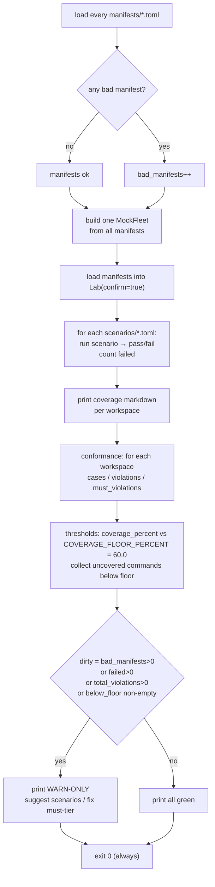

# 03 · CLI, scenarios, conformance, coverage
How you drive the lab headlessly, and the exact guarantee each mechanism provides.

> **cratelab docs** · SPDX `MIT` · security: this file must never contain credentials, tokens, private-repo content, or absolute user paths.

**Status:** live · **Last verified:** 2026-11-04 · **Related:** [00-index](00-index.md) · [02-manifest](02-manifest.md) · [06-crate-intelligence](06-crate-intelligence.md) · [architecture.html](architecture.html) · [lifecycle.html](lifecycle.html)

## 1. The `lab` CLI

The headless entry point is `crates/lab-engine/src/bin/lab.rs` (binary `lab`, `[[bin]] name = "lab"` in `crates/lab-engine/Cargo.toml`). What the Tauri shell does with pixels, this binary does with stdout. Dispatch is a single `match` on `args[0]`; the process returns `ExitCode` from the match arm, and any `Err(LabError)` prints `error: {e}` plus `remedy: {:?}` to stderr and exits with `e.exit_code()`.

Exit codes come from `LabError::exit_code()` (`crates/lab-errors/src/lib.rs`): `Info → 0`, `Warn → 2`, `Fatal → 3`. CLI misuse is raised as `LabError::Scenario` (step `<cli>`), so its remedy prints as `FixScenario`.

| Subcommand | Exact usage | What it prints | Exit codes |
|---|---|---|---|
| `discover` | `lab discover <workspace-root>` | `workspace {name} ({root}) — {N} member crates:` then one `{name:<28} {version}` line per member | `0` on success; discovery failure → `Err` path (`Warn`→2 for most; missing members array is `Discovery` = `Warn`=2) |
| `manifests` | `lab manifests <dir>` | one `ok   {name:<26} v{version}  commands={n} events={n} servers={n} limits={n}` per parsed manifest, or `FAIL {e}`; then `{n} manifest(s) loaded` | always `0` — a `FAIL` line does not change the exit code |
| `run` | `lab run <scenario.toml> [--manifest <file>] [--confirm]` | `scenario '{name}' — PASS|FAIL`, one row per step `{name:<28} {status:<8} {outcome|-}({detail})`, then the coverage markdown | `0` if `report.ok`, else `2` |
| `coverage` | `lab coverage <manifest.toml>` | the coverage markdown for a **fresh** `Lab` (no scenario is run) | always `0` |
| `conform` | `lab conform <manifest.toml>` | the conformance markdown; plus a `remedy: fix the violations above…` line when `violations() > 0` | always `0` (see note) |
| `gate` | `lab gate [manifests-dir] [scenarios-dir]` | the full gate report (see §6) | **always `0`** — warn-only |

No subcommand / unknown subcommand → usage error listing `discover | manifests | run | coverage | conform | gate`.

### `gate` is WARN-ONLY

`gate` defaults to `manifests` and `scenarios` when the two dir args are omitted. It computes a `dirty` flag:

```
dirty = bad_manifests > 0 || failed > 0 || total_violations > 0 || !below_floor.is_empty()
```

but regardless of `dirty` it prints either `gate: WARN-ONLY — build not failed; tighten once the scenario set stabilises` or `gate: all green` and returns `Ok(ExitCode::SUCCESS)`. **It never fails the build.** The coverage floor is a named constant, deliberately not a flag:

```rust
const COVERAGE_FLOOR_PERCENT: f64 = 60.0;   // crates/lab-engine/src/bin/lab.rs:333
```

When a workspace is below the floor, `gate` prints the first five uncovered command ids as a `next step — add scenarios covering:` suggestion. When there are `must`-tier property violations it prints a separate `next step — fix the 'must'-tier property violations`.

### `conform` exits 0 even with violations

`lab conform` prints the report and, if `report.violations() > 0`, a remedy line — but the arm still returns `Ok(ExitCode::SUCCESS)`. Only `run` returns a non-zero code (from `report.ok`). This is a verified property of the current code, not an aspiration.

## 2. Discovery

`crates/lab-engine/src/discovery.rs` (local) and `crates/lab-engine/src/registry.rs` (crates.io sparse index, behind `--features registry`). The module doc is explicit that both are deliberately dependency-light — no `cargo metadata` subprocess, no `walkdir` — so it works on CI machines without cargo.

### Local checkout (`discover_local`)

- Reads `root/Cargo.toml`, requires a `[workspace].members` array (missing → `LabError::Discovery`).
- Resolves glob members (`crates/*`) by listing the directory and keeping entries that contain a `Cargo.toml`; plain paths are used directly; inline-table form (`{ path = "crates/x" }`) is supported.
- **`version.workspace = true` inheritance**: a member whose `package.version` is `{ workspace = true }` inherits the root's `[workspace.package].version`; without this every inheriting crate would report `0.0.0`. There is a regression test for it.
- **Virtual manifests are skipped, not errors**: a member `Cargo.toml` with no `[package]` table returns `Ok(None)`.
- Members are sorted by name. The workspace name is the directory's file name.
- Known nuance (verified): when a member declares **no** version at all (not the `workspace = true` table form), `resolve_version` falls back to the inherited version rather than cargo's `0.0.0`.

### crates.io sparse index (`--features registry`)

- Uses `index.crates.io` (not the REST API): plain JSON-lines, no auth, the same transport cargo uses.
- `registry::latest_versions(names)` picks the latest non-yanked version per crate, skipping `yanked` entries and treating `404` as "unknown crate" (non-fatal).
- Gated so `cargo test --workspace` runs fully offline; `ureq` is an optional dependency enabled only by the `registry` feature.

> **Verified limitation:** the `lab discover` subcommand calls `discovery::discover_local` **unconditionally** and never calls `registry::latest_versions`. `latest_versions` has no call site anywhere in the tree, and `match_workspaces` is invoked only from a unit test (with `registry: None`). So the registry path exists as a library capability only — the README's `--features registry … discover` invocation does not produce online results today. Also, `index_path` sends every name shorter than 4 chars to `3/<name>`; the real sparse-index layout is `1/x`, `2/ab`, `3/abc`, so 1–2 char crates 404 quietly.

## 3. Scenarios

`crates/lab-scenarios/src/lib.rs`. A scenario is a timeline of steps, authored in TOML. The file format is `[scenario]` (head) plus `[[steps]]` (body); unknown fields are rejected (`deny_unknown_fields`), so a typo fails loudly.

### Declarative steps (`[[steps]]`)

| Field | Type | Notes |
|---|---|---|
| `name` | `Option<String>` | human name; defaults to the command id, then `step-N` |
| `run` | `Option<String>` | command id to invoke |
| `device` | `Option<String>` | explicit device; otherwise `pick_device_for` chooses one exposing the capability |
| `args` | `BTreeMap<String, Value>` | values of the form `"$vars.name"` are substituted |
| `expect` | `Option<Expect>` | defaults to `ok` when absent |
| `within_ms` | `u64` | per-step timeout, default `5000` |
| `poll` | `Option<PollSpec>` | `{ attempts: u32, interval_ms: u64 }` — re-invokes (sleeping `interval_ms`) until the expectation holds |
| `script` | `Option<String>` | inline Rhai step (ignored when `rhai` is set) |
| `rhai` | `Option<String>` | Rhai file path, documented "relative to the scenario file" |

`Expect` variants: `ok`, `{ error_kind = "<kind>" }` (matched against `LabError::kind().as_str()`), `{ state = { key, equals } }`.

Scenario head: `name` (required), `target` (default `"mock"`), `on_fail` (`abort` default, or `continue`), `vars` (map).

### Rhai generative steps

Sandbox is hard (`crates/lab-scenarios/src/lib.rs`): a fresh `Engine` with `set_max_operations(200_000)` and `set_max_string_size(2_000_000)`. The step's contract is `fn step(vars_json) -> String` returning lab-JSON `{ vars: {...}, verdict: "pass"|"fail", message: "..." }`. Returned `vars` are merged forward. There is no I/O in the engine. (For comparison, the mock-fleet script sandbox uses tighter bounds — 50 000 operations and `set_max_expr_depths(64, 64)`.)

### Step report shape and variable substitution

`StepResult`: `name`, `command: Option<String>`, `status` (`pass | fail | skipped`), `outcome: Option<Outcome>`, `detail: Option<String>`, `duration_ms`, `events`. `ScenarioReport`: `name`, `ok`, `steps[]`, `duration_ms`, `vars`. `run()` never panics; on `on_fail = abort` it stops at the first failing step and still records it, on `continue` it keeps going.

Substitution rule (verified): a string arg whose value starts with `$vars.` is replaced by `vars.get(rest)`, or `Value::Null` when missing. Event payloads are also written back into `vars` as `last_event_{id with dots → underscores}`.

### The pack's real inputs

| Path | Kind | Content |
|---|---|---|
| `scenarios/tv-morning-loop.toml` | declarative | `tv-rs`; 5 steps: read `tv.power.state`, `tv.power.wake`, poll `tv.power.state` for `power == "On"` (5 attempts × 100 ms), `tv.key.press`, `tv.launch.app`; `on_fail = abort` |
| `scenarios/cctv-zone-watch.toml` | declarative | `cctv-rs`; 6 steps including a `device = "uvc-02"` step expecting `{ error_kind = "capability" }`; `on_fail = continue` so a PTZ refusal does not hide detection results |
| `scenarios/scripts/fleet_chaos.rhai` | Rhai | generative step: emits `chaos_vendor` / `chaos_blips` / `chaos_unpairable` vars, `verdict = "pass"` |

> **Verified limitation:** `fleet_chaos.rhai` is referenced by **no** scenario, and `Step::rhai` paths resolve against the process CWD (`scenario.load_script(Path::new("."), rel)`), not the scenario file, so a `rhai =` step only works when the lab is launched from the repo root. The `rhai` feature is effectively untested by the shipped pack.

## 4. Conformance

`crates/lab-conformance/src/lib.rs`. A manifest declaration is also a **generator**: for each command it emits a deterministic set of invocations from the argument types and bounds — no RNG, so a failing run replays identically.

- `MAX_CASES = 96` — an upper bound per command; cases are ordered most-informative-first (baseline, then an "every argument hostile at once" case, then per-argument boundary/enum/hostile cases) so `truncate(MAX_CASES)` keeps the signal.
- Case families (`CaseKind`): `Baseline`, `Boundary` (at and one past each `min`/`max`/`min_len`/`max_len`), `EnumSweep` (one per declared option), `Hostile` (type-directed malformed values: empty/control/oversized strings; `i64::MAX`/`MIN`; `f64` extremes/subnormal; null/wrong-typed bools; unknown enum; octet-overflow IPv4; `file:///etc/passwd` URLs; directory traversal paths; embedded NUL; etc.).
- **Zero-panic** is made executable with `catch_unwind(AssertUnwindSafe(...))` around every sink call (`call()`), turning any unwind into a `ViolationKind::Panic` carrying the payload text.
- **Declared invariants**: today only `Invariant::Idempotent`. Clear the `idempotent` bit and the same non-idempotent sink passes invisibly; declare it and the second call is compared via `same_effect` (value + events + state, excluding wall-clock duration).
- **`reset_limits()` between cases**: the sink's limiter is cleared before each case so a spent token bucket cannot refuse every hostile input and mask the command body it is meant to exercise.
- **Classification rule**: a *typed* outcome — a capability refusal, rate limit, timeout or script error — is a **pass** (`typed_outcomes` counter). Only an unwind (`Panic`) or `LabErrorKind::Internal` (`InternalError`) is a violation. A repeat call that is itself refused is counted as `not_asserted`, not passed and not a violation.
- **Tier-aware reporting**: `CommandReport.tier` is `spec.tier()` (`must`/`should`/`may`); `PropertyReport::must_violations()` sums violations on `must` commands — what a release gate should treat as blocking. The suite exercises every command regardless of tier; the tier only decides how loudly a violation is reported.

Violation kinds: `Panic`, `InternalError`, `Invariant`. Reports render to markdown (`to_markdown`) with one line per command and, per violation, the input map that triggered it; `to_json` is available.

## 5. Coverage

`crates/lab-coverage/src/lib.rs`. Coverage here is **behavioural**, not line coverage: the ledger records `(workspace, command, arg-bucket)` cells, and the heatmap is the difference between the manifest's declared surface and the filled cells.

| Type | Fields / values |
|---|---|
| `CellKey` | `workspace`, `command`, `bucket` (e.g. `vendor=roku`, or `default`) |
| `Outcome` | `pass`, `refused`, `failed`, `timeout`, `rate_limited` |
| `CellRecord` | `outcome`, `at_ms`, `duration_ms`, `scenario`, `detail` |
| `HeatRow` | `workspace`, `command`, `label`, `danger`, `buckets_covered`, `runs`, `pass`, `refused`, `failed`, `timeout`, `rate_limited`, `status` |

- `Outcome::from_error` maps `Capability → Refused`, `Timeout → Timeout`, `RateLimited → RateLimited`, everything else → `Failed`. **A refusal is valuable coverage** — it proves the "refusals are part of the API" invariant at that cell.
- `record()` rejects a `Failed` outcome whose `detail` starts with `"manifest:"` or `"coverage:"` — the intent being to keep lab-internal errors out of the heatmap. (See the note below.)
- Row status: `pass` if any `pass`; `uncovered` if `runs == 0`; else `partial` if there is a `refused` and **no** `failed`/`timeout`/`rate_limited`; otherwise `failed`. Timeouts and rate limits are counted apart from `failed` on purpose so a gate is not fooled by its own throttling.
- `coverage_percent` = (rows with status `pass` or `partial`) / all declared rows × 100.
- Reports: `to_markdown` (the CI/PR table) and `to_json` (`{ workspace, version, coverage_percent, rows }`).

> **Verified limitation:** the guard's prefix test never matches a real error, because `LabError::Manifest` displays as `manifest {path}: {problem}` and `LabError::Coverage` as `coverage ledger: {problem}` — neither starts with `"manifest:"`/`"coverage:"`. The unit test passes only because it feeds a synthetic string no real error produces. Separately, the `Ledger` is in-memory only: `lab coverage` runs nothing and therefore always prints `0.0%`.

## 6. The pre-release gate composition

`lab gate` composes the whole lab in one process over one shared mock fleet (`MockFleet::from_manifests`), so a green gate means the console has real devices behind it too.



Order of operations in `gate.dirty` output: `manifest(s)`, `scenario(s) pass/fail` counts, `propert(y/ies) case(s) · violation(s) (N on 'must')`, then the coverage threshold table, then the WARN-ONLY / all-green verdict. Because construction is manifest → scenarios → coverage → conformance → thresholds, the gate is the single composition that exercises the shared `CommandSink` end-to-end.

## 7. Quick-start commands (README, verified against the CLI)

```bash
cargo test --workspace
cargo run -p lab-engine --bin lab -- manifests manifests/
cargo run -p lab-engine --bin lab -- run scenarios/tv-morning-loop.toml \
        --manifest manifests/tv-rs.lab.toml --confirm
cargo run -p lab-engine --bin lab -- run scenarios/cctv-zone-watch.toml \
        --manifest manifests/cctv-rs.lab.toml --confirm
cargo run -p lab-engine --bin lab -- gate manifests scenarios
cargo run -p lab-engine --features registry --bin lab -- discover ~/code/tv-rs   # see §2 limitation
cargo run -p lab-generate -- <path-to>/command.rs CommandId \
        --prefix tv --out manifests/generated/tv-rs.commands.json
```

## Consolidation notes

- Merged the `lab` CLI module doc, the README quick-start, and the actual dispatch in `bin/lab.rs` into one table with usage lines, printed output and **real** exit semantics — correcting the README's implication that `--features registry … discover` yields online results (the subcommand is local-only).
- Documented scenarios, conformance and coverage from their source rather than from prose, including the exact outcome states (`pass`/`refused`/`failed`/`timeout`/`rate_limited`), `MAX_CASES = 96`, `COVERAGE_FLOOR_PERCENT = 60.0`, and the classification rule.
- Added the gate flowchart and stated the warn-only behaviour and the two guard/limitation notes (\`coverage\` is a no-op, the ledger guard never fires) as verified facts.
- Dropped no still-relevant facts; UI timeline rendering details are left to the sibling UI docs.
