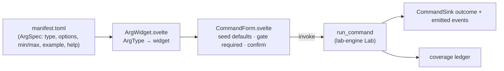
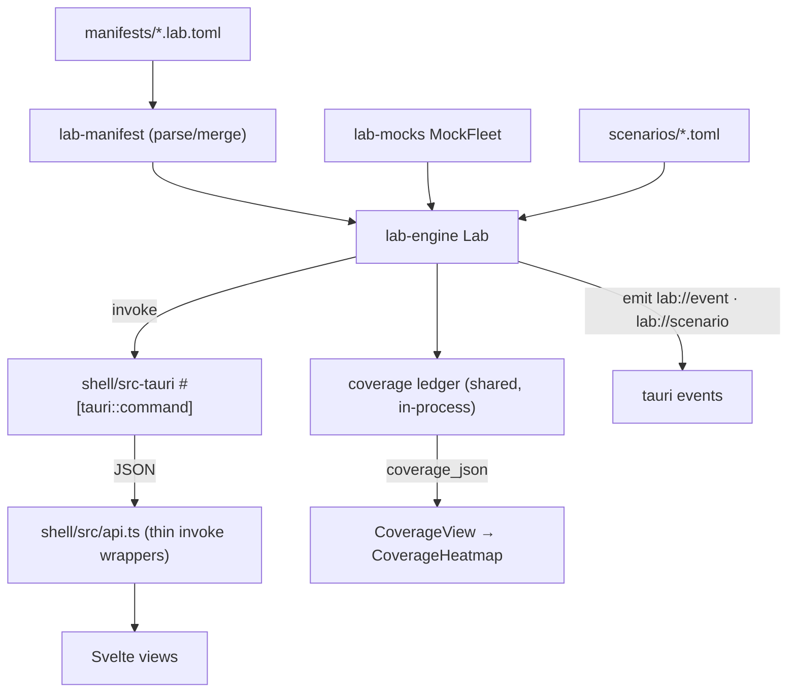

# 04 · The shell: Tauri + Svelte desktop app

The desktop shell that turns lab manifests into a live UI: a Tauri v2 Rust backend over a Svelte 5 webview.

> **cratelab docs** · SPDX `MIT` · security: this file must never contain credentials, tokens, private-repo content, or absolute user paths.

**Status:** live · **Last verified:** 2026-11-04 · **Related:** [00-index](00-index.md) · [01-architecture](01-architecture.md) · [02-manifest](02-manifest.md) · [03-cli-and-workflows](03-cli-and-workflows.md) · [05-ui-wireframes](05-ui-wireframes.md) · [06-crate-intelligence](06-crate-intelligence.md) · [12-operations](12-operations.md) · [architecture.html](architecture.html) · [lifecycle.html](lifecycle.html)

The shell is `shell/`. It is a **standalone Cargo workspace** (`shell/src-tauri`) plus a Svelte webview (`shell/src`). The Rust side owns all state; the webview renders it. The shell does not embed the fleet logic — it calls the same `lab-engine` the CLI calls, and a local fleet subsystem documented in [07-fleet-overview](07-fleet-overview.md) through [12-operations](12-operations.md).

## 1 · Stack at a glance

| Layer | Choice | Verified in |
|---|---|---|
| Desktop shell | **Tauri v2** (`tauri = "2"`, `tauri-plugin-opener = "2"`) | `shell/src-tauri/Cargo.toml` |
| UI framework | **Svelte 5 with runes** (`$state`, `$props`, `$effect`, `$derived`, `$derived.by`) | `shell/src/**/*.svelte` |
| Mount API | `mount(App, …)` from `svelte` (not `new App()`) | `shell/src/main.ts` |
| Bundler | **Vite 8** (`vite ^8.3.5`) + `@sveltejs/vite-plugin-svelte ^7.3.1` | `shell/vite.config.ts` |
| Package manager | **Bun** — `tauri.conf.json` runs `bun run dev` / `bun run build` | `shell/src-tauri/tauri.conf.json` |
| Type check | `svelte-check` (runs before `vite build`) | `shell/package.json` |
| IPC | Tauri `invoke` wrappers in one thin module | `shell/src/api.ts` |
| Config | `productName` `cratelab`, window `cratelab — the crate bench` 1360×860, `csp: null` | `shell/src-tauri/tauri.conf.json` |

> **Migration note.** The shell was migrated **from React to Svelte 5 (runes)** and **from npm to Bun**, and `shell/README.md` has been updated to match. There is no `widgets.tsx` — the arg-type→widget table is `shell/src/components/ArgWidget.svelte` (§5).

## 2 · Workspace isolation (why `shell/src-tauri` is standalone)

`shell/src-tauri/Cargo.toml` declares its own **nested `[workspace]`** on purpose:

```
# STANDALONE WORKSPACE on purpose: Tauri needs the platform webview stack
# (webkit2gtk-4.1 on Linux, WebView2 on Windows) which the core workspace
# must not require.
[workspace]
```

The effect: `cargo test --workspace` at the repo root stays green on a headless machine **without** `webkit2gtk` installed, because the shell is not a member of the root workspace. Build the shell on its own (`cd shell/src-tauri && cargo build`, or `bun run tauri dev`). The shell still depends on the core crates by path: `lab-engine`, `lab-manifest`, `lab-mocks`, `lab-coverage`, `lab-scenarios`, `lab-errors`.

## 3 · The Rust / IPC side

Source of truth: `shell/src-tauri/src/lib.rs` (plus `fleet_knowledge.rs` and `fleet_circleci.rs`).

### 3.1 One persistent `Lab`

```rust
pub struct LabState { lab: Mutex<Lab> }
```

Module doc (verbatim intent): *one persistent `Lab` (mock fleet + manifests + coverage ledger) lives in managed state, so every command the UI runs is booked into the same heatmap. Hardware stays behind the explicit `set_backend` toggle — the same `CommandSink` port serves both.*

- `run()` builds the lab once in `.setup()` via `build_lab(&manifests_dir())` and `app.manage(LabState { lab: Mutex::new(lab) })`.
- `build_lab` = `load_all_manifests(dir)` → `MockFleet::from_manifests(...)` → `Lab::new(...)` → load each manifest. Every `run_command` / `run_scenario` books coverage into that single shared ledger.
- `manifest_load_errors(dir)` is the one thing the shell must never hide: a manifest that fails to parse is surfaced (via `manifest_errors`), not silently skipped.

### 3.2 Local fleet config helpers + the secret rule

| Helper | Behaviour |
|---|---|
| `fleet_dir()` | `CARGO_MANIFEST_DIR/../../fleet`, resolved **lexically** (pop on `ParentDir`) so UI paths are clean absolute paths, never `…\src-tauri\..\..\fleet`. |
| `fleet_env_value(name)` | Reads the process env var first, else parses `fleet/.env` (strips a leading `export `, trims surrounding quotes). |
| `FLEET_SETTINGS_KEYS: &[(&str, bool)]` | The ~35 allow-listed setting keys, each tagged `secret: bool`. `fleet_get_settings` / `fleet_save_settings` reject any key not in this list (`"unsupported setting: {key}"`). |

**The rule (module comment, verbatim):** *"Secrets are read only to test whether a variable is populated; values never leave Rust."*

- `fleet_settings_snapshot()` returns `{ key, secret, configured, value, setup_url }`. For `secret: true` keys, `value` is **always `null`** — the UI only ever sees a boolean `configured`.
- `MODAL_TOKEN_ID` / `MODAL_TOKEN_SECRET` are special-cased: "configured" means a local `fleet/.modal-config` profile file exists, not an env var.
- `fleet_credential_guides()` reads `fleet/config.json` → `credential_guides` for "How to get" links.

### 3.3 `set_backend` — a typed refusal, not a TODO

The hardware toggle is real and honest. `shell/src-tauri/src/lib.rs`:

```rust
#[tauri::command]
fn set_backend(_backend: String) -> Result<serde_json::Value, serde_json::Value> {
    Err(serde_json::json!({
        "kind": "capability",
        "message": "hardware adapter lands in v0.2: implement CommandSink over TvClient / the cctv facade",
        "remedy": { "action": "retry" },
    }))
}
```

`devices` likewise reports backend `"mock"` with the note *"hardware toggle lands with the real `TvClient` adapter (v0.2)"*. Nothing is faked: the mock path is the only backend until a `CommandSink` adapter over `TvClient` / the cctv facade exists.

## 4 · The command surface (real `#[tauri::command]` functions)

Every function below is registered in `run()`'s `invoke_handler` (`tauri::generate_handler![ … ]`). All are plain JSON in / JSON out; errors are a `{ kind, message, remedy }` object produced by `lab_error_value`, not a string.

**Lab commands (manifest-driven):**

| Command | What it does |
|---|---|
| `workspaces` | Lists the workspaces loaded from every parseable manifest. |
| `manifest_detail` | Full manifest for one workspace (commands, events, servers, limits, device classes). |
| `devices` | Backend info; reports `mock` until the v0.2 hardware adapter. |
| `run_command` | Invokes one manifest command with args + a `confirmed` flag; books coverage. |
| `run_scenario` | Runs a scenario TOML with a `confirmed` flag; books coverage. |
| `coverage` | Coverage ledger JSON for a workspace (`(workspace, command, arg-bucket)` cells). |
| `discover_local` | Discovers a local Cargo workspace (`members`) from a root path. |
| `set_backend` | Hardware toggle; returns the typed `capability` refusal (§3.3). |
| `manifest_errors` | Every manifest in the dir that failed to parse, as strings. |
| `probe_url` | One honest HTTP probe for `url`-typed args (used by the form's **Test** button). |

**Fleet commands (local control plane):**

| Command | What it does |
|---|---|
| `fleet_status` | The readiness/summary object: providers, pilot crates, daily caps, `safe_mode`, runs. |
| `fleet_select_repository` | Switches the active scope repository (shared by every fleet view). |
| `fleet_select_provider` | Sets the active rung (explicit; no silent fallback). |
| `fleet_select_model` | Sets the model on a rung (from its last probe's discovered IDs). |
| `fleet_dry_run` | Prepares a **local** case packet (source evidence); no provider call. |
| `fleet_probe_provider` | Cheap-GET credential check against a rung's identity/health endpoint. |
| `fleet_get_settings` | Masked settings snapshot (secret values never returned). |
| `fleet_save_settings` | Writes allow-listed keys; secrets are accepted but never returned. |
| `fleet_run_tool` | Runs a local knowledge tool (build/validate index, HF/Modal/Kaggle actions). |
| `fleet_circleci_dashboard` | Read-only CircleCI account/project/pipeline/workflow status. |
| `fleet_reports` | Lists report files under `fleet/reports`. |
| `fleet_read_report` | Reads one report's bytes (the viewer shows the file, unparaphrased). |
| `fleet_open_report` | Reveals a report in the OS file manager (opener plugin). |
| `fleet_dashboard` | Aggregates for the Dashboard view (runs by day/task, coverage, catalog). |
| `fleet_crate_research_prompt` | Builds a context-engineered prompt pack for an internal crate. |
| `fleet_search_crate_knowledge` | Queries the Modal crate-knowledge search endpoint. |
| `fleet_preview_live` | Builds the outbound live-run preview (files, size, route, cost note). |
| `fleet_generate_audit` | Runs the **confirmed** live audit and records the run. |

`fleet_status().safe_mode` in the current build is `{ provider_calls: true, network: true, github_writes: false, target_writes: false }`; the pilot uses `batch_size: 3` over 8 task ids; the daily caps map covers `gemini`, `groq`, `cloudflare`, `openrouter`.

## 5 · The generative UI core

The frontend contains no per-command hand-written forms. A manifest command produces its own UI:



| `ArgType` | Widget (`ArgWidget.svelte`) |
|---|---|
| `enum` | `<select>` from `arg.options` |
| `bool` | `<select>` true/false |
| `int` / `float` | `<input type=number>` with `min`/`max` |
| `json` | `<textarea>` (parses on change; falls back to raw string) |
| `url` | text `<input>` + **Test** button → `probe_url`, shows `✓ status in N ms · content-type` or the failure |
| default | text `<input>` |

`ArgWidget` also derives a self-explaining placeholder per type (`AA-BB-CC-DD-EE-FF` for `mac`, `192.168.1.40` for `ipv4`, `http://host:port/path` for `url`, `C:\path\to\file` for `path`), appending `arg.help` when present.

**`CommandForm.svelte` gating:** a card grid (`CommandsView`) selects a command; the form seeds values from `default`/`example`, computes `missingRequired` (`$derived`) and disables **Run** until every required arg is present, showing a `needs: a, b` hint. A command whose `danger === "destructive"` opens a **confirm modal** ("Confirm destructive command … Refusals and outcomes still book coverage") before anything is sent; non-destructive commands run directly.

## 6 · View inventory

Navigation is a grouped sidebar (`shell/src/App.svelte`): **Project** → Dashboard; **Automation** → Workflows, Integrations & scenarios; **Evidence** → Reports; **Settings** → Providers & credentials; **Lab tools** → Commands, Events, Servers, Limits, Coverage, Scenarios, Discovery. Sidebar brand reads `cratelab` / *evidence · workflows · learning*.

| View id | Label | Question it answers | Key components |
|---|---|---|---|
| `dashboard` | Dashboard | Is the fleet improving the crates, and what needs a human? | `DashboardView` |
| `fleet` | Workflows | What runs now, and what will it cost? | `AutomationView` (tab `workflows`) → `FleetView` |
| `ops-dashboard` | Integrations & scenarios | What integrations/scenarios are wired? | `AutomationView` (tab `integrations`) → `OpsDashboard` |
| `reports` | Reports | What did we learn, and can I trust it? | `ReportsView` |
| `fleet-settings` | Providers & credentials | Which free AI is usable right now? | `FleetSettings` |
| `commands` | Commands | What can this workspace do? | `CommandsView` → `CommandForm` → `ArgWidget` |
| `events` | Events | What events does it emit? | inline event table (`App.svelte`) |
| `servers` | Servers | What servers, ports and routes exist? | inline server cards (`App.svelte`) |
| `limits` | Limits | What limits does the lab exercise? | inline limits table (`App.svelte`) |
| `coverage` | Coverage | Which commands are actually exercised? | `CoverageView` → `CoverageHeatmap` |
| `scenarios` | Scenarios | Compose and run a playlist. | `ScenariosView` → `Timeline` |
| `discovery` | Discovery | What is in a local checkout? | `DiscoveryView` |

`TopHeader.svelte` is the persistent, always-visible header: brand, a **scope** `<select>` (repositories), the `[MOCK]`/`[LIVE]` env chip (`live = env !== "" && env !== "mock"`), a **readiness chip** `rungs {probed}/{providerTotal} probed` (click → Providers; tooltip: *"Configured and Probed are different claims"*), a section/view breadcrumb, and two actions (`Run ▾` quick-cases menu, `Reports`). Every number in the header comes from `fleet_status`.

> Brand-case note: `TopHeader.svelte` currently renders `cratesLab` in the header markup. The product brand is `cratelab`; this document and the rest of the docs set use `cratelab`.

## 7 · Data flow: manifest → IPC → views, plus the shared coverage ledger



- `shell/src/api.ts` is by design a **thin wrapper over `invoke` with no browser fallback** — the shell only runs inside Tauri.
- The coverage ledger is the shared invariant: console runs (`run_command`), scenario runs (`run_scenario`) and the heatmap all read the *same* in-process `Lab`.
- `run_command` / `run_scenario` set the confirm flag before dispatch and `emit` `lab://event` / `lab://scenario` so the UI can stream outcomes.

## 8 · IPC integration test

`shell/src-tauri/tests/ipc_engine.rs` exercises the real `build_lab` wiring headlessly (no webview needed). What it asserts:

| Test | Assertion |
|---|---|
| `workspaces_and_manifest_detail_read_the_real_manifests` | manifest ids `["cctv-rs", "tv-rs"]`; `tv-rs` version `0.6.0`; facade `tv-rs`; 10 commands. |
| `run_command_invokes_and_enforces_the_destructive_gate` | `tv.power.wake` executes; `tv.power.off` is refused unconfirmed and allowed after `set_confirm_destructive(true)`. |
| `coverage_json_reports_the_shared_ledger` | 10 rows; `wake` pass == 1. |
| `run_scenario_executes_the_authored_playlist` | `tv-morning-loop` runs, 5 steps pass. |
| `discover_local_reports_inherited_versions` | ≥7 members, no `0.0.0` versions, `lab-engine` reports `0.1.0`. |

## 9 · Fleet IPC modules

### 9.1 `fleet_knowledge.rs` — corpus + third-party orchestration

Doc intent: the desktop control plane is Rust; the only Python runtime is Modal's **deployed** ASGI service. It owns: `build_signage_index`, `validate_signage_index`, `build_crate_intelligence_index`, `validate_crate_intelligence_index`, `crate_research_prompt`, `search_crate_intelligence`, `check_hf_token`, `upload_signage_index`, `upload_crate_intelligence_index`, `deploy_crate_intelligence_search`, `check_crate_intelligence_search`, `kaggle_crate_intelligence_status`, `submit_kaggle_crate_intelligence`, `deploy_modal_search`, plus CLI-availability probes `hf_cli_available` / `kaggle_cli_available`. Corpus safety uses `SKIP_PARTS`, `FORBIDDEN_NAMES`, and `patterns()` credential regexes so secret-like source is excluded from any index. See [06-crate-intelligence](06-crate-intelligence.md) and [09-fleet-rag](09-fleet-rag.md).

### 9.2 `fleet_circleci.rs` — read-only CI

Doc intent (verbatim gist): *"only issues CircleCI API GET requests… never starts a pipeline, edits project settings, or writes repository files."* CircleCI API v2, `MAX_PROJECTS = 12`, GET `/me`, `/me/collaborations`, `/project/{slug}`, `/project/{slug}/pipeline`, `/pipeline/{id}/workflow`. Entry point: `dashboard(token, configured_slugs, fleet_dir)`.

## Consolidation notes

- **Corrected the stale `shell/README.md`** for React→Svelte 5 and npm→Bun: `.svelte` components, `mount()` in `main.ts`, `ArgWidget.svelte` (not `widgets.tsx`), `bun run dev/build`.
- **Brand normalised to `cratelab`** (lowercase); the header markup's `cratesLab` is noted, not repeated.
- **Fleet tooling split out**: this file keeps only the *shell/IPC surface* of the fleet subsystem; providers, RAG, workflows and operations live in [07](07-fleet-overview.md)–[12](12-operations.md).
- Verified against `shell/src-tauri/src/lib.rs`, `shell/src/**`, `shell/src-tauri/Cargo.toml`, `tauri.conf.json`, `package.json`, and `tests/ipc_engine.rs` on 2026-11-04.
