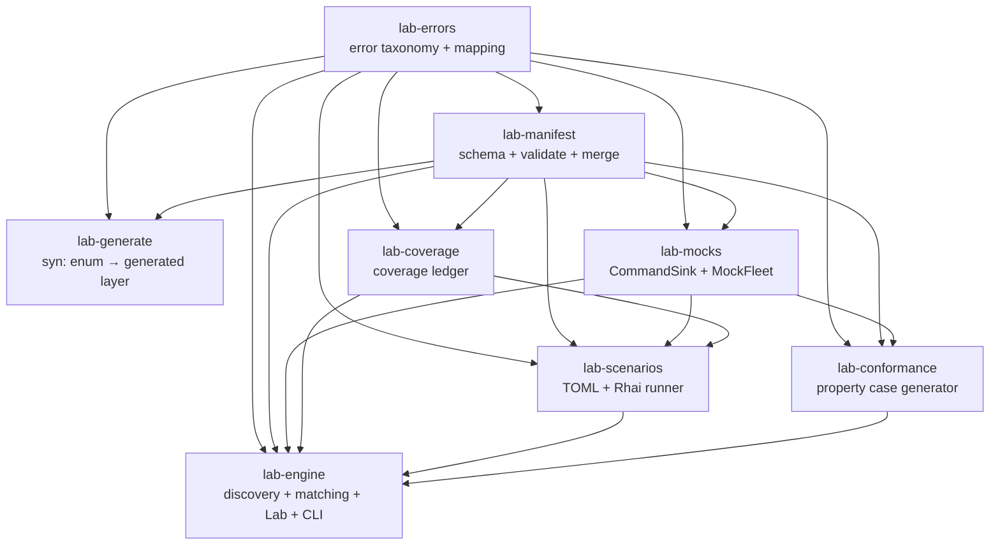
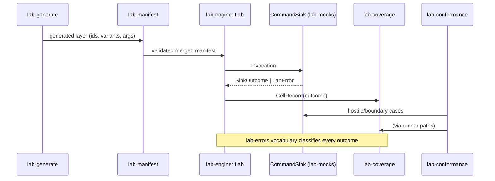

# 06 · Internal crate architecture map
The source-traced dependency and responsibility map of cratelab's own crates, for both humans and the fleet's research prompts.

> **cratelab docs** · SPDX `MIT` · security: this file must never contain credentials, tokens, private-repo content, or absolute user paths.

**Status:** reference · **Last verified:** 2026-11-04 · **Related:** [00-index](00-index.md) · [01-architecture](01-architecture.md) · [02-manifest](02-manifest.md) · [03-cli-and-workflows](03-cli-and-workflows.md) · [07-fleet-overview](07-fleet-overview.md) · [09-fleet-rag](09-fleet-rag.md) · [architecture.html](architecture.html)

## 1. Scope

This map covers the eight crates that make up the lab core. It is derived from the workspace `Cargo.toml`, each `crates/*/Cargo.toml` dependency block, and the `use` statements and public APIs in `crates/*/src/lib.rs`. It describes cratelab's own test-lab implementation; it does **not** describe the separate `tv-rs` / `cctv-rs` target workspaces the lab tests. The Tauri shell (`shell/`) is deliberately outside the workspace (see §6).

## 2. Dependency graph (verified)

Arrow direction: `A --> B` means **B depends on A** (A is used by B). Edges verified from `crates/*/Cargo.toml` `[dependencies]` and `use` statements.

**Correction vs the earlier draft in `docs/crate-intelligence.md`:** that graph omitted three verified direct edges — `lab-errors --> lab-generate`, `lab-errors --> lab-conformance`, and `lab-errors --> lab-engine` (each of those crates lists `lab-errors` in its `Cargo.toml` and imports from it). It also implied a straight `manifest --> generate --> …` runtime chain; in fact `lab-generate` has **no dependents inside the workspace** — `lab-engine` does not depend on it. `lab-generate` is a standalone authoring tool (its only consumer is its own `lab-generate` binary), so it sits off to the side of the runtime path.

Dependency summary (from each manifest):

| Crate | Direct internal dependencies |
|---|---|
| `lab-errors` | — (only `serde`, `thiserror`) |
| `lab-manifest` | `lab-errors` |
| `lab-generate` | `lab-errors`, `lab-manifest` |
| `lab-mocks` | `lab-errors`, `lab-manifest` |
| `lab-coverage` | `lab-errors`, `lab-manifest` |
| `lab-scenarios` | `lab-errors`, `lab-manifest`, `lab-mocks`, `lab-coverage` |
| `lab-conformance` | `lab-errors`, `lab-manifest`, `lab-mocks` |
| `lab-engine` | `lab-errors`, `lab-manifest`, `lab-mocks`, `lab-coverage`, `lab-scenarios`, `lab-conformance` (+ optional `ureq` under `registry`) |

## 3. Per-crate map

| Crate | Verified role and evidence | Knowledge/ops value |
|---|---|---|
| `lab-errors` | The one error vocabulary: `LabErrorKind` (11 kinds), `Remedy` (8 actions), `Severity` (`Info`/`Warn`/`Fatal`), `LabError` (11 variants), `ErrorMapping` + `MappingRule`, `LabResult`, and `kind()`/`retryable()`/`remedy()`/`severity()`/`exit_code()`; `crates/lab-errors/src/lib.rs` | Canonical refusal/error vocabulary. Research prompts must classify expected refusals (Capability = Info, exit 0) separately from defects. |
| `lab-manifest` | Schema + `validate()` (returns **all** problems) + `apply_generated()` merge; `LabManifest`, `WorkspaceRef`, `CommandSpec`, `ArgSpec`/`ArgType`, `EventSpec`, `ServerSpec`, `LimitSpec`, `QuirksRef`, `GeneratedManifest`; `crates/lab-manifest/src/lib.rs` | Strongest context source for what the lab promises to exercise and how the UI is generated. See [02-manifest](02-manifest.md). |
| `lab-generate` | `syn`-based: parses a typed `CommandId` enum + doc comments, emits `GeneratedManifest` (ids/variants/docs/args via a type heuristic) and an authoring TOML skeleton; depends on both `lab-errors` and `lab-manifest`; `crates/lab-generate/src/lib.rs`, `src/main.rs` | Compare generated declarations with authored overlays; preserve provenance; never guess command semantics. |
| `lab-mocks` | The device-facing port `CommandSink` and the `MockFleet`: `VirtualDevice`, `Invocation`, `SinkOutcome`, `EmittedEvent`, `ChaosPolicy` (deterministic, RNG-free), `TokenBucket`, Rhai behaviour scripts, and `pick_device_for` capability routing; `crates/lab-mocks/src/lib.rs` | Run reproducible failure/refusal/limit experiments without hardware. `CommandSink` is the seam a hardware adapter will implement. |
| `lab-coverage` | `Ledger`, `CellKey (workspace, command, bucket)`, `Outcome`, `CellRecord`, `CellStats`, `HeatRow`, `heatmap()`, `coverage_percent()`, `to_markdown()`/`to_json()`; in-memory only; `crates/lab-coverage/src/lib.rs` | Identify unexercised commands and distinguish pass, refusal, failure, timeout and rate-limit coverage. See [03-cli-and-workflows](03-cli-and-workflows.md). |
| `lab-scenarios` | `Scenario`, `Step`, `Expect`, `PollSpec`, `OnFail`, `StepResult`, `ScenarioReport`, `ScenarioRunner`; TOML declarative timelines plus bounded, no-I/O Rhai steps; `crates/lab-scenarios/src/lib.rs` | Compose repeatable multi-command workflows and retain step-level evidence. |
| `lab-conformance` | Deterministic type-directed default/boundary/enum/hostile case generation, zero-panic via `catch_unwind`, declared-invariant checks, cap `MAX_CASES = 96`, tier-aware `must_violations()`; `crates/lab-conformance/src/lib.rs` | Run stable schema-driven robustness sweeps and return minimized, replayable violations. |
| `lab-engine` | Composes all subsystems: `Lab` (manifest table + sink + ledger + destructive gate), local discovery, drift matching (`match_workspaces`, `Drift`), optional crates.io registry, and the headless `lab` CLI; `crates/lab-engine/src/lib.rs`, `discovery.rs`, `registry.rs`, `bin/lab.rs` | Operator entry point and integration boundary; keep provider/orchestration concerns outside the core test engine. |

## 4. Evidence-backed operating model

1. `lab-generate` proposes a machine-derived surface from typed source (`syn` over the `CommandId` enum).
2. `lab-manifest` validates and merges that proposal with authored labels, danger, timeouts, events, servers, limits, mock bindings (rule: generated proposes, authored disposes).
3. `lab-engine::Lab` routes calls through the `CommandSink` port; the current desktop uses `lab-mocks`, not hardware.
4. `lab-scenarios::ScenarioRunner` sequences calls and `lab-coverage::Ledger` books every outcome (including typed refusals).
5. `lab-conformance` exercises the same declared schema with repeatable hostile and boundary inputs.
6. `lab-errors` provides the shared vocabulary used to judge refusals and failures at every one of those steps.

## 5. Priority intelligence questions

The RAG corpus should be able to answer these about the internal crates:

- Which manifest declarations are absent from the generated source surface, and which generated commands lack authored semantics?
- Do conformance cases cover each argument's boundary and hostile envelope without exceeding the 96-case cap, and are typed capability refusals scored as expected outcomes rather than violations?
- Are `ScenarioRunner` polling/timeouts and `on_fail` semantics consistent with the mock sink's deterministic delays, chaos and rate limits?
- Does `lab-engine` book every invocation exactly once — including retries, refusal paths and scenario polling?
- Which coverage cells remain uncovered after the named scenarios and the property sweep, grouped by crate and command risk?
- Which behaviour is stated in source/API docs versus inferred from implementation?

## 6. Research-prompt contract and context packet

Use `fleet/prompts/crate-evolution-research.md` as the common system prompt. Its contract, verbatim in intent:

- **Context packet order:** (1) the question, target crate(s), task class, deliverable; (2) this map for boundaries and dependency direction; (3) the target crate's `Cargo.toml`, module docs and relevant public declarations with source paths and line ranges; (4) direct dependency/dependent evidence only where a contract crosses a boundary; (5) relevant `manifests/*.lab.toml`, `scenarios/*.toml`, local coverage/conformance outputs and CircleCI gate results; (6) retrieval snippets only when they add evidence, each preserving source, crate, revision and line metadata.
- **Analysis method:** verified facts first with `path:line` citations; label deductions **Inference** and unresolved choices **Open question**; trace public API → manifest semantics → mock behaviour → coverage → operator effect; distinguish expected typed refusals from defects; never silently prefer one side of a generated/authored disagreement.
- **Output contract (fixed headings):** Finding (with confidence) → Evidence (claim / source / what it proves) → Cross-crate effects → Coverage and CI implications → Recommended next actions (≤5) → Prompt/context gaps. No patch unless the task is explicitly changed to implementation.
- **Evaluation rubric (0–2 each):** source traceability and correct crate boundaries; separation of facts/inferences/unknowns; coverage of dependencies that matter; actionability with a measurable completion condition; scope/privacy/cost compliance. Below 8/10 the answer is revised before it becomes an HF artifact or Kaggle result.

For cross-crate work, feed the dependency slice above rather than the whole repository. Every retrieved passage must keep its path, line, revision and crate identity. The fleet builds a **separate** internal index from `crates/*/src/**/*.rs` plus each package's name, description and direct internal dependencies (`fleet/README.md` §Internal crate intelligence); the private `simple-signage`/`companion-app` docs corpus is a different, explicitly-bounded retrieval route.

## 7. Current limitations (verified from source)

| Limitation | Evidence |
|---|---|
| The Tauri device backend still reports `mock`; the hardware sink is not wired | `shell/src-tauri/src/lib.rs` `devices()` returns `"backend": "mock"` with note "hardware toggle lands with the real TvClient adapter (v0.2)"; `set_backend` returns a typed `capability` refusal; `build_lab` builds a `MockFleet::from_manifests` |
| Registry discovery is defined but not reachable from the CLI | `lab-engine/src/bin/lab.rs` `discover` calls `discovery::discover_local` unconditionally; `registry::latest_versions` has no call site anywhere; `match_workspaces` is only exercised by a unit test with `registry: None` |
| `CommandSpec.mock` is declared but consumed by nothing | the manifest exposes the field and `tv-rs.lab.toml` sets `mock = "tv/…rhai"`, but `MockFleet::from_manifests` never reads it and the referenced files are absent |
| Rhai scenario steps are CWD-relative and the shipped generative script is unused | `ScenarioRunner::run` calls `scenario.load_script(Path::new("."), rel)`; `scenarios/scripts/fleet_chaos.rhai` is referenced by no scenario |
| The coverage ledger is in-memory only, so `lab coverage` prints `0.0%` | `Ledger` has no serialization path and `lab coverage` builds a fresh `Lab` and runs nothing |
| The shell previously hid broken manifests; a separate error surface now exists | `load_all_manifests` still skips parse failures, but `manifest_load_errors` + the `manifest_errors` command surface them — addressed (was review finding F10/F12) |
| Internal `crates/` intelligence is a separate fleet index, not mixed into the private docs corpus | `fleet/README.md` builds the crates index from `crates/*/src/**/*.rs`; `fleet_retrieve` in `shell/src-tauri/src/lib.rs` accepts only `simple-signage` / `companion-app` project ids |

## Consolidation notes

- Rebuilt the dependency graph from the actual `crates/*/Cargo.toml` files and corrected `docs/crate-intelligence.md`: added the three omitted `lab-errors` → {generate, conformance, engine} edges and clarified that `lab-generate` has no in-workspace dependents.
- Kept the verified per-crate roles (they matched the source) and expanded the evidence to exact file paths and the real public types in each `src/lib.rs`.
- Preserved the operating-model flow, priority questions and the research-prompt contract (still accurate against `fleet/prompts/crate-evolution-research.md`), and updated the limitations with the now-separate crates index route.
- Dropped the old draft's Kaggle-CLI-not-detected claim (not re-verified this pass) and any statement about hardware that the source does not support.
