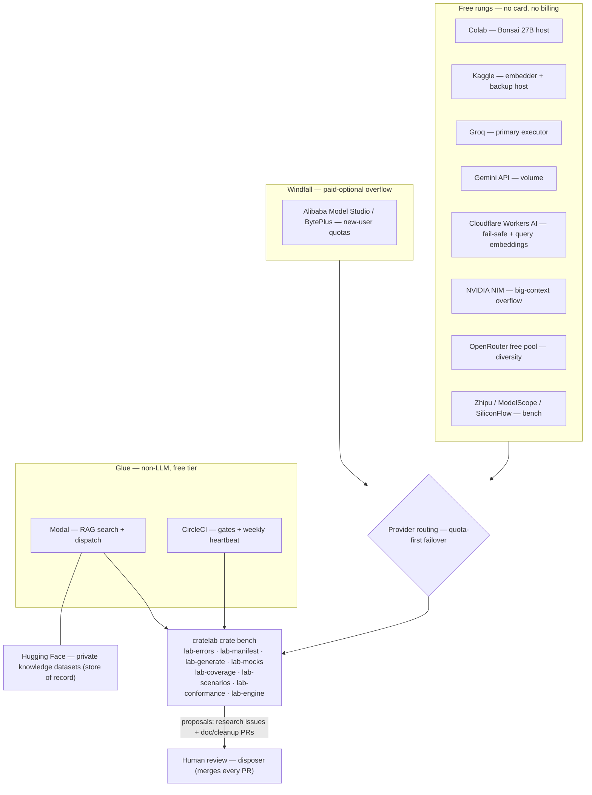

# 07 · Fleet overview

The fleet is cratelab's free-AI provider fleet: a set of zero-cost (or already-paid) model rungs plus non-LLM glue that cratelab uses to analyse, document, and research its local Rust crates without new paid infrastructure.

> **cratelab docs** · SPDX `MIT` · security: this file must never contain credentials, tokens, private-repo content, or absolute user paths.

**Status:** reference · **Last verified:** 2026-11-04 · **Related:** [00-index](00-index.md), [01-architecture](01-architecture.md), [06-crate-intelligence](06-crate-intelligence.md), [08-fleet-providers](08-fleet-providers.md), [09-fleet-rag](09-fleet-rag.md), [10-fleet-workflows](10-fleet-workflows.md)

## 1. What the fleet is

The fleet is the collection of external AI services cratelab draws on to improve and research the local Rust crates. It is deliberately built from free tiers and accounts the operator already owns — no new subscriptions, no payment card, no self-hosted model downstream. Two constraints define it:

- **Cost:** every rung is either permanently free, a free session (Colab/Kaggle GPUs), or a windfall new-user quota; the design never schedules paid usage. Free-tier availability and quota terms are account-specific and can change.
- **Behaviour:** the fleet **analyses, documents, researches, and feeds knowledge** into the crates. It does not write features. Any code change is a mechanical cleanup, delivered as a review-gated proposal and merged by a human.

The fleet targets the public Rust workspace configured in `fleet/config.json` (`target.name` = `tv-rs`), with `cctv-rs` present as a second selectable repository. It is distinct from the cratelab crate bench: the bench (`crates/lab-*`) is cratelab's own test-lab implementation of manifests, mocks, scenarios, coverage, and conformance; the fleet is the external worker layer that reads the bench's evidence and produces proposals about the target crates. See [06-crate-intelligence](06-crate-intelligence.md) for the invited crate map and [01-architecture](01-architecture.md) for how the pieces fit.

## 2. Conceptual model

**Rungs (tiers) by capability and cost.** Providers are organised as an ordered ladder: cheapest and most abundant rungs first, paid-optional windfalls last. Session GPU hosts (Colab, Kaggle) sit at the top because they are the cheapest tokens available (a free GPU); free API executors follow; windfall quotas close the ladder. Provider specifics live in [08-fleet-providers](08-fleet-providers.md).

**Orchestration roles — one job per resource.** Each resource has exactly one primary role, and no resource wears two hats:

| Resource | Role | Kind |
|---|---|---|
| Colab | Primary model host (Bonsai 27B session) | LLM |
| Kaggle | Embedder + backup model host | LLM |
| Hugging Face | Knowledge store (private datasets) | storage |
| Groq | Primary API executor | LLM |
| Gemini API | Volume executor | LLM |
| Cloudflare Workers AI | Fail-safe rung + query embeddings | LLM |
| NVIDIA NIM | Big-context overflow | LLM |
| OpenRouter | Diversity executor | LLM |
| Zhipu / ModelScope / SiliconFlow | Bench | LLM |
| Modal | Glue: RAG search + dispatch | non-LLM |
| CircleCI | Gates + weekly heartbeat | non-LLM |

Non-LLM resources never burn inference quota; LLM resources never host glue.

**Proposer / disposer separation.** The fleet is a **proposer**: it produces reviewable artefacts — research issues, documentation PRs, knowledge updates, gated cleanup PRs — and never merges. The **disposer** is the human operator, who reviews every proposal; the fleet never pushes to a default branch. This mirrors the rule already enforced inside the crate bench, where the generated layer *proposes* (`lab-generate` derives a machine surface from typed source) and the authored layer *disposes* (`lab-manifest` validates and merges generated facts with authored semantics). The fleet's proposals about a target crate are grounded in exactly that bench evidence. See [06-crate-intelligence](06-crate-intelligence.md) §4.

## 3. Layering and work flow

Work flows in two directions: the fleet consumes the bench's evidence (the crate map, manifests, scenarios, coverage and gate results) to ground its analysis, and returns proposals to the human disposer. The retrieval path that grounds a proposal is described in [09-fleet-rag](09-fleet-rag.md); the provider rungs that execute it are detailed in [08-fleet-providers](08-fleet-providers.md).

## 4. Fleet workspace layout

Everything the fleet runs lives under `fleet/`. Verified contents:

| Path | Purpose |
|---|---|
| `fleet/README.md` | Workspace orientation: Rust-owned desktop path, RAG boundary, HF → Modal flow. |
| `fleet/config.json` | Workspace roots, knowledge sources, credential-setup links, execution flags, forbidden paths. |
| `fleet/circleci/config.yml` | Rust 1.89 gate template (fmt, clippy, workspace tests, warning-denying rustdoc). Not auto-installed into a target. |
| `fleet/modal/app.py` | Authenticated, read-only BM25 search over the pinned signage-docs dataset. |
| `fleet/modal/crate_intelligence_app.py` | Authenticated, read-only BM25 search over the internal crates index. |
| `fleet/kaggle/crate-intelligence/` | Private Kaggle job (`crate_intelligence_eval.py` + `README.md`) comparing dense retrieval with BM25. |
| `fleet/notebooks/kaggle_embed.md` | Optional future GPU embedding experiment notes; dense embedding is not used in the active lexical pilot. |
| `fleet/prompts/crate-evolution-research.md` | The common research system prompt: context order, evidence labelling, output contract. |
| `fleet/scripts/build_rag_index.py` | Portable builder that emits a provenance-rich JSONL corpus from a source checkout. |

The Rust desktop control plane that owns local settings, provider routing, corpus build/validation and the HF/Modal orchestration lives in the shell (`shell/src-tauri/src/fleet_knowledge.rs`, `fleet_circleci.rs`).

## 5. Governance and execution constraints

`fleet/config.json` carries the machine-readable guardrails. The `execution` block and `forbidden_paths` are authoritative:

| Key | Value | Meaning |
|---|---|---|
| `execution.network` | `true` | External network access is allowed. |
| `execution.provider_calls` | `true` | Provider calls are allowed — but each is a reviewed, confirmed action, not an automatic side effect. |
| `execution.github_writes` | `false` | The fleet may not create branches, issues, or PRs automatically. |
| `execution.target_writes` | `false` | The fleet may not write into the target workspaces (`tv-rs` / `cctv-rs`). |
| `forbidden_paths` | `Cargo.toml`, `Cargo.lock`, `.github/**`, `.circleci/**` | Manifests, lockfiles, and CI configuration are out of bounds for retrieval and for any proposed change. |

Additional operator guardrails from the playbook (process rules, not config keys): one crate per task; tasks never touch version fields, CI files, or other crates; the human merges every PR and the fleet never pushes to the default branch; a daily budget of ≤ 8 tasks and ≤ 3 PRs/crate; and a `done-when` of four passing `cargo` commands before a PR may open.

The `target` block pins the pilot: `tv-rs`, `crate_dir` `crates/*`, `batch_size` 3, `phase_one_tasks` `["rustdoc-audit", "research-summary"]`, and a RAG `top_k` of 6.

## 6. Provider-rung summary

Names and tier only; limits, offers and credential guides are in [08-fleet-providers](08-fleet-providers.md).

| Rung | Provider | Tier | Role |
|---|---|---|---|
| 0 | Colab — Bonsai 27B | free (session GPU) | Primary model host |
| 0 | Kaggle | free (session GPU) | Embedder + backup host |
| 1 | Groq | free API | Primary API executor |
| 1 | Gemini API | free API | Volume executor |
| 1 | Cloudflare Workers AI | free API (fails, never bills) | Fail-safe rung + query embeddings |
| 1 | NVIDIA NIM | free API | Big-context overflow |
| 1 | OpenRouter | free API | Diversity |
| 1 | Zhipu | free API | Bench |
| 1 | ModelScope / SiliconFlow | free API | Bench |
| 1 | allam-2-7b (via Groq) | free API | Trivial bulk (optional) |
| 2 | Alibaba Model Studio / BytePlus | windfall | Overflow |
| — | Hugging Face | free storage | Knowledge store |
| — | Modal | free glue | RAG search + dispatch |
| — | CircleCI | free CI | Gates + heartbeat |

## Consolidation notes

- Merged the overlap between the collaboration playbook and the technical-implementation build sheet: both described "what the fleet is", the role matrix and the ladder. This doc keeps the shared structure and defers all provider telemetry to [08-fleet-providers](08-fleet-providers.md) and retrieval to [09-fleet-rag](09-fleet-rag.md).
- Normalised branding to lowercase `cratelab` and named the subsystem "the fleet" throughout (the source documents used inconsistent product casing).
- Grounded the workspace layout in the actual `fleet/` tree; every listed path was verified to exist. The Rust-owned control plane is confirmed at `shell/src-tauri/src/fleet_knowledge.rs` and `fleet_circleci.rs`.
- Recorded the **actual** `fleet/config.json` values: `forbidden_paths` is exactly `["Cargo.toml", "Cargo.lock", ".github/**", ".circleci/**"]`. A longer forbidden-path list appears in `docs/specs/cross-language-research.md` described as coming from `fleet/config.json`; that claim is inaccurate for this file and was not repeated here.
- Dropped absolute user/project paths and any per-key secret examples from the overview (security contract).
- Cross-links point to sibling docs by filename per the contract; at the time of writing only `02`–`06` physically exist in `docs/`, so `00`, `01`, `07`–`13` in the header are forward references.
