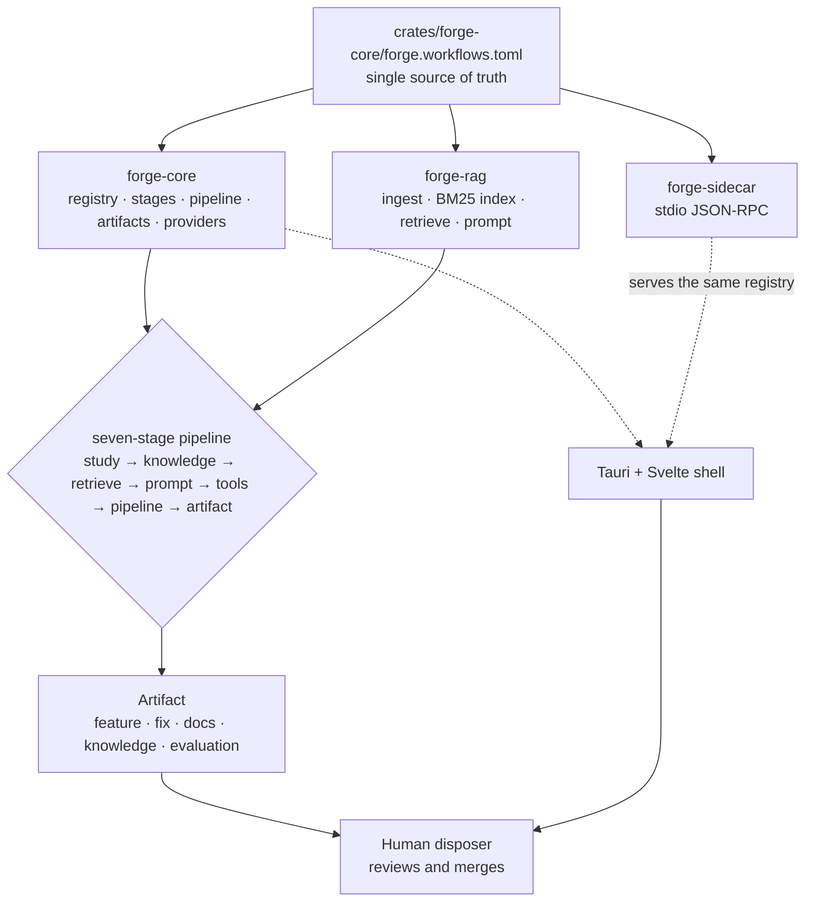

# 07 · The forge

The forge is cratelab's unified agentic crate-evolution subsystem: one manifest-driven pipeline that studies sources, builds a knowledge base, retrieves grounded evidence, renders scripted prompts, arms an agent with tools, runs a gated pipeline, and emits a reviewable evolution artifact.

> **cratelab docs** · SPDX `MIT` · security: this file must never contain credentials, tokens, private-repo content, or absolute user paths.

**Status:** reference · **Last verified:** 2026-11-04 · **Related:** [00-index](00-index.md), [01-architecture](01-architecture.md), [08-forge-sdk-and-sidecar](08-forge-sdk-and-sidecar.md), [09-the-workflow-model](09-the-workflow-model.md), [11-providers-and-capacity](11-providers-and-capacity.md), [13-roadmap](13-roadmap.md)

## 1. What the forge is

The forge is the renamed, unified agentic crate-evolution subsystem. It replaces the former `fleet/` control plane — a scatter of one-off Python scripts, loose markdown prompts and a config file sitting *outside* the crate graph — with **three typed engine crates** plus **one authored registry**:

| Crate | Role | Docs |
|---|---|---|
| `forge-core` | The SDK: workflow registry, stages and gates, the deterministic pipeline, artifacts, the provider port, the error vocabulary. | [08](08-forge-sdk-and-sidecar.md), [09](09-the-workflow-model.md) |
| `forge-rag` | The retrieval plane: ingest/chunking, a BM25 index, evidence packets, prompt templates. | [10](10-knowledge-base-and-retrieval.md) |
| `forge-sidecar` | The stdio JSON-RPC bridge that serves the same registry, retrieval and pipeline to any host. | [08](08-forge-sdk-and-sidecar.md) |

Its job is to turn any **target** into a **gated pipeline** that produces a reviewable proposal — a *feature*, a *fix*, a *doc/knowledge* update, or an *evaluation* result. Each of those is an **evolution**. Two constraints define the forge:

- **It proposes; a human disposes.** The forge never merges, never writes to a target workspace and never pushes to a default branch. Every output is a proposal awaiting review.
- **The core is deterministic and offline.** `forge-core` uses no RNG and performs no network I/O; providers sit behind a port that is attached explicitly, after an operator has seen and confirmed the request.

The engine assets are read-only and live *inside* the crates; the mutable runtime home is `forge/` (gitignored `state/`, `reports/`, `data/`, `.env`, `.kaggle-venv/`, `.modal-config`). See [08-forge-sdk-and-sidecar](08-forge-sdk-and-sidecar.md) for the crate APIs and [12-operations](12-operations.md) for the runtime home.

## 2. Why it replaces the fleet

The old fleet worked, but it was **scattered**: the same workflow was re-described in a frontend table, a set of Python scripts, a config file and several markdown specs that drifted apart. The forge collapses all of that into **one source of truth**:

- **One authored registry** (`crates/forge-core/forge.workflows.toml`) declares every workflow, its domain, its target, its tools and its ordered stages. The Svelte UI *renders* it, the `forge-core` engine *executes* it, and the `forge-sidecar` *serves* it over JSON-RPC. Nothing re-implements it.
- **Engine assets travel with the code.** Credential guides, the CircleCI gate template, the Modal ASGI apps, the Kaggle kernel and the corpus builder all ship inside `crates/forge-*` and are addressed from the workspace root by a single `engine_asset()` helper instead of being copied into a runtime tree.
- **One error vocabulary.** Every forge failure classifies into the lab's `LabError` taxonomy (`kind` / `remedy` / `severity` / `exit_code`), so the UI, the coverage ledger and the CLI keep branching on the same small set of kinds.

| Old (`fleet/`) | New (forge) |
|---|---|
| `fleet/config.json` at the repo root | `crates/forge-core/forge.config.json` (credential guides + governance) |
| `fleet/modal/*.py`, `fleet/kaggle/…`, `fleet/notebooks/…` | `crates/forge-sidecar/remotes/{modal,kaggle,notebooks}/…` |
| `fleet/scripts/build_rag_index.py` | `crates/forge-sidecar/scripts/build_rag_index.py` + the typed `forge-rag` crate |
| `fleet/prompts/crate-evolution-research.md` | `crates/forge-rag/prompts/crate-evolution-research.md` (embedded via `include_str!`) |
| `fleet/` runtime + shell help | `forge/` runtime home + the `crate::`-typed engine crates |
| ad-hoc workflow tables in the UI | one embedded `forge.workflows.toml` |

## 3. Proposer / disposer separation

The forge is a **proposer**: it produces evidence-grounded proposals. The **disposer** is the human operator, who reviews every proposal and merges it. This mirrors the rule already enforced inside the crate bench, where the generated layer *proposes* (`lab-generate` derives a machine surface from typed source) and the authored layer *disposes* (`lab-manifest` validates and merges generated facts with authored semantics). The forge adds one hard rule carried in code: **target writes are off**. `execution.github_writes` and `execution.target_writes` are both `false`.

## 4. Domains

A `Domain` says which plane a workflow belongs to; a `Target` says which artifact tree it walks. Both are authored in the registry and rendered by the shell, so there is no per-surface frontend code.

| Domain | Meaning | Shipped workflow | Target |
|---|---|---|---|
| `intern` | A cratelab crate — the bench evolves the bench. | `cratelab-intern-evolution` | `lab-manifest` |
| `extern` | A public Rust workspace under evolution. | `extern-workspace-evolution` | `tv-rs` |
| `ops` | Operations surfaces (CI, provider readiness, env hygiene). | `ops-readiness` | `cratelab-ops` |
| `rag` | The retrieval plane that feeds every other domain. | `rag-intelligence` | `cratelab-crates` |

## 5. The seven-stage pipeline

Every workflow walks the same ordered spine (`StageKind::ALL`). Gates sit on Study (Research), Tools (Propose) and Artifact (Validate).

| # | Stage | Default gate | Purpose |
|---|---|---|---|
| 1 | `study` | Research | Study research sources (a NotebookLM-style corpus). |
| 2 | `knowledge` | Research | Build the knowledge base. |
| 3 | `retrieve` | Research | Retrieve a provenance-rich evidence packet. |
| 4 | `prompt` | Research | Render scripted, retrieval-grounded prompts. |
| 5 | `tools` | Propose | Hand the agent the tools it needs for this target. |
| 6 | `pipeline` | Propose | Run the gated step pipeline. |
| 7 | `artifact` | Validate | Emit a feature / fix / doc / knowledge proposal. |

The registry is validated at load time: ids must be unique, every workflow must have at least one stage, and each workflow's stages must walk `StageKind::ALL` in strictly increasing order. The full model — registry schema, `StageKind` / `Gate`, the pipeline engine and rule sets, artifacts and evidence — is specified in [09-the-workflow-model](09-the-workflow-model.md).

## 6. Refusals are data

The forge's central discipline is that **declining to act is part of the API, not a failure**. A stage that declines yields a `Refusal { code, message, severity }` whose severity defaults to `Severity::Info`. The pipeline records it in the outcome and halts — but `PipelineOutcome::exit_code()` stays `0`, and the process never panics:

- *Refusal* (`Info`) ⇒ exit `0` — the run is data.
- `Warn` ⇒ exit `2`.
- `Fatal` ⇒ exit `3`.

This is the same rule the crate bench enforces, and it is why `ForgeError` (the one failure vocabulary) maps onto `LabError`'s kinds rather than inventing a second error language.

## 7. Governance

Governance is machine-readable. `crates/forge-core/forge.config.json` carries the `execution` flags and the `forbidden_paths`, and the shell surfaces them as `policy` in `forge_status`:

| Key | Value | Meaning |
|---|---|---|
| `execution.network` | `true` | External network access is allowed. |
| `execution.provider_calls` | `true` | Provider calls are allowed — each is a reviewed, confirmed action, never an automatic side effect. |
| `execution.github_writes` | `false` | The forge may not create branches, issues or PRs automatically. |
| `execution.target_writes` | `false` | The forge may not write into a target workspace. |
| `forbidden_paths` | `Cargo.toml`, `Cargo.lock`, `.github/**`, `.circleci/**` | Manifests, lockfiles and CI configuration are out of bounds for retrieval and for any proposed change. |

The model providers the forge draws on are an ordered ladder of free/zero-cost rungs (session GPU hosts first, then free API executors, then windfall quotas) with a circuit breaker and a "fails, not bills" fail-safe rung. The rung roster, free-tier limits and the capacity/VRAM arithmetic are in [11-providers-and-capacity](11-providers-and-capacity.md).

## 8. The factory (forward view)

The reframe is deliberate: **the forge is a factory.** Any target project — `tv-rs`, `cctv-rs`, or any crate — enters one pipeline: study sources → build a knowledge base → produce retrieval-grounded, scripted prompt suggestions → give the agent tools → run the staged pipeline → land a feature or a fix (an *evolution*). Everything after the reframe is meant to be **dynamic, generated scripting driven by the registry**, not hand-written per-target code. The phased path from today's scaffold toward that is in [13-roadmap](13-roadmap.md).

## 9. How the parts fit

## Consolidation notes

- **Renamed the subsystem** from "the fleet" to "the forge" throughout and rewrote the doc as `07-the-forge.md`; the old `07-fleet-overview.md` is superseded and deleted.
- **Kept and re-grounded** the useful provider-rung and governance ideas (the rung ladder, the circuit breaker, the `execution` flags and `forbidden_paths`) but moved all provider telemetry to [11-providers-and-capacity](11-providers-and-capacity.md) and the SDK details to [08-forge-sdk-and-sidecar](08-forge-sdk-and-sidecar.md).
- **Dropped fleet-specific nouns and paths**: the `fleet/` tree, the per-resource role matrix, and the fleet-branded workspace layout are replaced by the crate-hosted assets and the `forge/` runtime home.
- **Grounded every claim in the code**: the seven `StageKind` variants, the `Refusal` default severity, the `execution` flags (from `forge.config.json`) and the `ForgeError → LabError` mapping are all read from `crates/forge-core`.
- Cross-links point to the new sibling filenames per the documentation contract.
