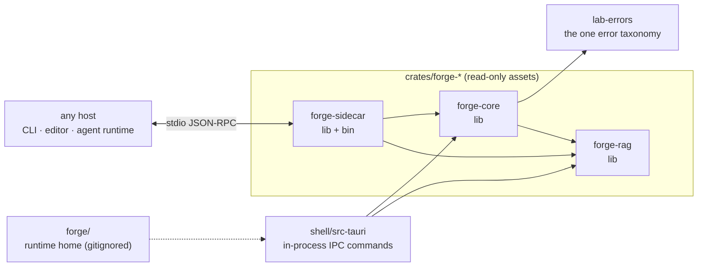

# 08 · Forge SDK and sidecar

The three engine crates that make up the forge — `forge-core`, `forge-rag` and `forge-sidecar` — their public APIs, the JSON-RPC protocol the sidecar serves, and how crate-hosted assets are addressed.

> **cratelab docs** · SPDX `MIT` · security: this file must never contain credentials, tokens, private-repo content, or absolute user paths.

**Status:** reference · **Last verified:** 2026-11-04 · **Related:** [00-index](00-index.md), [07-the-forge](07-the-forge.md), [09-the-workflow-model](09-the-workflow-model.md), [10-knowledge-base-and-retrieval](10-knowledge-base-and-retrieval.md), [12-operations](12-operations.md)

## 1. The three crates

The forge is an engine, not a service mesh. Three crates under `crates/forge-*` carry all of it, and a fourth consumer (the Tauri shell) drives them:

| Crate | Type | Responsibility |
|---|---|---|
| `forge-core` | library | The SDK: registry, stages/gates, deterministic pipeline, artifacts, provider port, error vocabulary. |
| `forge-rag` | library | The retrieval plane: ingest/chunking, BM25 index, evidence packets, prompt templates. |
| `forge-sidecar` | library + binary `forge-sidecar` | A stdio JSON-RPC bridge that exposes the same registry, retrieval and pipeline to any host. |

`forge-core` depends on `lab-errors` for its error vocabulary; `forge-rag` and `forge-sidecar` are otherwise I/O-free at their core. The shell (`shell/src-tauri`) consumes `forge-core`/`forge-rag` in-process; the sidecar exposes them out-of-process.



## 2. `forge-core` — the SDK

`forge-core` re-exports its surface at the crate root:

```text
pub use artifact::{Artifact, ArtifactKind, EvidenceRef};
pub use error::{ForgeError, ForgeResult};
pub use pipeline::{AllowAll, GateRules, Pipeline, PipelineOutcome, RuleSet, StageRun};
pub use provider::{MockProvider, Provider, ProviderPort, ProviderRequest, ProviderResponse};
pub use stage::{Gate, Refusal, RuleVerdict, Stage, StageKind};
pub use target::{Domain, Target};
pub use task::{embedded_tasks, Task, TaskCatalog, TaskScope, EMBEDDED_TASKS};
pub use workflow::{embedded, Workflow, WorkflowRegistry, EMBEDDED_REGISTRY};
```

| Module | Key items | What it is |
|---|---|---|
| `workflow` | `Workflow { id, domain, title, target, tools, stages }`; `WorkflowRegistry` with `from_toml` / `get` / `by_domain` / `ids` / `validate`; `EMBEDDED_REGISTRY` (`include_str!`) and `embedded()`. | The single source of truth for *how* a run proceeds: one authored TOML, parsed and validated. |
| `task` | `Task { id, label, group, local, live, steps, refs, scopes }`; `TaskScope {Pilot, CrateIntelligence}`; `TaskCatalog` with `from_toml` / `get` / `ids` / `in_scope` / `ids_in_scope` / `validate`; `EMBEDDED_TASKS` (`include_str!`) and `embedded_tasks()`. | The single source of truth for *what* a run asks: one authored TOML across two scopes, parsed and validated. |
| `stage` | `StageKind` (7 variants, `ALL`, `as_str`, `order`, `default_gate`); `Gate {Research, Propose, Validate}`; `Refusal { code, message, severity }` defaulting to `Info`; `RuleVerdict {Pass, Refuse(Refusal)}`; `Stage { id, kind, title, gate }`. | The ordered spine and its decision gates. |
| `target` | `Domain {Intern, Extern, Ops, Rag}` (`ALL`, `as_str`); `Target { id, root, crate_glob, domain }` (`crate_glob` defaults to `crates/*`). | *What* the forge evolves and *which plane* it lives on. |
| `artifact` | `ArtifactKind {Feature, Fix, Docs, Knowledge, Evaluation}`; `EvidenceRef { source, path, start_line, revision }`; `Artifact { kind, target, title, summary, evidence, steps }`; `Artifact::draft`. | The reviewable proposal a completed run emits. |
| `provider` | `Provider { id, model, present }`; `ProviderRequest { provider, model, prompt, evidence }`; `Usage`; `ProviderResponse`; `trait ProviderPort { name, complete }`; `MockProvider`. | The one place the forge crosses the network boundary — and it does not, until a port is attached. |
| `pipeline` | `StageRun`; `PipelineOutcome { workflow, runs, artifacts, halted }` with `refused()` / `refusals()` / `exit_code()`; `trait RuleSet { evaluate }`; `GateRules` (`no-evidence` / `unproposed-artifact`) and `AllowAll`; `Pipeline::new` / `run(evidence)` / `dry_run` / `run_with_rules`. | The deterministic engine that drives a workflow's stages; `run` gates on grounded evidence, `dry_run` is a structural walk. |
| `error` | `ForgeError {Lab, Workflow, Pipeline, Retrieval, Remote}` with `kind()` / `remedy()` / `severity()` / `exit_code()`; `ForgeResult<T>`. | One error vocabulary, mapped onto `LabError`. |

**Invariants carried by the SDK.** Manifest-driven; refusals are data (`Severity::Info` ⇒ exit `0`, never a panic); zero-panic; a deterministic core (no RNG, no network); and the single `ForgeError` vocabulary. The full stage/pipeline model is in [09-the-workflow-model](09-the-workflow-model.md).

## 3. `forge-rag` — the retrieval plane

`forge-rag` re-exports:

```text
pub use index::{tokenize, Bm25Index, Hit};
pub use ingest::{chunk_lines, ingest, Chunk, SourceSpec};
pub use prompt::{crate_evolution_template, render, PromptTemplate, CRATE_EVOLUTION_PROMPT};
pub use retrieve::{retrieve, EvidencePacket, Snippet};
```

- `ingest` — `chunk_lines`, the constants `CHUNK_LINES = 80` / `CHUNK_OVERLAP = 12`, a `DENIED_FILES` set, `SourceSpec`, `Chunk`, `is_indexable` and `ingest`. It is deliberately I/O-free at the core: it ingests in-memory `(path, contents)` files so the whole pipeline is unit-testable and reproducible.
- `index` — `Bm25Index::build` / `len` / `is_empty` / `idf` / `search`, `tokenize`, and `Hit { chunk, score }`, with `K1 = 1.2` and `B = 0.75`.
- `retrieve` — `Snippet`, `EvidencePacket { query, snippets }` with `empty()` / `is_empty()` / `citations()`, and `retrieve`.
- `prompt` — `PromptTemplate { id, system_role, sections, output_contract }`, `CRATE_EVOLUTION_PROMPT` (`include_str!`), `crate_evolution_template()` and `render()`.

The plane's invariant: **a missing retrieval result is no evidence, never proof that a behaviour is absent** — an empty packet must be surfaced as such. Details are in [10-knowledge-base-and-retrieval](10-knowledge-base-and-retrieval.md).

## 4. `forge-sidecar` — the stdio bridge

`forge-sidecar` is one process, one transport, no scatter. Requests are newline-delimited JSON objects on stdin; responses are newline-delimited JSON objects on stdout. The router (`dispatch`) is **pure and deterministic** — it performs no I/O, so every method is unit-testable — and the binary (`main.rs`) is only the transport loop: read a line, dispatch, write a response.

### 4.1 Envelope

| Type | Fields |
|---|---|
| `Request` | `id: u64` (caller-chosen, echoed back), `method: String`, `params: Value` (optional). |
| `Response` | `id: u64`, `result: Option<Value>`, `error: Option<RpcError>` (both `skip_serializing_if = "Option::is_none"`). |
| `RpcError` | `code: i32`, `message: String`. |

Error codes: `INVALID_REQUEST = -32600`, `METHOD_NOT_FOUND = -32601`, `INTERNAL_ERROR = -32603`. When a request cannot be parsed, the binary replies with id `0` and `INVALID_REQUEST`.

### 4.2 Methods

| Method | Params | Result |
|---|---|---|
| `forge.ping` | — | `{ "pong": true }` |
| `forge.workflows` | — | `{ "count": n, "workflows": [...] }` — the embedded registry. |
| `forge.tokenize` | `{ "text": string }` | `{ "tokens": [...] }` — a missing/invalid `text` returns `INVALID_REQUEST`. |

An unknown method returns `METHOD_NOT_FOUND` — reported, never panicked.

### 4.3 Declared remotes

Some forge work (embedding, large-scale evaluation) runs better off-box. The sidecar keeps those **declared** in `remote` while the actual assets live beside them under `remotes/`. A `Remote` only names the environment variable a credential or endpoint comes from; nothing secret is stored.

| id | `RemoteKind` | `endpoint_env` |
|---|---|---|
| `crates-search` | `ModalAsgi` | `CRATE_INTEL_MODAL_SEARCH_URL` |
| `retrieval-eval` | `KaggleKernel` | `KAGGLE_KERNEL_ID` |

`RemoteKind` is `Local` (in-process, the default), `ModalAsgi` (a Modal-hosted ASGI app) or `KaggleKernel` (a Kaggle notebook kernel). These are descriptors only: no network is touched until a caller attaches a bridge and confirms the request.

## 5. The authored registries: workflows and tasks

`crates/forge-core/forge.workflows.toml` is the single authored workflow registry. It is not generated: editing a workflow is editing this file, never a frontend. It is embedded at build time (`EMBEDDED_REGISTRY = include_str!("../forge.workflows.toml")`) and validated when parsed (`WorkflowRegistry::from_toml`). It declares four workflows:

| id | domain | target | tools |
|---|---|---|---|
| `cratelab-intern-evolution` | `intern` | `lab-manifest` | `cargo`, `rustdoc`, `coverage-ledger`, `clippy` |
| `extern-workspace-evolution` | `extern` | `tv-rs` | `cargo`, `rustdoc`, `git`, `coverage-ledger` |
| `ops-readiness` | `ops` | `cratelab-ops` | `cargo`, `circleci`, `env-audit` |
| `rag-intelligence` | `rag` | `cratelab-crates` | `corpus-builder`, `bm25`, `kaggle-eval` |

Each walks all seven stages in order. The registry is rendered by the Svelte UI, executed by the `Pipeline`, and served by the sidecar's `forge.workflows` method. The TOML schema and validation rules are specified in [09-the-workflow-model](09-the-workflow-model.md).

Alongside it, `crates/forge-core/forge.tasks.toml` is the second authored registry — the **task catalog** (*what* a run asks). It embeds the same way (`EMBEDDED_TASKS = include_str!("../forge.tasks.toml")`, validated by `TaskCatalog::from_toml`) and declares ten tasks across two scopes (`pilot` · `crate-intelligence`). Both registries reach the UI through one `forge_catalog` Tauri command, so the shell renders the engine's authored data instead of a hand-written table; the task model is in [09-the-workflow-model](09-the-workflow-model.md#8--the-task-catalog).

## 6. Crate-hosted assets

Read-only engine assets ship *inside* the crates; only mutable runtime data lives in `forge/`. The shell addresses an asset from the workspace root with one helper (`engine_asset(relative)` = `workspace_root().join(relative)`), so an asset path is always repo-relative and never an absolute user path.

| Asset | Location |
|---|---|
| Credential guides + governance | `crates/forge-core/forge.config.json` |
| The workflow registry | `crates/forge-core/forge.workflows.toml` |
| The task catalog | `crates/forge-core/forge.tasks.toml` |
| CircleCI gate template | `crates/forge-sidecar/ci/circleci/config.yml` |
| Modal search apps | `crates/forge-sidecar/remotes/modal/app.py`, `…/crate_intelligence_app.py` |
| Kaggle evaluation job | `crates/forge-sidecar/remotes/kaggle/crate-intelligence/{README.md, crate_intelligence_eval.py}` |
| Embedding experiment notes | `crates/forge-sidecar/remotes/notebooks/kaggle_embed.md` |
| Portable corpus builder | `crates/forge-sidecar/scripts/build_rag_index.py` |
| Crate-evolution research prompt | `crates/forge-rag/prompts/crate-evolution-research.md` |

The runtime home (`forge/.env`, `forge/state/`, `forge/reports/`, `forge/data/`, `forge/.kaggle-venv/`, `forge/.modal-config`) is gitignored and holds only mutable data. See [12-operations](12-operations.md) for the `forge_*` IPC commands that drive these assets.

## Consolidation notes

- **New file.** It splits the engine-crate and transport material out of the old fleet docs into one reference: the three crates, their public APIs, the JSON-RPC protocol and methods, the declared remotes, the embedded registry and the crate-hosted asset addressing.
- **Grounded every signature in the code** — the re-export lists, the `K1`/`B` BM25 constants, the JSON-RPC error codes and method table, and the two declared remotes are read directly from `crates/forge-*`.
- **Introduced the crate-hosted-asset model**: read-only assets inside `crates/forge-*` addressed by a single `engine_asset()` helper, mutable data in the gitignored `forge/` home.
- **Deferred detail** to siblings: the stage/pipeline model to [09](09-the-workflow-model.md), retrieval internals to [10](10-knowledge-base-and-retrieval.md), providers/capacity to [11](11-providers-and-capacity.md), and runtime operations to [12](12-operations.md).
