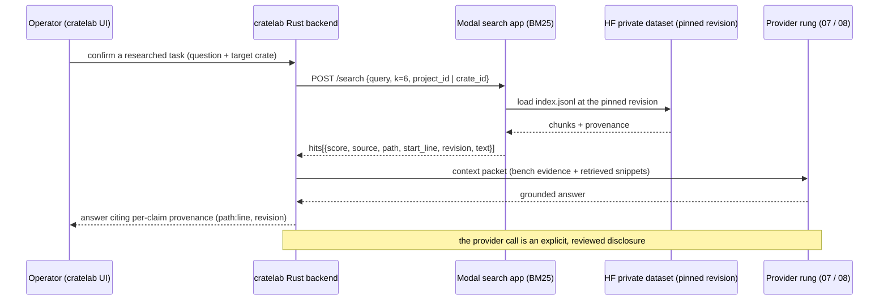

# 09 · Fleet RAG

How the fleet retrieves grounded evidence — the corpora it indexes, how they are chunked, how retrieval is served, and how every returned snippet keeps its provenance.

> **cratelab docs** · SPDX `MIT` · security: this file must never contain credentials, tokens, private-repo content, or absolute user paths.

**Status:** reference · **Last verified:** 2026-11-04 · **Related:** [00-index](00-index.md), [06-crate-intelligence](06-crate-intelligence.md), [08-fleet-providers](08-fleet-providers.md), [10-fleet-workflows](10-fleet-workflows.md), [11-model-capacity](11-model-capacity.md)

## 1. Status: what is implemented vs design

Retrieval-augmented generation (RAG) in cratelab grounds a research or documentation answer in real source, so the model cites evidence instead of recalling it. The **lexical pilot is implemented in this repository**; the dense/hybrid extensions are design only.

**Implemented now (verified in the repo):**

- A portable JSONL corpus builder, `fleet/scripts/build_rag_index.py`, that emits provenance-rich text chunks.
- Two authenticated, read-only Modal search apps: `fleet/modal/app.py` (signage docs) and `fleet/modal/crate_intelligence_app.py` (internal crates), both serving **BM25** retrieval over a pinned private Hugging Face dataset revision.
- The knowledge-source boundaries in `fleet/config.json` and the HF → Modal flow in `fleet/README.md`.
- A private Kaggle evaluation, `fleet/kaggle/crate-intelligence/crate_intelligence_eval.py`, comparing dense retrieval against BM25.

**Design only (not the active pilot):** dense BGE-M3 embeddings, a Qdrant serving layer, server-side hybrid (BM25 + dense) fusion, and LLM reranking. `fleet/notebooks/kaggle_embed.md` explicitly records that dense embedding is a later optimisation and that the active first-phase index is lexical.

## 2. Knowledge sources

`fleet/config.json` defines two retrieval routes that are kept deliberately separate.

**Route A — initial private docs context** (`knowledge_sources`). Only each repository's `docs/` tree and the top-level README/CHANGELOG/CONTRIBUTING are indexed; application source is excluded. Both entries have `scope: "docs-only"`:

| id | scope |
|---|---|
| `simple-signage` | docs-only |
| `companion-app` | docs-only |

These repositories are **never task targets** and are never edited by the fleet. Their documentation is contextual evidence only: findings and proposals apply to the public target workspace, and the corpus builder records each source revision and whether a documentation file was dirty (the upload review discloses uncommitted documentation). The default retrieval artifact is `signage-docs-index.jsonl`, with a default `top_k` of 6 (`target.rag`).

**Route B — internal crate intelligence** (`internal_crates_knowledge`). A separate index built from `crates/*/src/**/*.rs` plus each package's name, description and direct internal dependencies (`crates/*/Cargo.toml`). Its artifact is `cratelab-crates-index.jsonl`, served by `fleet/modal/crate_intelligence_app.py`. This route grounds the crate-evolution research prompt against the cratelab bench (see [06-crate-intelligence](06-crate-intelligence.md)).

The two routes are never mixed: the docs retrieval path accepts only the `simple-signage` / `companion-app` project ids, and the crates retrieval path accepts only cratelab crate ids.

## 3. Indexing and chunking

The corpus builder (`fleet/scripts/build_rag_index.py`) is intentionally text-only — embeddings can be added later, after the corpus is reviewed.

- **Included extensions:** `.rs`, `.md`, `.toml`.
- **Skipped directories:** `target`, `.git`, `node_modules`, `vendor`, `.env`, `secrets`, `credentials`, `.agents`, `.circleci`, `.github`, `e2e_suite`.
- **Excluded files:** `Cargo.toml`, `Cargo.lock`, `.env`, `secrets.toml`, `credentials.json`, and anything under `.github/` or `.circleci/` — consistent with the `forbidden_paths` guardrail ([07-fleet-overview](07-fleet-overview.md) §5).
- **Chunking:** a fixed window of **80 lines with a 12-line overlap** (line-based, not token-based), emitting one JSONL record per chunk.
- **Revision:** each record is stamped with the checkout's git revision (`HEAD`).

Each record keeps its provenance intact:

```json
{ "id": "<crate>:<relpath>:<line>", "crate": "...", "source": "crate://<crate>/<relpath>#L<line>",
  "path": "<relpath>", "start_line": <n>, "revision": "<git sha>", "indexed_at": <unix>, "text": "..." }
```

The Rust desktop backend builds and validates the signage-docs route locally and scans indexed text for credential-like strings before any upload can be reviewed.

## 4. Retrieval and citation

Retrieval is served by Modal as authenticated, read-only BM25 over the dataset pinned to a specific revision — the container loads `index.jsonl` from the private dataset into memory and never writes back.

- **Endpoint:** `POST /search`, bearer-authenticated.
- **Query:** `{ query, k (1–20, default 6), project_id | crate_id }`. An unknown project or crate returns a `400`.
- **Hit shape:** `{ score, project, source, path, start_line, revision, text }` (the crates route adds `crate` and `kind`, with `project: "cratelab"`).

Every hit carries its own provenance, and the research prompt (`fleet/prompts/crate-evolution-research.md`) requires the answer to cite `path:line` and to preserve source, crate, revision and line metadata. A missing retrieval result is treated as **no evidence**, never as proof that behaviour is absent. Reports retain source paths and pinned revisions.

## 5. Flow: question → retrieval → provider call → cited answer



The retrieval step is local to the fleet (Modal) and costs no provider quota. Only the final answer step crosses to a provider, and per [08-fleet-providers](08-fleet-providers.md) that call is gated behind a preview and confirmation — provider fallback is still an external disclosure.

## 6. Relation to the crate bench and the research cycle

The retrieval index is the evidence bridge between the cratelab bench and the fleet:

- **Crate bench.** The internal crates route grounds the bench research prompt; its context order is defined in `fleet/prompts/crate-evolution-research.md` and mirrors the crate map in [06-crate-intelligence](06-crate-intelligence.md). Retrieval snippets enter the packet only when they add evidence, and each keeps its source, crate, revision and line metadata.
- **Cross-language research cycle.** The cycle's diff step compares a candidate external SDK against our crate using local inventory plus **RAG hits at k=6**, with every claim tied to our `file:line` and the reference's URL. The cycle and its budget belong to [10-fleet-workflows](10-fleet-workflows.md).
- **Host capacity.** Which rung serves the retrieval-heavy context (a session GPU host for whole-crate reads, or a large-context API executor) is a capacity question covered in [11-model-capacity](11-model-capacity.md).

## 7. Design-only extensions

Listed for planning; none are active in the lexical pilot:

1. **Contextual chunk headers** — prefix each chunk with `crate://{crate}/{path}::{item}` so provenance is embedded in the text itself.
2. **Dense embeddings** — BGE-M3 on a Kaggle GPU, compared against BM25 before adoption. The private Kaggle evaluation already measures dense hit@5 against BM25 hit@5 on crate-filtered questions.
3. **Qdrant Cloud serving layer** — a free single node holding the source-of-truth parquet/JSONL, with server-side hybrid BM25 + dense fusion.
4. **LLM rerank** — reduce a top-20 candidate set to a top-6 set using an existing cheap rung instead of a dedicated reranker vendor.

## Consolidation notes

- Merged the RAG material from the playbook (§6) and the build sheet (§6.4). Both described the corpus, chunking and the Modal search endpoint; this doc keeps one account and grounds it in the actual repo files.
- **Corrected** the chunking claim: the implemented builder chunks by **80 lines with a 12-line overlap**, not "~800 tokens with 100 overlap" as the playbook states.
- **Corrected** the serving claim: the active pilot is **lexical BM25** over `index.jsonl` served by `fleet/modal/app.py` and `fleet/modal/crate_intelligence_app.py`, not the playbook's dense `rust-rag-index.parquet` served by `scripts/mcp_rag.py`. Dense BGE-M3, Qdrant and hybrid fusion are labelled design only, matching `fleet/notebooks/kaggle_embed.md`.
- Distinguished the two retrieval routes — private docs-only context (`simple-signage` / `companion-app`) and the separate internal crates index — instead of the playbook's single "Rust knowledge" corpus; the crates route is verified against `internal_crates_knowledge` in `fleet/config.json`.
- Reduced the source distinction to what is verifiable: only the `docs/` tree plus top-level README/CHANGELOG/CONTRIBUTING are indexed for the private repositories; source code is excluded, and the repositories are never task targets.
- **Dropped** absolute repository paths, secret examples and the stale Hugging Face dataset name; the dataset is referred to through its env var (`HF_DATASET_REPO` / `HF_CRATES_DATASET_REPO`).
