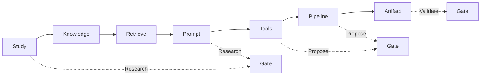
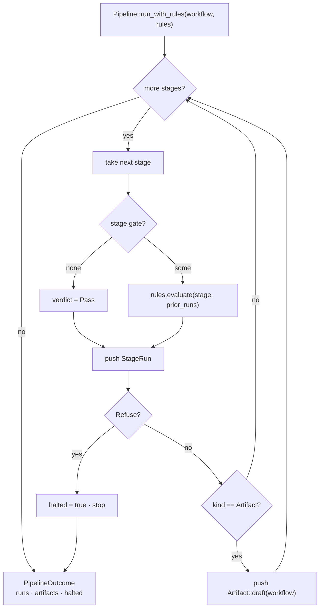

# 09 · The workflow model

The forge workflow model: the authored registry and its TOML schema, the `StageKind` / `Gate` vocabulary, the deterministic pipeline engine and its rule sets, the artifacts and evidence it emits, and the four workflows that ship today.

> **cratelab docs** · SPDX `MIT` · security: this file must never contain credentials, tokens, private-repo content, or absolute user paths.

**Status:** reference · **Last verified:** 2026-11-04 · **Related:** [00-index](00-index.md), [03-cli-and-workflows](03-cli-and-workflows.md), [06-crate-intelligence](06-crate-intelligence.md), [07-the-forge](07-the-forge.md), [08-forge-sdk-and-sidecar](08-forge-sdk-and-sidecar.md), [10-knowledge-base-and-retrieval](10-knowledge-base-and-retrieval.md)

## 1 · What a workflow is here

A **workflow** is an authored evolution recipe: one `Workflow { id, domain, title, target, tools, stages }`. It belongs to a `Domain` (`intern` / `extern` / `ops` / `rag`), names a `Target` (`{ id, root, crate_glob, domain }`), lists the agent tools it may use, and walks an ordered list of `Stage`s. The vocabulary is fixed by the SDK and shared by the UI and the sidecar ([08-forge-sdk-and-sidecar](08-forge-sdk-and-sidecar.md)).

A workflow is **local-first and deterministic**: the core engine prepares evidence and walks gates with no provider call and no network I/O. A provider — if any — is only invoked after an operator has previewed and confirmed the request, through an explicitly attached `ProviderPort`.

## 2 · The registry and its TOML schema

The single authored registry is `crates/forge-core/forge.workflows.toml`, embedded at build time (`EMBEDDED_REGISTRY`) and parsed by `WorkflowRegistry::from_toml`. The schema:

```toml
[[workflows]]
id = "extern-workspace-evolution"   # unique across the registry
domain = "extern"                   # intern | extern | ops | rag
title = "Evolve a public Rust workspace"
target = "tv-rs"                    # the target id this workflow evolves
tools = ["cargo", "rustdoc", "git", "coverage-ledger"]  # optional

[[workflows.stages]]
id = "study"        # unique within its workflow
kind = "study"      # one of the seven StageKind variants
title = "Study the workspace and its docs sources"
gate = "research"   # optional: research | propose | validate
```

**Validation** (`WorkflowRegistry::validate`) rejects a registry when:

- a workflow has **no stages**;
- two workflows share an **id**;
- a workflow's stages are **not in strictly increasing `StageKind::order`**.

Lookups: `get(id)`, `by_domain(domain)` (registry order) and `ids()`. `embedded()` parses the shipped file; a parse or validation error becomes a `ForgeError::Workflow`.

## 3 · `StageKind` and `Gate`

`StageKind` is the ordered spine every workflow walks. `Gate` is the decision point a stage may consult.



| `StageKind` | order | `as_str` | `default_gate` |
|---|---|---|---|
| `Study` | 0 | `study` | `Research` |
| `Knowledge` | 1 | `knowledge` | `Research` |
| `Retrieve` | 2 | `retrieve` | `Research` |
| `Prompt` | 3 | `prompt` | `Research` |
| `Tools` | 4 | `tools` | `Propose` |
| `Pipeline` | 5 | `pipeline` | `Propose` |
| `Artifact` | 6 | `artifact` | `Validate` |

`StageKind::ALL` is the canonical seven-element array; `order()` gives the position used to validate authored ordering; `default_gate()` maps a kind onto the gate it falls under by default — **Study/Knowledge/Retrieve/Prompt → Research**, **Tools/Pipeline → Propose**, **Artifact → Validate**.

A `Stage { id, kind, title, gate }` may override or omit its gate. `gate: None` means the stage always runs.

## 4 · Gates: Research → Propose → Validate

A gate answers one question before the stage runs:

| `Gate` | Question |
|---|---|
| `Research` | Is the gathered evidence sufficient to proceed? |
| `Propose` | Is the proposed change safe and in scope? |
| `Validate` | Does the emitted artifact satisfy the output contract? |

A gate produces a `RuleVerdict`:

- `RuleVerdict::Pass` — the stage cleared its gate.
- `RuleVerdict::Refuse(Refusal)` — the stage declined to act; the **refusal is carried as data**.

A `Refusal { code, message, severity }` defaults to `Severity::Info` and its severity survives a wire round-trip. Declining to act is part of the API, not a failure — it keeps the caller's exit code at `0`.

## 5 · The pipeline engine and rule sets

`Pipeline` drives a workflow's stages in order. It uses no RNG and performs no network I/O, so the same workflow against the same rule set yields the same `PipelineOutcome` every time.



- `trait RuleSet { fn evaluate(&self, stage: &Stage, prior: &[StageRun]) -> RuleVerdict }` — rules **must be deterministic**: they may read `prior` runs but must not touch the clock, the filesystem or the network.
- `AllowAll` is the default rule set: it clears every authored gate. Real rules arrive with the scripted-prompt layer (e.g. "refuse to propose when the evidence packet is empty").
- `Pipeline::new(workflow).run()` uses `AllowAll`; `run_with_rules(rules)` consults `rules` at every gated stage.

`StageRun` records the stage id, its `kind`, the `gate` consulted (if any), the `verdict`, and deterministic `notes`. `PipelineOutcome { workflow, runs, artifacts, halted }` exposes:

- `refused()` — true when any stage produced a refusal.
- `refusals()` — every `Refusal`, in order.
- `exit_code()` — the max severity across refusals mapped to `Info → 0`, `Warn → 2`, `Fatal → 3` (or `0` when there are none). A refused run therefore still exits `0`.

## 6 · Artifacts and evidence

The forge never edits a target silently. The terminal stage emits an `Artifact`: a reviewable proposal whose every claim can carry an `EvidenceRef` back to the exact source revision it came from.

| Type | Fields |
|---|---|
| `ArtifactKind` | `Feature` · `Fix` · `Docs` · `Knowledge` · `Evaluation`. |
| `EvidenceRef` | `source` (e.g. a crate id or docs-tree id), `path` (relative, slash-separated), `start_line` (optional), `revision` (the exact source revision). |
| `Artifact` | `kind`, `target`, `title`, `summary`, `evidence: Vec<EvidenceRef>`, `steps: Vec<String>`. |

`Artifact::draft(workflow)` builds an empty draft (kind `Docs`, no fabricated evidence, no steps) for a workflow that reached its artifact stage; it is populated by the prompt/agent stages and awaits review until then. A refusal halts before the artifact stage, so a refused run emits no artifact.

## 7 · The four shipped workflows

The embedded registry declares four workflows, one per domain. Each walks all seven stages; the table shows each workflow's Study/Tools/Artifact titles (the gated stages) and its tools.

| id | domain | target | Study | Tools | Artifact | tools |
|---|---|---|---|---|---|---|
| `cratelab-intern-evolution` | `intern` | `lab-manifest` | Study crate sources and research notes | Arm the agent with cargo/rustdoc/coverage tools | Emit a feature, fix or doc proposal | `cargo`, `rustdoc`, `coverage-ledger`, `clippy` |
| `extern-workspace-evolution` | `extern` | `tv-rs` | Study the workspace and its docs sources | Arm the agent with workspace tools | Emit a feature, fix or doc proposal | `cargo`, `rustdoc`, `git`, `coverage-ledger` |
| `ops-readiness` | `ops` | `cratelab-ops` | Study provider, quota and CI surfaces | Arm the agent with CI and env-audit tools | Emit an operations remediation proposal | `cargo`, `circleci`, `env-audit` |
| `rag-intelligence` | `rag` | `cratelab-crates` | Study the indexed source roots | Arm the agent with retrieval and evaluation tools | Emit a retrieval evaluation result | `corpus-builder`, `bm25`, `kaggle-eval` |

The gated stages are consistent across all four: `study` carries the `research` gate, `tools` carries the `propose` gate, and `artifact` carries the `validate` gate. The four workflows are the pipelines; the shell additionally offers a task catalog (research, documentation, feature study, bug investigation, debug plan, issue triage, knowledge synthesis, cross-language research) that selects the task a run performs — see [12-operations](12-operations.md) and [04-shell-and-ui](04-shell-and-ui.md).

## Consolidation notes

- **Renamed and rewrote** the old `10-fleet-workflows.md` as `09-the-workflow-model.md`: it is now a specification of the registry + engine rather than a catalogue of fleet work cycles.
- **Grounded the model in `forge-core`**: the `Workflow`/`WorkflowRegistry` schema, the three validation rules, the `StageKind`/`Gate` tables, the `Refusal` default severity, the `Pipeline`/`RuleSet`/`AllowAll` engine and the `Artifact`/`EvidenceRef` shapes are all read from the code.
- **Kept the four-workflow table** grounded in `forge.workflows.toml`, and **distinguished** the registry pipelines from the shell task catalog so the two are not conflated.
- **Dropped** the old fleet's cross-language research rail, per-template local/live table and the design-only execution schedule (they described a different, non-registry model); the forge's forward plan now lives in [13-roadmap](13-roadmap.md).
