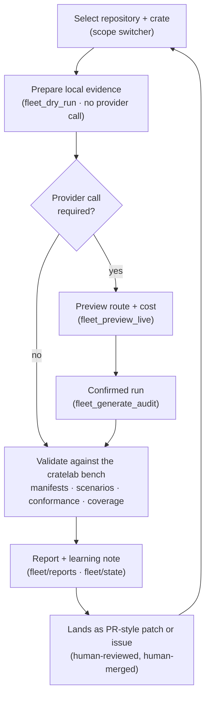

# 10 · Fleet workflows

The end-to-end work cycles the fleet runs against a selected repository — research, documentation, triage, and validation against the cratelab bench — and where each one's output lands.

> **cratelab docs** · SPDX `MIT` · security: this file must never contain credentials, tokens, private-repo content, or absolute user paths.

**Status:** reference · **Last verified:** 2026-11-04 · **Related:** [00-index](00-index.md), [03-cli-and-workflows](03-cli-and-workflows.md), [04-shell-and-ui](04-shell-and-ui.md), [06-crate-intelligence](06-crate-intelligence.md), [08-fleet-providers](08-fleet-providers.md), [09-fleet-rag](09-fleet-rag.md), [12-operations](12-operations.md)

## 1 · What a "workflow" is here

The fleet is the control plane that stages research and documentation work on **one selected repository** (the `tv-rs` or `cctv-rs` Rust workspace). The vocabulary is fixed and shared by the UI and the docs ([04-shell-and-ui](04-shell-and-ui.md), `fleet-workflows.ts`):

| Term | Meaning |
|---|---|
| **Repository** | A source checkout selected for analysis (`tv-rs`, `cctv-rs`) via the shared scope switcher. |
| **Workflow** | An ordered task recipe (research, docs, feature, bug, debug, issue, knowledge). |
| **Case** | One repository + crate + task (+ optional issue/reference). |
| **Scenario** | A deterministic mock-device simulation — the cratelab bench, not a provider call. |
| **Learning note** | User-reviewed outcome feedback carried into future prompt context for the same repo/task. |

A workflow is **local-first**: it prepares source evidence with no provider call, and only then optionally calls a provider. Workflow labels and previews state which side of that line a step is on. Learning notes do **not** update system prompts automatically — they are reviewed context.

## 2 · The canonical cycle

The canonical unit of work is **research → propose → validate against the cratelab bench → report**. The bench is the lab core the fleet validates against: manifests, mock fleet, scenarios, conformance sweeps and the coverage ledger ([03-cli-and-workflows](03-cli-and-workflows.md)); the internal crate map that grounds a proposal lives in [06-crate-intelligence](06-crate-intelligence.md).

Links that anchor the two ends of the loop: the bench contracts are specified in [03-cli-and-workflows](03-cli-and-workflows.md); the evidence and prompt contract that grounds a proposal is in [06-crate-intelligence](06-crate-intelligence.md).

## 3 · Workflow catalog (implemented)

The shipped templates are defined in `shell/src/fleet-workflows.ts` and consumed by the Workflows view. Each has a **local** verb (inventory, no LLM) and a **live** verb (provider-backed analysis over that evidence).

| id | Label | Group | Local step (no provider) | Live step (provider) |
|---|---|---|---|---|
| `research-summary` | Research | Understand | Inventory source and public API | Map purpose, boundaries, related crates, open questions |
| `rustdoc-audit` | Documentation | Improve | Find public-API documentation candidates | Identify missing/unclear rustdoc with exact source evidence |
| `feature-study` | Feature study | Plan | Map API and implementation files | Trace a feature across crates, contracts, tests, behavior |
| `bug-investigation` | Bug investigation | Diagnose | Collect risk markers and nearby API evidence | Rank hypotheses from supplied symptoms; separate facts from guesses |
| `debug-plan` | Debug plan | Diagnose | Collect panic/unwrap/TODO/FIXME candidates | Propose a minimal diagnostic sequence and safe stop conditions |
| `issue-triage` | Issue triage | Plan | Prepare crate context; issue content is **not** fetched | Classify supplied issue text into impact, evidence, gaps, next action |
| `knowledge-synthesis` | Knowledge synthesis | Learn | Build source and dependency inventory | Synthesize source-grounded knowledge with provenance |
| `cross-language-research` | Cross-language research | Research | Inventory public API, docs, tests, feature surface | Find comparable SDKs, extract, diff, write adoption notes (§5) |

Every template ends with a **Capture learning** step. The cross-language workflow additionally carries the reference anchors `github.com/google/artemis` and `github.com/morluto/rea` (see §5).

## 4 · Repository workflow: issue → proposal → patch-style diff → review

This is the fleet's contract for turning a workspace observation into reviewable output.

**Trigger.** An operator selects a repository and a crate and runs a workflow (or supplies an issue's text/link for `issue-triage`).

**Steps.**
1. **Select.** The repository picker (`tv-rs` / `cctv-rs`) sets a scope shared by Fleet and the Ops dashboard; the choice persists locally under ignored `fleet/state` ([04-shell-and-ui](04-shell-and-ui.md)). Repo path, availability and the crate catalog appear in Fleet status.
2. **Prepare local evidence.** `fleet_dry_run` builds a local case packet (source evidence) — this is where local evidence preparation is deliberately distinguished from provider-backed analysis.
3. **Analyze (optional).** A live provider request runs only after an explicit preview + confirmation; the preview shows files, size, route and a cost note.
4. **Propose.** The output is a proposal: doc additions, a feature note, or a diff.
5. **Validate against the cratelab bench.** Manifests, scenarios, conformance and coverage validate the proposal's claims about command/event/limit surface before anything lands ([03-cli-and-workflows](03-cli-and-workflows.md)).
6. **Review.** Reviewed learning notes are stored locally (repo/task scoped) and carried into later prompts for the same repository/task.

**Artifacts.** A case packet (local), a run transcript, and a report (see §6) plus a learning note.

**Guardrails.** `fleet/config.json` → `execution` sets `network: true`, `provider_calls: true`, but **`github_writes: false`** and **`target_writes: false`**: the fleet never writes to GitHub and never edits a target repository. Writes to `forbidden_paths` (`Cargo.toml`, `Cargo.lock`, `.github/**`, `.circleci/**`) are out of scope. Class C/D findings land as issues, not patches; every change stays human-reviewed and human-merged.

**Where results land.** Run history under ignored `fleet/state`; reports under ignored `fleet/reports` (§6). Neither is git-tracked.

> **Open item (from the repo workflow spec):** issue triage can only be evidence-grounded if the issue text/link is supplied; the fleet will not silently fetch private forge data. Automatic prompt-policy changes remain out of scope.

## 5 · Cross-language research cycle

Goal: study SDKs in other languages that excel at the same job as a cratelab target crate, reverse-engineer *why*, and adopt deliberately. The method is evidence-based, license-safe, budget-accounted and fleet-wired.

### 5.1 Language coverage

Languages are mapped to the product (a Windows signage player + a mobile companion), and every finding must trace back to that context.

| Ecosystem | Why it is in scope | Learn mostly about |
|---|---|---|
| Kotlin / Android | it *is* the companion platform | provisioning flows, lifecycle/permission handling, telemetry SDK shapes |
| C# / .NET (WinRT/WPF) | it *is* the desktop player platform | Windows device/app SDK conventions, settings/update UX, error surfaces |
| Go | discovery/protocol culture | small APIs, `context` cancellation, zero-dep discipline, error wrapping |
| TypeScript | control-plane / web provisioning UI | docs culture, config-object DX, changelog discipline |
| Python | ops/telemetry tooling | logging/tracing conventions, packaging story |
| Swift | parked — only if an iOS companion exists | — |

### 5.2 The rail (7 steps, actor + budget)

| Step | What happens | Actor / rung | Cost |
|---|---|---|---|
| 1 · Pick a capability | one per run, from a fixed catalog | local | 0 |
| 2 · Shortlist comparable SDKs | 3–6 candidates per ecosystem, each with a repo URL and a search trail | `gemini-3.8-flash`; `groq/compound` deep-dive only if thin (≤1/day) | ~10K tok |
| 3 · Verify + fetch **evidence pack** | `gh api` each candidate (exists? license? `pushed_at`? stars); then ≤6 raw files (README, docs index, errors page, 2 examples, CHANGELOG; ~80 KB cap) | **local, zero LLM** | 0 |
| 4 · Extract excellence | reverse-engineering method over the pack + scorecard | `gemini-3.8-flash` (1M ctx) | ~20K tok |
| 5 · Diff against our crate | local inventory + RAG hits (k=6); every claim = our `file:line` + their URL(+file) | local + `gemini` / Bonsai | 1–2 req |
| 6 · Adoption notes | grouped, effort/impact tagged, `lands-as` assigned | `gemini-3.8-flash` / `gpt-oss-20b` | 1 req |
| 7 · Capture learning | learning-log rating + note; RAG write-back as a knowledge issue | `gpt-oss-20b` | 1 req |

Run totals: **dry run ≈ 0 LLM tokens** (steps 1–3 only); **live ≈ 50–60K tokens** (well inside a Groq model-day or Gemini's soft cap). Provider ladder for class-C research: `gemini → colab-bonsai → nvidia → groq-compound → openrouter:free`. Research never runs on the lowest-quality rungs ([08-fleet-providers](08-fleet-providers.md)).

### 5.3 The reverse-engineering method

1. **Surface first** — public API over implementation; read the evidence pack, not vendored code.
2. **State machines** — name lifecycle states explicitly and who owns each transition.
3. **Error taxonomy** — collect every error variant; classify transient / permanent / usage.
4. **Contracts** — what the caller must provide vs what the library guarantees.
5. **Docs surface** — what a newcomer reads first; what is missing.
6. **Adopt** — port only what maps onto the product context, as adoption notes, never as code.

Steps 2–4 are answered **from the evidence pack**, with pack-file citations. If the pack cannot answer a point, the scorecard cell stays `0` + "not in pack" — never guessed.

### 5.4 Scorecard

Eight axes, each scored `0 / 1 / 2`: API shape & ergonomics · naming & vocabulary · error taxonomy · docs & examples · testing strategy · versioning & compat · packaging & feature flags · observability. Every non-zero score carries evidence: their URL(+file) and our `file:line`.

### 5.5 Deduplication, verification and guardrails

- **Link-verification gate.** Every candidate repo must resolve via `gh api` or it is dropped and listed under "could not verify". The report header shows `links verified n/m`.
- **Evidence-pack cache.** The pack and scorecard are keyed by `sha256(capability+ecosystem+candidate)`; a repeated diff skips re-fetch and re-extract.
- **No-fabrication.** Every external claim carries a URL + access date; anything unverifiable goes to a mandatory "Could not verify" section.
- **License firewall.** Record the SPDX of every reference; adopt patterns, naming and doc *structure* — **zero code copying, zero verbatim doc text** (paraphrase with an attribution link). Each report ends with a license table.
- **Forbidden paths.** The research guardrail set is broader than `config.json`'s four: never read `.git`, `node_modules`, `target`, `dist`, `build`, `.agents`, `.github`, `.circleci`, `secrets`, `credentials`, `private-keys`; never `Cargo.toml` / `Cargo.lock` / `.env` / `credentials.json` / `secrets.toml` / `AGENTS.md`.
- **Budget.** Dry-run default; live ≤ ~60K tokens/run; `compound` ≤ 1/day; free rungs only (no paid tier, no local model download — the Colab session serves Bonsai; see [11-model-capacity](11-model-capacity.md)).

### 5.6 Output and where it lands

Report naming: `fleet/reports/dry-run-{repo}-{crate}-cross-language-research.md` for dry runs, `provider-audit-…` for live runs (ignored by git; see §6). Adoption notes each carry `effort S/M/L · impact A/B/C · lands-as`:

| Group | Lands as | Fleet class |
|---|---|---|
| docs missing | PR: rustdoc/README/examples additions | B |
| features to add | issue: roadmap + reference links + product justification | C |
| issues found (in our crate) | issue: repro hint + our `file:line` | C |
| research to continue | knowledge issue + RAG write-back — next cycle starts here | D |

### 5.7 Run harness

- **Compiled briefs** — each run's brief is content-addressed (`sha256`), stored with workflow id, rung, model and prompt hash, so it replays byte-identical on another rung.
- **Full log capture** — prompt, RAG hits, raw output, diff and verdict land in the run transcript.
- **Scored cycle** — the weekly dry-run suite is the fleet's acceptance benchmark: a run *succeeds* only when its report passes the acceptance checklist (real links, evidence citations, license table, `lands-as` assigned). Success rate per workflow is tracked in the ops digest.
- **Error taxonomy on ourselves** — run failures classify as transient (429/timeout → next rung) / permanent (bad brief → fix the template) / usage (budget → reschedule).

Cadence: **1 capability per week** by default; the first candidate is `device discovery` against `tv-rs-discovery` across Kotlin/NsdManager + C#/WinRT + Go.

## 6 · Where results land

| Artifact | Path / surface | Tracking |
|---|---|---|
| Case packet (local evidence) | built in-process by `fleet_dry_run`; surfaced in the Workflows view | in-memory |
| Run history | `fleet/state/` (e.g. `runs.json`) | gitignored |
| Reports (dry-run, provider-audit) | `fleet/reports/` | gitignored |
| Learning notes | local, repo/task scoped | local |
| Knowledge write-back | knowledge issue + RAG corpus | tracked per prompt contract in [06-crate-intelligence](06-crate-intelligence.md) |

The RAG side of the loop (local corpus → HF → Modal search) is documented in [09-fleet-rag](09-fleet-rag.md); the provider rungs and their budgets in [08-fleet-providers](08-fleet-providers.md); day-day operation in [12-operations](12-operations.md).

## 7 · Proposed execution plan (design)

A planning-stage design sketches a dated rollout for a **free inference fleet** around a ternary-Bonsai host: a 7-day Day-0…Day-7 schedule, a starter queue of ten documentation/cleanup tasks, and a loop that restarts monthly. Treat the following as **design, not shipped**: the repo does not contain the scripts or state paths it names.

- The plan references helper scripts `router.py`, `dispatch.py`, `mcp_rag.py`, `bootstrap.sh`, `verify.sh`, `gh-setup.sh` and state files (a home-directory env file plus `state/ledger.json` and `usage.jsonl`). **None of these exist in this repo.** The only fleet script on disk is `fleet/scripts/build_rag_index.py` (the provenance-rich JSONL corpus builder). The live env file is `fleet/.env` (gitignored) and the live state directory is `fleet/state/` (gitignored).
- The plan's roster ("7 public crates") predates the current repo target: `fleet/config.json` defines a single **target** `tv-rs` (`crates/*`) and two selectable **repositories** (`tv-rs`, `cctv-rs`), with `batch_size: 3` and phase-one tasks `["rustdoc-audit", "research-summary"]`.
- The plan's guardrail intent matches the shipped config: docs/analysis only, `github_writes: false`, `target_writes: false`, forbidden paths auto-rejected.

When the plan's scripts are actually added to `fleet/scripts/`, this section should be promoted from design to reference and verified against the files.

## Consolidation notes

- **Merged** `docs/proposal-final-execution-plan.md` and `docs/specs/fleet-repository-workflows.md` into one workflow doc: the repo spec supplies the implemented selection/workflow vocabulary and guardrails (§1, §4); the plan supplies the canonical cycle and the (design-only) schedule, now clearly separated in §7.
- **Ground-truthed the workflow catalog** against `shell/src/fleet-workflows.ts` (8 templates) rather than the plan's older prose roster; added the local-vs-live split per template.
- **Corrected branding** to lowercase `cratelab` (the plan used mixed-case branding in its title).
- **Demoted to design** the plan's helper scripts (`router.py`, `dispatch.py`, `mcp_rag.py`, `bootstrap.sh`, `verify.sh`, `gh-setup.sh`), its home-directory env path, and the "7 public crates" roster — none verifiable in the repo; the live equivalents are `fleet/.env`, `fleet/state/`, and the `tv-rs`/`cctv-rs` pair in `fleet/config.json`.
- **Kept** the cross-language cycle from `docs/specs/cross-language-research.md` intact (languages, 7-step rail, rubric, license firewall, harness) since it is the spec of record; **dropped** v1-vs-v2 changelog prose that no longer informs a reader.
