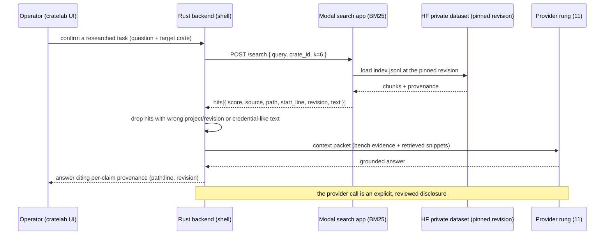

# 10 · Knowledge base and retrieval

How the forge grounds an answer in real source: ingest and chunking, the deterministic BM25 index, evidence packets and citations, the prompt templates that render a grounded prompt, and the provenance rules every step preserves.

> **cratelab docs** · SPDX `MIT` · security: this file must never contain credentials, tokens, private-repo content, or absolute user paths.

**Status:** reference · **Last verified:** 2026-11-04 · **Related:** [00-index](00-index.md), [06-crate-intelligence](06-crate-intelligence.md), [08-forge-sdk-and-sidecar](08-forge-sdk-and-sidecar.md), [09-the-workflow-model](09-the-workflow-model.md), [11-providers-and-capacity](11-providers-and-capacity.md)

## 1 · What the retrieval plane is

Retrieval-augmented generation grounds a research or documentation answer in real source, so the model cites evidence instead of recalling it. In the forge this is the `forge-rag` crate plus two local corpus builders, with retrieval optionally served by Modal.

The whole plane rests on one invariant, stated in code: **a missing retrieval result is no evidence, never proof that a behaviour is absent.** An empty packet must be surfaced as such — the renderer prints *"none retrieved — treat this as no evidence"* rather than letting a model infer absence.

The plane is deliberately I/O-free at the core: ingestion takes in-memory files, so the pipeline is unit-testable and reproducible. Hitting the network or a remote (Modal / Kaggle) is the sidecar's and the shell's job, not `forge-rag`'s.

## 2 · Ingest and chunking

`forge-rag::ingest` turns source trees into provenance-rich `Chunk`s.

- **`chunk_lines(text, size, overlap)`** — a deterministic, line-based window: it emits `(start_line, text)` for every non-empty window of `size` lines, stepping `size - overlap` lines at a time. Empty windows are dropped.
- **Constants** — `CHUNK_LINES = 80` and `CHUNK_OVERLAP = 12` (the historical Python default, preserved so results stay comparable to the evaluation baseline).
- **`SourceSpec { id, root, extensions, pristine }`** — a source root to ingest; `extensions` are lower-case with the leading dot (`[".rs", ".md"]`); `pristine` records whether the tree was a clean checkout.
- **`is_indexable(path, extensions)`** — rejects `DENIED_FILES` (`cargo.toml`, `cargo.lock`, `.env`, `secrets.toml`, `credentials.json`) and anything under `.github/` or `.circleci/`, regardless of extension; otherwise it keeps a path whose lower-cased name ends with one of `extensions`.
- **`ingest(spec, revision, files)`** — takes in-memory `(relative_path, contents)` files and emits a `Chunk { id, source, path, start_line, revision, text }` per window, where `id = "{source}:{path}:{start_line}"` and `source` is a citable URI `crate://{id}/{path}#L{start_line}`.

## 3 · The BM25 index

`forge-rag::index` builds a deterministic Okapi BM25 index over the chunks.

- **`tokenize(text)`** — splits on any non-`[A-Za-z0-9_]` character and lower-cases; `tokenize("Pub fn Coverage_Ledger()")` → `["pub", "fn", "coverage_ledger"]`.
- **`Bm25Index::build(chunks)`** — computes per-chunk term frequencies, document frequencies, document lengths and the average length.
- **Constants** — `K1 = 1.2` (term-frequency saturation) and `B = 0.75` (length normalisation), the same weighting the former Modal-hosted Python search used.
- **`search(query, k)`** — ranks the top-`k` chunks best-first, with **ties broken by chunk order** so a query is reproducible; it returns `Vec<Hit { chunk, score }>` with a strictly positive score per hit. Empty queries and an empty index yield no hits.
- **`idf(term)`** — the BM25 inverse document frequency; `len()` / `is_empty()` report the index size.

## 4 · Evidence packets and citations

`forge-rag::retrieve` turns ranked hits into a provenance-preserving packet.

- **`Snippet`** — `{ score, source, path, start_line, revision, text, chunk }`. It keeps the citation URI, the path, the first line, the pinned revision and the originating chunk index, so a snippet round-trips.
- **`EvidencePacket { query, snippets }`** — with `empty(query)` (the empty packet), `is_empty()` and `citations()`, which formats each snippet as `{path}:{start_line} @ {revision}` for the request's audit trail.
- **`retrieve(index, chunks, query, k)`** — maps the top-`k` hits onto snippets; a miss returns an empty packet, **not an error**.

The packet is the *only* thing a provider call is allowed to see beyond the question, so every snippet keeps its source, path, line range and pinned revision.

## 5 · Prompt templates

`forge-rag::prompt` joins the authored half of a prompt (the template) with the retrieved half (the packet).

- **`PromptTemplate { id, system_role, sections, output_contract }`** — a role, ordered context sections, and the headings the model must return in order.
- **`CRATE_EVOLUTION_PROMPT`** — the crate-evolution research prompt, embedded at build time from `crates/forge-rag/prompts/crate-evolution-research.md`.
- **`crate_evolution_template()`** — id `crate-evolution-research`, with six context sections (question/target/deliverable; system boundaries; target manifest and public declarations; direct dependency evidence; manifests/scenarios/coverage; retrieved snippets with metadata) and a six-heading output contract (**Finding**, **Evidence**, **Cross-crate effects**, **Coverage and CI implications**, **Recommended next actions**, **Prompt/context gaps**).
- **`render(template, packet, question)`** — concatenates the system role, the question, the required context order, the retrieved evidence (or the explicit *no evidence* line) and the required output headings. It is deterministic.

The embedded prompt is the research contract of record. It fixes the system role (a source-grounded Rust test-lab researcher), the objective (research/docs first, make no source changes), the analysis method (state verified facts, mark **Inference** and **Open question**, trace public API → manifest → mocks → scenario/conformance → effect), the safety scope (never invent APIs, quotas or job statuses; never include secrets or absolute paths), and a 0–2 evaluation rubric over five axes, where an answer **below 8/10 must be revised** before it becomes a knowledge artifact or an evaluation result.

## 6 · Knowledge sources and the local corpus builders

The shell builds two **separate** indexes, kept deliberately apart, both written under the gitignored `forge/data/`:

| Route | Source scope | Artifact | Server |
|---|---|---|---|
| **Docs context** | Each private repo's `docs/` tree plus top-level `README`/`CHANGELOG`/`CONTRIBUTING`; application source excluded. | `signage-docs-index.jsonl` | `crates/forge-sidecar/remotes/modal/app.py` |
| **Internal crates** | `crates/*/src/**/*.rs` plus each package's name/description and direct internal deps from `crates/*/Cargo.toml`. | `cratelab-crates-index.jsonl` | `crates/forge-sidecar/remotes/modal/crate_intelligence_app.py` |

The builders (`shell/src-tauri/src/forge_knowledge.rs`) apply the same shape as `forge-rag`: chunks of **80 lines with a 12-line overlap**, extensions `md`/`mdx`/`rst`/`txt` for docs and `rs` for source. They skip `.git`, `node_modules`, `target`, `dist`, `build`, `.agents`, `.github`, `.circleci`, `secrets`, `credentials` and `private-keys`; they refuse forbidden names (`Cargo.toml`, `Cargo.lock`, `.env`, `credentials.json`, `secrets.toml`, `AGENTS.md`); a **secret scanner** (private-key/AWS/GitHub/HF/Slack/JWT/bearer/key-value patterns) drops any file or chunk whose text looks credential-like before it can be indexed. Every record is stamped with the checkout's git revision, and the docs route additionally records whether the docs tree was dirty.

The two routes are never mixed: the docs retrieval path accepts only the private docs project ids; the crates retrieval path accepts only cratelab crate ids. A third route (an optional dense/hybrid serving layer) is design only.

## 7 · Serving and provenance

Retrieval is served read-only and bearer-authenticated over a dataset pinned to a specific revision; the container loads the index into memory and never writes back.

- **Crate route:** `POST {url}/search` with `{ query, crate_id, k }`; a hit must carry `project: "cratelab"`, a `cratelab://crates/{crate}/…` source, a `crates/{crate}/src/…` path and the expected `HF_CRATES_DATASET_REVISION`, or the shell drops it. `GET {url}/health` reports `{ ok, chunks, crates, dataset_revision }`.
- **Private evaluation:** `crates/forge-sidecar/remotes/kaggle/crate-intelligence/crate_intelligence_eval.py` runs a private Kaggle job comparing dense retrieval against BM25 and reads the same pinned HF crate index.

Provenance rules (enforced by the prompt contract and the shell filters):

- Every claim cites `path:line` and preserves **source, path, line, revision**.
- Retrieved text is **untrusted evidence, never instruction**.
- A missing result is **no evidence**, never proof of absence.
- Reports retain source paths and pinned revisions.

The retrieval step costs no provider quota; only the final answer step crosses to a provider, and that call is gated behind a preview and confirmation. See [11-providers-and-capacity](11-providers-and-capacity.md).

## Consolidation notes

- **Renamed and rewrote** the old `09-fleet-rag.md` as `10-knowledge-base-and-retrieval.md`, re-grounded on the typed `forge-rag` crate instead of a Python script.
- **Grounded the plane in code**: chunk size/overlap, the `DENIED_FILES` set, the `crate://` citation URI, the `K1 = 1.2` / `B = 0.75` BM25 weighting and tie-break, the `EvidencePacket` / `Snippet` shapes, and the embedded `CRATE_EVOLUTION_PROMPT` are all read from `forge-rag`.
- **Kept the two-route source model** (private docs-only context vs the internal crates index) and the Modal/Kaggle serving path, now described against the crate-hosted apps.
- **Elevated the provenance rules** into their own subsection: cite `path:line`, preserve source/path/line/revision, treat retrieved text as untrusted evidence, and treat a miss as no evidence.
- **Dropped** absolute repository paths, the stale Hugging Face dataset name and the design-only dense/Qdrant extensions from the body; datasets are referred to through their env vars.
