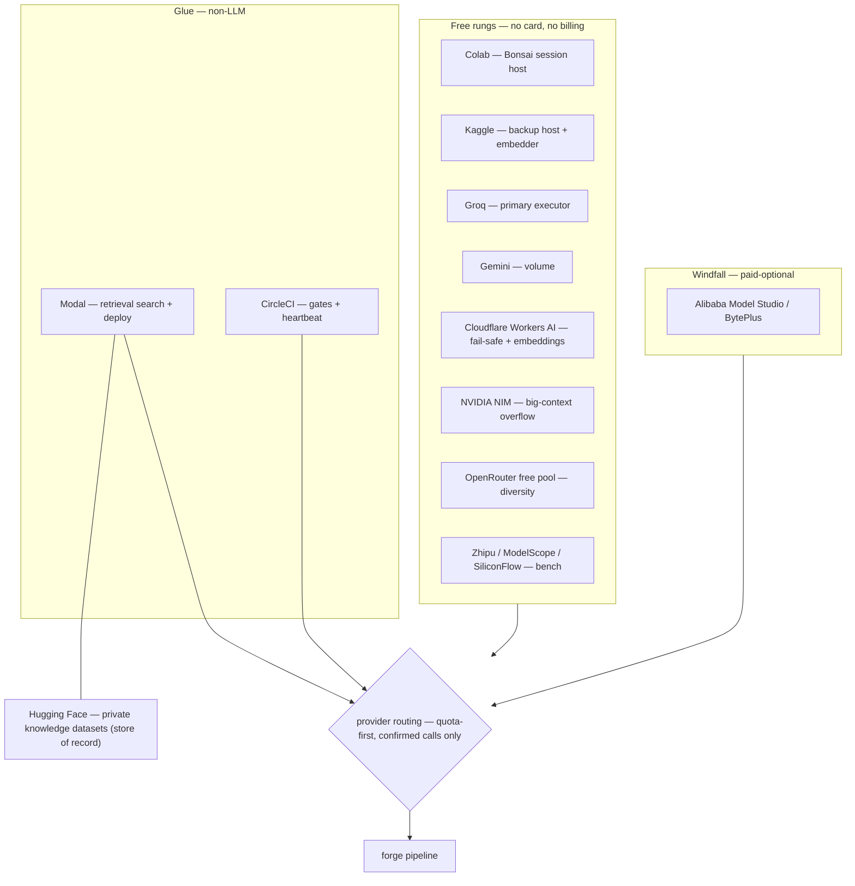

# 11 · Providers and capacity

Every model provider rung the forge can draw on — capabilities, free-tier limits and credential keys — plus the quantization and VRAM arithmetic that decides which models fit which free hardware.

> **cratelab docs** · SPDX `MIT` · security: this file must never contain credentials, tokens, private-repo content, or absolute user paths.

**Status:** live · **Last verified:** 2026-11-04 · **Related:** [00-index](00-index.md), [04-shell-and-ui](04-shell-and-ui.md), [07-the-forge](07-the-forge.md), [10-knowledge-base-and-retrieval](10-knowledge-base-and-retrieval.md), [12-operations](12-operations.md)

## 1 · Roster

The forge orders providers cheapest-first: **session GPU hosts** lead (a free GPU is the cheapest token available), then **free API executors**, then **windfall quotas**. Declaring a `Provider` performs no I/O — it records what is configured; a provider is only called through an attached `ProviderPort` after an operator confirms the request. Credential keys are referenced **by name only**; the setup link for each key lives in `crates/forge-core/forge.config.json → credential_guides`.



## 2 · Session GPU hosts

### 2.1 Colab — Bonsai host (primary)

- **Offers:** a free T4 GPU session on which the forge runs Ternary-Bonsai-2-27B (a ternary quantisation of a 27B dense model: 5.95 GB at PTQ1_0 / 7.21 GB at PQ2_0, 262K native context), served by a PrismML `llama.cpp` fork. With an existing Google AI Pro plan: monthly compute units, priority GPUs, longer runtimes.
- **Free-tier constraints:** free T4 sessions with an ~12 h cap and a shorter inactivity disconnect; the design is **session-batch** (boot → burn a few hours → save → stop), never a 24/7 endpoint.
- **How the forge uses it:** primary model host for crate-grounded work (whole-crate analysis, doc rewrites, release hygiene). The session endpoint is configured locally and only joins the forge after it is configured, probed and confirmed in a reviewed request.
- **Credential key:** `BONSAI_URL`.

### 2.2 Kaggle — backup host + embedder

- **Offers:** GPU notebooks (T4×2 / P100) and a weekly GPU-hour allowance; free **private** datasets for caching model assets.
- **Free-tier constraints:** GPU-hours are metered weekly; CPU-first jobs are the default for the crate-intelligence evaluation. Quotas vary by account and date — check the Kaggle settings page before scheduling.
- **How the forge uses it:** the optional embedding home turf and the backup Bonsai host; it also runs the private crate-intelligence evaluation job that compares dense retrieval with BM25 ([10](10-knowledge-base-and-retrieval.md)).
- **Credential keys:** `KAGGLE_BONSAI_URL`, `KAGGLE_KERNEL_ID`, `KAGGLE_API_KEY`.

## 3 · Free API executors

### 3.1 Groq — primary API executor

- **Offers:** fast OpenAI-compatible inference on open models. Executors used by the forge: `openai/gpt-oss-120b` (deep analysis, doc rewrites, research synthesis), `openai/gpt-oss-20b` (fast loop: triage, summarise, classify), a `qwen3.8-27b` executor (consistency checks against Bonsai's base family) and `allam-2-7b` (see §4.1). A free prompt-guard model acts as an inbound prompt-injection filter.
- **Free-tier limits (source claim, verified 2026-11-04):** `openai/gpt-oss-120b` = **30 RPM · 1,000 RPD · 8,000 TPM · 200,000 TPD**. Cached tokens do not count toward rate limits (byte-stable system prompts are effectively free quota); limits are enforced at the **organization** level, with `429` plus `retry-after` headers.
- **How the forge uses it:** the default executor for deep-analysis and documentation runs. Because `gpt-oss-120b` is token-limited (8K TPM) rather than request-limited, long inputs are map-reduced before sending.
- **Credential key:** `GROQ_API_KEY`.

### 3.2 Gemini API — volume executor

- **Offers:** free rows for a Flash model family with a large context window.
- **Free-tier constraints:** the official rate-limit docs publish **no universal RPD**; the widely quoted ~1,500 RPD is a **soft cap** used only as a router budget input — per-project limits are visible only in AI Studio, and RPD resets at midnight Pacific.
- **How the forge uses it:** the volume executor for long-context research digests and high-count fast-loop work.
- **Credential key:** `GEMINI_API_KEY`.

### 3.3 Cloudflare Workers AI — fail-safe rung + query embeddings

- **Offers:** a per-day Neuron allowance over a large model catalogue, reachable through the official OpenAI-compatible endpoint (`/ai/v1`), so no custom adapter is needed.
- **Free-tier constraints:** 10,000 Neurons/day, resets 00:00 UTC. The free plan **fails rather than bills** — exceeding the allowance requires an explicit paid signup, so an exhausted quota is a hard stop, not a charge.
- **How the forge uses it:** the fail-safe rung at the bottom of the ladder. Model IDs churn, so the exact ID is verified against the catalogue before use.
- **Credential keys:** `CF_ACCOUNT_ID`, `CF_API_TOKEN`.

### 3.4 NVIDIA NIM — big-context overflow

- **Offers:** an OpenAI-compatible endpoint with many open models and up to ~1M-token context.
- **Free-tier constraints:** limits are not published and model IDs drift, so the rung is never load-bearing; it is used only when a wider context is genuinely required.
- **Credential key:** `NVIDIA_API_KEY`.

### 3.5 OpenRouter — diversity executor

- **Offers:** a `:free` model pool plus an auto-router, giving model diversity without a paid plan.
- **Free-tier constraints:** 20 RPM and a hard 50 requests/day without a purchase; **failed attempts count** toward the daily cap, so the router caps retries at one for this rung.
- **Credential key:** `OPENROUTER_API_KEY`.

### 3.6 Zhipu — bench

- **Offers:** the `glm-*-flash` family on a permanent free tier with a large context window.
- **Free-tier constraints:** no published daily figure; an observed ceiling on the order of ~1k requests/day.
- **Credential key:** `ZHIPU_API_KEY`.

### 3.7 ModelScope / SiliconFlow — bench

- **Offers:** ModelScope offers free daily API-inference calls for signed-in users; SiliconFlow offers a free model set.
- **Free-tier constraints:** ModelScope's daily call count should be confirmed in-console; SiliconFlow requires mainland-phone SMS and identity verification. Both are bench-only rungs.
- **Credential keys:** `MODELSCOPE_TOKEN`; **SiliconFlow: no guide configured** in `forge.config.json`.

## 4 · Optional and windfall rungs

### 4.1 allam-2-7b (via the Groq console)

Present on the operator's Groq console snapshot at 30 RPM · 7K RPD · 500K TPD — the largest request budget on the account. It does **not** appear in Groq's general rate-limit documentation, so it may be withdrawn; the rung is optional, never load-bearing (trivial bulk only).

### 4.2 Alibaba Model Studio / BytePlus (Doubao)

Per-model new-user free quotas. **Windfall only** — used opportunistically, never scheduled around. **No guide configured** in `forge.config.json`.

### 4.3 Hugging Face (storage, not inference)

GGUF hosting and free **private** dataset repositories — the forge's knowledge store of record. It stores the pinned corpus datasets the retrieval path reads ([10](10-knowledge-base-and-retrieval.md)). Credential keys: `HF_TOKEN`, `HF_TOKEN_WRITE`, `HF_READ_TOKEN`, `HF_DATASET_REPO`, `HF_CRATES_DATASET_REPO`.

### 4.4 Modal and CircleCI (glue, non-LLM)

- **Modal** hosts the authenticated, read-only retrieval search apps and the deploy glue; it never burns inference quota. Credential keys: `MODAL_TOKEN_ID`, `MODAL_TOKEN_SECRET`, `MODAL_SEARCH_URL`, `CRATE_INTEL_MODAL_SEARCH_URL`.
- **CircleCI** runs the fmt/clippy/test/rustdoc gates and a heartbeat, read-only. Credential keys: `CIRCLECI_TOKEN`, `CIRCLECI_PROJECT_SLUGS`.

### 4.5 Qdrant Cloud (optional serving layer)

A free forever single-node cluster. An **optional** retrieval serving layer, not part of the active lexical pilot ([10](10-knowledge-base-and-retrieval.md)). Credential keys: `QDRANT_URL`, `QDRANT_API_KEY`.

## 5 · Capability and limit matrix

| Provider | Free limits | Best-fit task |
|---|---|---|
| Colab (Bonsai 27B) | free T4 session, ~12 h cap | whole-crate analysis, doc rewrites, release hygiene |
| Kaggle | metered weekly GPU-hours | embedding experiments, backup host, retrieval eval |
| Groq `gpt-oss-120b` | 30 RPM · 1K RPD · 8K TPM · 200K TPD (source claim); cached tokens free | deep analysis, research synthesis |
| Groq `gpt-oss-20b` | same class as 120b | fast loop: triage, summarise, classify |
| Groq `qwen3.8-27b` | same class | consistency checks vs Bonsai's base family |
| Gemini API | soft cap ~1,500 RPD (AI Studio is truth) | volume: long-context digests |
| Cloudflare Workers AI | 10,000 Neurons/day, resets 00:00 UTC; fails, never bills | fail-safe rung + query embeddings |
| NVIDIA NIM | unpublished, IDs drift | big-context overflow |
| OpenRouter | 20 RPM · 50/day; failed attempts count | diversity |
| Zhipu `glm-flash` | permanent free, ~1k/day observed | bench |
| ModelScope | free daily calls (verify console) | bench |
| SiliconFlow | free set, CN phone required | bench |
| allam-2-7b | 30 RPM · 7K RPD · 500K TPD (console) | trivial bulk (optional) |
| Alibaba / BytePlus | new-user quotas | windfall overflow |
| Hugging Face | free private datasets | knowledge store |
| Modal | free-tier credits + cron | retrieval search + deploy |
| CircleCI | free-credits tier | gates + heartbeat |
| Qdrant Cloud | free single node | optional serving layer |

`forge_status` surfaces the per-provider daily caps for the keyed rungs (`gemini`, `groq`, `cloudflare`, `openrouter`) and the policy flags. Free-tier limits are account-specific and can change: **a local cap does not prove a provider's free allowance** — check the account dashboard.

## 6 · Circuit breaker and "fails, not bills"

Two safety behaviours keep a free ladder from turning into a cost or a hang:

- **Circuit breaker.** The router counts consecutive failures per rung; after **three** consecutive failures a rung is tripped into a **30-minute cooldown** and skipped. Quota walls are treated as explicit signals (`HTTP 402/403/429`), and the router spends at most **80 %** of any published daily budget before moving on. The router only ever calls providers that have been configured, probed and confirmed.
- **Fails, not bills.** Cloudflare's free plan rejects requests once the Neuron allowance is exhausted rather than silently charging — the forge's designated fail-safe rung for exactly this property. The general rule is that the forge never schedules paid usage.

## 7 · Capacity: what fits which hardware

### 7.1 Why capacity matters

The Bonsai rung is served by a **session** (a Colab or Kaggle notebook), not downloaded locally: the session serves whatever fits its accelerator, and the model picker is driven by what the session's `/models` reports plus a hardware-capability hint (`shell/src/bonsai-models.ts`). Capacity therefore decides which tasks can run on the Bonsai rung at all; everything else falls to the API ladder above.

### 7.2 The Bonsai fit (correction)

Ternary-Bonsai-2-27B **PQ2_0 is ~7.21 GB and fits a free T4 (15 GB usable)** — that fit is the entire reason the Colab plan works. The 27B size class is normally A100-only *for a dense FP16 model* (~54 GB); Bonsai is a ternary packing, so it is not. The shipped picker maps **T4 → 27B (fits)**, **L4 / A100-40 → 30–32B**, **A100-80 / G4 → 70B / 120B**.

### 7.3 The hardware a Colab session hands you

Google publishes no guaranteed GPU/RAM numbers; limits fluctuate by demand and account. Treat these as recent measurements, not entitlements — verify a session with `!nvidia-smi` and `!free -g` before choosing a model.

| Tier / accelerator | Usable VRAM | Host RAM | Session |
|---|---|---|---|
| **Free — T4 (Turing)** | **15 GB** (marketed 16 GB; ~1 GB reserved) | ~12.7 GB | ≤ 12 h, pre-emptible |
| **Pro / PAYG — T4, L4, A100-40** | 15 / 22.5 / 40 GB | ~25–32 GB (High-RAM) | ≤ 24 h |
| **Pro+ — A100 40/80, priority GPUs** | 40 / 80 GB | up to ~51–52 GB | ≤ 24 h incl. background |
| **G4 — RTX PRO 6000 (Blackwell)** | **~96 GB** | High-RAM | ~8.71 CU/h |
| **H100 (Hopper, 80 GB)** — rarely granted | 80 GB | High-RAM | rate not published |
| **Kaggle (backup host)** | 2× T4 ≈ 30 GB, or P100 16 GB | ~29 GB | 30 GPU-h/week, 12 h sessions |
| **CPU session** | 0 | — | not usable for crate audits |

Disk is temporary and varies widely; check `!df -h` before pulling a large GGUF. Host RAM matters most for `llama.cpp` CPU-offload spillover, not the file itself (GGUF is mmapped).

### 7.4 The memory arithmetic

```
total VRAM ≈ weights (quantised file size)
           + ~0.5–1.5 GB runtime overhead (CUDA ctx, buffers, compute)
           + KV cache
           + safety reserve (~1–2 GB)

KV bytes/token = 2 × layers × kv_heads × head_dim × dtype_bytes
```

Worked KV sizes (dense transformers, fp16 KV; halve with `--cache-type-k/v q8_0`):

| Model | KV bytes/token | 16K ctx | 32K ctx | 128K ctx |
|---|---|---|---|---|
| Qwen2.5-Coder-7B (28 L, 4 KV heads) | 28.7 KB | 0.47 GB | 0.94 GB | 3.8 GB |
| Qwen2.5-Coder-14B (48 L, 8 KV) | 98.3 KB | 1.6 GB | 3.2 GB | 12.9 GB |
| Qwen2.5-Coder-32B / Qwen3-30B-A3B (64 L, 8 KV) | 131 KB | 2.1 GB | 4.3 GB | 17.2 GB |
| Llama-3.x 70B (80 L, 8 KV, GQA) | 164 KB | 2.7 GB | 5.4 GB | 21.5 GB |

**Rule of thumb: pick a quant whose file size is 1–2 GB smaller than usable VRAM, then spend the rest on context.** Every GB spent on a bigger model is a GB not spent on context: 32K of usable context on a well-fitting model beats 4K on a model that barely loads.

**Why Bonsai is the outlier.** Ternary-Bonsai-2-27B is a *ternary* ({−1, 0, +1}) packing of a 27B dense model: **PTQ1_0 = 5.95 GB**, **PQ2_0 = 7.21 GB** (vs ~54 GB at FP16), with ~98.2 % benchmark retention and a 262,144-token native context. Its hybrid attention (~75 % linear / ~25 % full) keeps the KV cache per token far smaller than a dense 32B. That is why a 27B model normally sized for an A100 runs on a free T4. It requires the PrismML `llama.cpp` fork — stock `llama.cpp` cannot load PTQ1_0/PQ2_0.

### 7.5 Capacity table

"Fits" = weights + runtime overhead + a useful KV budget inside usable VRAM. Approximate sizes only; verify against the actual GGUF.

| Model | Quant | ~Weights | Target hardware | Fits? |
|---|---|---|---|---|
| **Ternary-Bonsai-2-27B** | **PQ2_0** | **7.21 GB** | **free T4 15 GB (default)** | **✅ 262K native ctx** |
| Ternary-Bonsai-2-27B | PTQ1_0 | 5.95 GB | free T4 15 GB | ✅ (more KV headroom) |
| Ternary-Bonsai-2-27B | PQ2_0 | 7.21 GB | L4 / A100-40 / A100-80 / G4 | ✅ (room to spare) |
| Qwen2.5-Coder-14B-Instruct | Q4_K_M | ~8.4–9.8 GB | free T4 15 GB | ✅ (~32K with q8_0 KV) |
| Qwen2.5-Coder-7B-Instruct | Q4_K_M | ~4.7 GB | free T4 15 GB | ✅ (fast triage/draft) |
| gpt-oss-20b | MXFP4 | 12.8 GB | free T4 15 GB | ⚠️ tight (~14.6 GB all-in → short ctx) |
| Qwen3-Coder-30B-A3B-Instruct | Q4_K_M | 17.3 GB | L4 22.5 GB | ✅ (~22 GB @16K) |
| Qwen2.5-Coder-32B-Instruct | Q4_K_M | ~18.6 GB | L4 22.5 GB | ✅ tight (16–24K ctx) |
| Qwen2.5-Coder-32B / Qwen3-Coder-30B-A3B | Q6_K / Q8_0 | 26–31 GB | A100-40 | ✅ (32K+ ctx) |
| Llama-3.3-70B-Instruct | Q4_K_M | ~40 GB | A100-40 | ⚠️ trap (weights eat the card → ~4K ctx) |
| Llama-3.3-70B-Instruct | Q3_K_S | ~30 GB | A100-40 | ⚠️ ~8–16K ctx, degraded |
| Llama-3.3-70B-Instruct | Q4_K_M | ~40 GB | A100-80 / H100 | ✅ (~100K+ ctx) |
| gpt-oss-120b | MXFP4 | ~61–63 GB | A100-80 / H100 | ✅ tight (~15 GB KV) |
| GLM-4.5-Air 106B (A12B MoE) | Q4_K_M | ~64–69 GB | A100-80 / H100 | ✅ tight (8–32K) |
| Mistral-Large-2 123B | Q4 | ~68 GB | A100-80 / H100 | ✅ tight |
| gpt-oss-120b | MXFP4 | ~61 GB | G4 96 GB | ✅ (~30 GB KV → 32K+ ctx) |
| GLM-4.5-Air 106B / Mistral-Large-2 123B | Q4_K_M / Q4 | ~64–69 GB | G4 96 GB | ✅ comfortable |
| Llama-3.1-405B | Q4_K_M | ~230–256 GB | any Colab tier | ❌ unloadable |
| 150B+ dense / 405B-class | any usable quant | exceeds card + host RAM | any Colab tier | ❌ unloadable |

Kaggle (backup): Qwen2.5-Coder-32B Q4_K_M splits across 2× T4; Bonsai 27B fits one card, leaving the second free for embeddings. **30 GPU-h/week** is the binding constraint.

### 7.6 The ceiling, stated plainly

| Question | Answer |
|---|---|
| Can Colab serve **Bonsai 27B** for coding? | **Yes — on the free T4.** 7.21 GB (PQ2_0) / 5.95 GB (PTQ1_0); 262K context; ~98 % quality retention. |
| Is the ceiling 50B+ or 150B+? | **~120B-class MoE** on A100-80 / G4-96 (gpt-oss-120b, GLM-4.5-Air 106B, 123B Mistral-Large-2). **Not 150B+.** 405B-class is unreachable on every Colab tier. |
| Best *usable* dense ceiling | 70B at Q4_K_M with long context, on A100-80 or better. On A100-40 a 70B loads but has ~4K context — unusable for repo analysis. |
| Hard wall | Weights + KV + overhead ≤ usable VRAM, and CPU offload capped by host RAM (~12.7 GB free / ~51 GB Pro+). 405B Q4_K_M (~230–256 GB) fails both. |

### 7.7 How capacity constrains the forge

- **Default assignment.** Cleanup, docs, knowledge and release-hygiene tasks run on **Bonsai 27B PQ2_0 on whatever T4 you get**, at `-c 32768` with `--cache-type-k/v q8_0`, `--parallel 2`, and PTQ1_0 as the OOM fallback — zero marginal cost.
- **When generation quality is the bottleneck** (a hard rewrite, a borrow-checker fix), step up to Qwen3-Coder-30B-A3B Q4_K_M on an L4, or Qwen2.5-Coder-32B on an A100-40.
- **Rare justified bursts** (gpt-oss-120b MXFP4 on A100-80/G4) are expensive per compute-unit and cost a large per-session download unless cached — batch them, do not loop on them.
- **Batching.** Because KV cost scales with context and a session is time-boxed, briefs are cache-first and context-budgeted: whole-crate analysis at 16–32K per call, a small number of parallel streams. Tasks that do not fit are routed to the API ladder rather than forced onto the session.
- **Do not plan around** 70B-dense on A100-40, 150B+, or 405B-class — they are context-starved or unloadable.

### 7.8 The picker mapping (verified in code)

`shell/src/bonsai-models.ts` exposes tiers with usable VRAM and the models that fit, and classifies a served model id against the detected tier (`fits` / `trap` / `too-large`).

| Tier | Usable VRAM | Recommended |
|---|---|---|
| Colab free · T4 | 15 GB | Bonsai 27B PQ2_0; Qwen2.5-Coder-14B/7B |
| Colab Pro/PAYG · L4 | 22.5 GB | Qwen3-Coder-30B-A3B or Qwen2.5-Coder-32B Q4_K_M |
| Colab Pro/Pro+ · A100-40 | 40 GB | 30–32B at Q6_K/Q8_0 (70B is a trap) |
| Colab Pro+ · A100-80 / H100 | 80 GB | Llama-3.3-70B Q4_K_M; gpt-oss-120b tight |
| Colab G4 · RTX PRO 6000 | 96 GB | gpt-oss-120b; GLM-4.5-Air 106B; Mistral-Large-2 123B |
| Kaggle backup · 2× T4 | 30 GB | Bonsai 27B (one card); 32B split |

A `bonsai` model id ≤ 27B is treated as a **15 GB** model, so it fits any tier with ≥ 15 GB.

## 8 · Credentials

Credentials live only in the ignored `forge/.env` (see [12-operations](12-operations.md)). Secret values are never returned to the UI, and an existing value is preserved when a secret input is left blank. Provider fields surface their official setup link (from `forge.config.json → credential_guides`) when missing. All credentials are referenced **by name only**; never paste a value into a report, commit, chat or doc.

## Consolidation notes

- **Merged** `08-fleet-providers.md` and `11-model-capacity.md` into one doc: a rung-per-subsection provider reference plus the capacity/quantization/VRAM material, both source files deleted.
- **Kept the verified Groq claim** (`openai/gpt-oss-120b` = 30 RPM / 1,000 RPD / 8,000 TPM / 200,000 TPD; cached tokens free; organization-level) labelled as a source claim, and kept the circuit-breaker (3 failures → 30-minute cooldown; 402/403/429 walls; 80 % budget ceiling) and the Cloudflare "fails, not bills" property.
- **Kept the corrected Bonsai fit** (§7.2): 27B PQ2_0 ≈ 7.21 GB fits a free T4, with the picker mapping verified against `shell/src/bonsai-models.ts`.
- **Referenced credentials by name only** and pointed every setup link at `forge.config.json → credential_guides`, dropping all inline secret examples, absolute paths and the stale env-file location.
- **Marked SiliconFlow, Alibaba and BytePlus as "no guide configured"** rather than inventing one, and dropped the elaborate CU-burn sourcing notes while keeping the measured hardware table.
