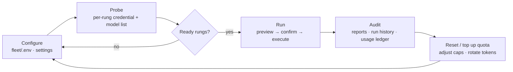

# 12 · Operations

Day-to-day running of the fleet: environment and credential handling, MOCK vs LIVE, quota safety, the field-test procedure, and how to audit what a run actually did.

> **cratelab docs** · SPDX `MIT` · security: this file must never contain credentials, tokens, private-repo content, or absolute user paths.

**Status:** live · **Last verified:** 2026-11-04 · **Related:** [00-index](00-index.md), [04-shell-and-ui](04-shell-and-ui.md), [08-fleet-providers](08-fleet-providers.md), [10-fleet-workflows](10-fleet-workflows.md), [11-model-capacity](11-model-capacity.md)

## 1 · Environment setup

The fleet runs inside the desktop shell (`shell/`, a standalone Cargo workspace) over the cratelab lab core. Setup is file-driven and local-first:

1. **Workspace roots.** `fleet/config.json` defines the selectable repositories `tv-rs` and `cctv-rs` (`path_env` + `default_root`) and the single `target` (`tv-rs`, `crate_dir: crates/*`, `batch_size: 3`). Roots are resolved from the process environment first (`TV_RS_ROOT`, `CCTV_RS_ROOT`), then `fleet/.env`.
2. **Env file.** Copy `fleet/.env.example` to `fleet/.env` and fill the cells locally. `fleet/.env` is gitignored; `fleet/.env.example` is the committed template.
3. **Build.** `cargo check` / `cargo test` for the shell's Rust side; `bun run tauri dev` to launch the desktop app (see [04-shell-and-ui](04-shell-and-ui.md) for the stack and view inventory).
4. **Verify.** Launch, open **Providers & credentials**, and confirm each rung's readiness chip before running anything with a provider call.

## 2 · Credentials and the env file

**Where credentials live.** All provider secrets live in the ignored `fleet/.env`, keyed by name only (never values). The committed `fleet/.env.example` lists every key, including: `GEMINI_API_KEY`, `GROQ_API_KEY`, `CF_ACCOUNT_ID`, `CF_API_TOKEN`, `NVIDIA_API_KEY`, `OPENROUTER_API_KEY`, `ZHIPU_API_KEY`, `MODELSCOPE_TOKEN`, `BONSAI_URL`, `KAGGLE_BONSAI_URL`, `HF_TOKEN` / `HF_TOKEN_WRITE` / `HF_READ_TOKEN`, `MODAL_SEARCH_URL` / `MODAL_SEARCH_TOKEN`, `CRATE_INTEL_MODAL_SEARCH_URL` / `CRATE_INTEL_MODAL_SEARCH_TOKEN`, `QDRANT_URL` / `QDRANT_API_KEY`, `CIRCLECI_TOKEN` / `CIRCLECI_PROJECT_SLUGS`, `KAGGLE_API_KEY` / `KAGGLE_KERNEL_ID`, `GH_TOKEN`. Per-key setup links come from `fleet/config.json` → `credential_guides`.

**How credentials are injected.** `fleet_env_value(name)` reads the process env var first, else parses `fleet/.env` (stripping a leading `export ` and surrounding quotes). Writing goes through `fleet_save_settings`, which rejects any key not in the allow-listed set (`FLEET_SETTINGS_KEYS`, ~35 keys, each tagged `secret`) with `unsupported setting: {key}`.

**The rule: secret values never leave Rust.** Secrets are read only to test whether a variable is populated. `fleet_settings_snapshot()` returns `{ key, secret, configured, value, setup_url }`; for any `secret: true` key, `value` is **always `null`** — the UI only ever sees a boolean `configured`. Blank secret inputs preserve the existing value. `MODAL_TOKEN_ID` / `MODAL_TOKEN_SECRET` are special-cased: "configured" means a local `fleet/.modal-config` profile file exists, not an env var. HF and Modal CLI profiles stay local; secret transfer to Modal happens only inside the confirmed deploy flow. Full mechanics: [04-shell-and-ui](04-shell-and-ui.md).

> Never paste a value into a report, a commit, a chat, or a doc. Docs reference credentials **by name only**.

## 3 · MOCK vs LIVE

| Mode | How to tell | What it means |
|---|---|---|
| **MOCK** | header chip `[MOCK]` (`live = env !== "" && env !== "mock"`) | Local evidence, deterministic scenarios and the mock fleet only. No provider call, no network spend. |
| **LIVE** | header chip `[LIVE]` | Provider-backed analysis may run — but only after an explicit preview + confirmation. |

The device backend is `mock` in the current build: `set_backend` returns a typed `capability` refusal ("hardware adapter lands in v0.2"), so nothing pretends hardware is wired. Provider-backed analysis is a distinct switch from device simulation — a workflow never silently changes provider or write behaviour. **Every configured provider request requires a preview and an explicit confirmation**, and the preview shows files, size, route and a cost note.

## 4 · Cost, quota safety and circuit breakers

- **Nothing costs silently.** Each provider request is previewed and confirmed. Provider quotas and billing terms are account-specific and can change: **local caps do not prove a provider's free allowance** — check account dashboards and keep spend controls enabled if the goal is zero out-of-pocket cost.
- **Failover is bounded.** Automatic failover is restricted to providers that (a) are configured, (b) previously passed a probe, and (c) have remaining local request budget. A rung that fails its probe or exhausts its budget is skipped — that is the circuit breaker. Failover never invents a route that was not configured.
- **Budget accounting.** A run records its requests/tokens/status into a usage ledger (e.g. a provider-audit run books `colab-bonsai: 2 requests / 640 tokens / status 200`). The ledger is the source of truth for "did this cost anything?".
- **Failure classification.** Run failures classify as **transient** (429/timeout → retry on the next rung), **permanent** (bad brief → fix the template), or **usage** (budget exhausted → reschedule). This mirrors the research method the fleet applies to third-party code.

## 5 · The ops loop

## 6 · Field-test procedure (reproducible checklist)

This procedure has **not yet been executed end-to-end**; the steps below are the checklist.

**Prerequisites.**
- [ ] A Bonsai-compatible endpoint. For a dry test, run a local fake OpenAI-compatible server on `127.0.0.1:18001` exposing `/models` (list shape) and `/chat/completions`.
- [ ] `fleet/.env` set with `BONSAI_URL` (and `KAGGLE_BONSAI_URL`) pointing at that endpoint.
- [ ] The app running with a debug/`CDP` port open for inspection.

**Steps.**
1. **Provider config** (Providers & credentials): set `BONSAI_URL` (and `KAGGLE_BONSAI_URL`) and Save; confirm Fleet Status shows the rungs' credentials as present.
2. **Probe** (Workflows → Providers & infrastructure): probe the rungs; confirm the `colab-bonsai` row discovers the served model IDs and that the `kaggle-bonsai` row reads as a backup host whose session URL changes.
3. **Dry run + report** (Workflows → Case workbench): run a local dry run (e.g. `cross-language-research` on a crate) and confirm the report; then run a **live provider audit** with confirmation and confirm the ledger entry and the report file.
4. **Real session** (not yet done): point `BONSAI_URL` at a real Colab/Kaggle `llama-server` tunnel; the probe contract is only `/models` + list shape. (`KAGGLE_BONSAI_URL` + kernel id for the Kaggle host.)

**About the helper script.** An earlier field-test note referred to a throwaway `fake_bonsai.py` local HTTP stub. That helper was a **development throwaway** — a small local HTTP stub, not part of the fleet runtime and not referenced by any shipped code — and has been removed from the repository. The manual equivalent is to run any OpenAI-compatible server locally that answers `/models` with a model list and `/chat/completions`, then point `BONSAI_URL` at it; the real path is a Colab/Kaggle session tunnel.

## 7 · Write permissions, forbidden paths, and auditing a run

**Write permissions** (`fleet/config.json` → `execution`): `network: true`, `provider_calls: true`, **`github_writes: false`**, **`target_writes: false`**. The fleet never writes to GitHub and never edits a target repository; every external change stays human-reviewed and human-merged. HF upload and Modal deploy are **separate, explicitly confirmed** actions — building or validating a local index never triggers them.

**Forbidden paths** (`fleet/config.json` → `forbidden_paths`): `Cargo.toml`, `Cargo.lock`, `.github/**`, `.circleci/**`. The corpus/index tools apply a wider exclusion set as well (skip `target`, `.git`, `node_modules`, `.env`, secrets/credential artifacts, and CI directories — see [09-fleet-rag](09-fleet-rag.md)).

**Auditing a run.**
- Reports land under `fleet/reports/` (`dry-run-…` and `provider-audit-…`); they are **gitignored/untracked**. Read them via the Reports view (`fleet_reports` / `fleet_read_report`) or "Reveal in Explorer" (`fleet_open_report`). Reports retain source paths and pinned revisions.
- Run history lives under `fleet/state/` (e.g. `runs.json`) — also gitignored.
- The usage ledger and the run transcript record prompts, RAG hits, raw output, diff, verdict, rung and status.
- **Known collision:** field-test runs overwrite the same `{repository}-{crate}-{task}` report filename, and `fleet/reports/` is untracked — clear or version the directory between runs if you need history.

## 8 · Troubleshooting

| Symptom | Likely cause | Remedy |
|---|---|---|
| Colab session dies mid-batch | free-tier pre-emption / 12 h cap | fail over to the Kaggle rung or the Gemini fallback; never wait on a GPU |
| Bonsai won't load | stock `llama.cpp` cannot read PTQ1_0/PQ2_0 | use the PrismML `llama.cpp` fork; keep both GGUFs cached |
| 429 arrives early on Gemini | the soft cap is not the real per-project RPD | read the real number in AI Studio and edit the ladder cap |
| Cloudflare fails at low volume | model-ID churn | re-check the model search endpoint; recalibrate the neuron estimate from the ledger |
| `compound` 429s | it is 1 deep-dive/day by policy | keep it a deep-dive tool, not a loop driver |
| Groq dies mid-day | the 8K TPM ceiling, not RPD | split briefs; keep system prompts byte-stable (cached prefixes are quota-free) |
| Everything is down | multiple rungs exhausted | the response cache + bench rungs carry the work; skipping a day is acceptable |
| Probe crashes on a slow target | DNS name taking >1 s hits the `checked_at` tick (FIELD-TEST open item) | prefer a literal endpoint; tests assert ok/status/models/summary/destination, not timestamps |
| App exits mid-launch | `beforeDevCommand` race | restart the app |
| Report looks overwritten | same `{repo}-{crate}-{task}` filename | treat reports as untracked; version or clear `fleet/reports/` |

## Consolidation notes

- **Dropped the helper script and its field-test note:** a dev-only `fake_bonsai.py` stub was referenced by the old field test; it is a throwaway and was removed, so the manual equivalent (any OpenAI-compatible `/models` + `/chat/completions` endpoint, or the real Colab/Kaggle tunnel) is documented instead.
- **Merged** `fleet/README.md` operations content (credentials, HF/Modal separation, CircleCI read-only, private-docs boundary) with `docs/FIELD-TEST.md` and `docs/proposal-final-execution-plan.md` §6–7 (ledger, forbidden paths, fast triage) into one ops doc.
- **Ground-truthed** write flags and forbidden paths against `fleet/config.json` (`github_writes: false`, `target_writes: false`; forbidden paths = `Cargo.toml`, `Cargo.lock`, `.github/**`, `.circleci/**`) rather than the plan's longer list.
- **Stated honestly** that the field test is **not executed end-to-end** and that `fleet/reports/` + `fleet/state/` are untracked, including the report-overwrite collision from the source.
- **Dropped** the plan's home-directory env path and `state/ledger.json` / `usage.jsonl` paths (not in this repo) and any script claims I could not find — the live equivalents are `fleet/.env` and `fleet/state/`.
