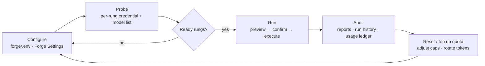

# 12 · Operations

Day-to-day running of the forge: the `forge/` runtime home, the `forge_*` IPC commands, crate-hosted assets, MOCK vs LIVE, quota safety, the field-test procedure, and how to audit what a run actually did.

> **cratelab docs** · SPDX `MIT` · security: this file must never contain credentials, tokens, private-repo content, or absolute user paths.

**Status:** live · **Last verified:** 2026-11-04 · **Related:** [00-index](00-index.md), [04-shell-and-ui](04-shell-and-ui.md), [08-forge-sdk-and-sidecar](08-forge-sdk-and-sidecar.md), [11-providers-and-capacity](11-providers-and-capacity.md)

## 1 · The runtime home: `forge/`

Read-only **engine assets** live inside the `crates/forge-*` crates ([08](08-forge-sdk-and-sidecar.md)). Only **mutable runtime data** lives in `forge/`, the gitignored home at the workspace root (`forge_dir() = workspace_root().join("forge")`):

| Path | Purpose | Tracking |
|---|---|---|
| `forge/.env` | Local secrets, keyed by name. The committed template is `forge/.env.example`. | gitignored |
| `forge/state/` | `settings.json`, `runs.json`, `probes.json`, `usage.json`. | gitignored |
| `forge/reports/` | `dry-run-*` and `provider-audit-*` reports. | gitignored |
| `forge/data/` | `signage-docs-index.jsonl`, `cratelab-crates-index.jsonl` (+ `.manifest.json`). | gitignored |
| `forge/.kaggle-venv/` | The optional Kaggle CLI virtual environment. | gitignored |
| `forge/.modal-config`, `forge/.modal-home/` | Local Modal CLI profile. | gitignored |
| `forge/.modal-secret-*.env`, `forge/.env-draft` | Transient deploy/secret staging files. | gitignored |

An asset that ships in a crate is addressed from the workspace root by one helper: `engine_asset(relative) = workspace_root().join(relative)`. Rust resolves the workspace root from its own manifest directory, so the UI never shows a `..`-laden path and no absolute user path is committed.

## 2 · Environment setup

The forge runs inside the desktop shell (`shell/`, a standalone Cargo workspace) over the cratelab lab core. Setup is file-driven and local-first:

1. **Workspace roots.** Targets are selected as repositories (`tv-rs`, `cctv-rs`); roots resolve from the process environment first (`TV_RS_ROOT`, `CCTV_RS_ROOT`, `SIMPLE_SIGNAGE_ROOT`, `COMPANION_APP_ROOT`), then `forge/.env`. The default target is `tv-rs` with crate glob `crates/*`.
2. **Env file.** Copy `forge/.env.example` to `forge/.env` and fill the cells locally. Both are gitignored; the shell creates the file on first save.
3. **Build.** `cargo check` / `cargo test` for the shell's Rust side; `bun run tauri dev` to launch the desktop app (see [04-shell-and-ui](04-shell-and-ui.md)).
4. **Verify.** Launch, open **Forge Settings**, and confirm each rung's readiness chip before running anything with a provider call.

## 3 · The `forge_*` IPC commands

The shell exposes the forge to the UI as a small set of focused commands:

| Command | What it does |
|---|---|
| `forge_get_settings` / `forge_save_settings` | Read/write the keyed settings snapshot; `forge_save_settings` rejects any key not in the allow-list. |
| `forge_status` / `forge_dashboard` | Status + dashboard: selected repository, targets, providers, runs, usage, policy flags, daily caps. |
| `forge_catalog` | The engine's authored registries — the workflow registry (`forge.workflows.toml`) and the task catalog (`forge.tasks.toml`) — served straight from `forge-core`. |
| `forge_select_repository` / `forge_select_provider` / `forge_select_model` | Persist the current selection into `forge/state/`. |
| `forge_probe_provider` | Probe a rung's credential and model list (e.g. a Bonsai session's `/models`). |
| `forge_dry_run` | Build a local case packet and report — no provider call. |
| `forge_preview_live` / `forge_generate_audit` | Preview a live request (files, size, route, cost note), then run it after explicit confirmation. |
| `forge_run_tool` | Run one local tool action (see below). |
| `forge_crate_research_prompt` / `forge_search_crate_knowledge` | Render the crate-evolution prompt for a crate/task; query the crate-intelligence retrieval route. |
| `forge_circleci_dashboard` | Read-only CircleCI operations summary (never starts a pipeline or writes files). |
| `forge_reports` / `forge_read_report` / `forge_open_report` | List, read and reveal run reports. |

`forge_run_tool` dispatches one action at a time. The actions are: `build-signage-index`, `validate-signage-index`, `build-crate-intelligence-index`, `validate-crate-intelligence-index`, `check-hf-token`, `upload-signage-index`, `upload-crate-intelligence-index`, `deploy-modal-search`, `deploy-crate-intelligence-search`, `check-crate-intelligence-search`, `kaggle-crate-intelligence-status`, `submit-kaggle-crate-intelligence`. Upload and deploy actions are reachable only from their explicit review dialogs; building or validating an index never triggers them.

## 4 · Credentials and the env file

**Where credentials live.** All secrets live in the ignored `forge/.env`, keyed by name only (never values). The committed template lists every key, including `GEMINI_API_KEY`, `GROQ_API_KEY`, `CF_ACCOUNT_ID`, `CF_API_TOKEN`, `NVIDIA_API_KEY`, `OPENROUTER_API_KEY`, `ZHIPU_API_KEY`, `MODELSCOPE_TOKEN`, `BONSAI_URL`, `KAGGLE_BONSAI_URL`, `HF_TOKEN` / `HF_TOKEN_WRITE` / `HF_READ_TOKEN`, `MODAL_SEARCH_URL` / `MODAL_SEARCH_TOKEN`, `CRATE_INTEL_MODAL_SEARCH_URL` / `CRATE_INTEL_MODAL_SEARCH_TOKEN`, `QDRANT_URL` / `QDRANT_API_KEY`, `CIRCLECI_TOKEN` / `CIRCLECI_PROJECT_SLUGS`, `KAGGLE_API_KEY` / `KAGGLE_KERNEL_ID`, `GH_TOKEN`. Per-key setup links come from `forge.config.json → credential_guides`.

**How credentials are injected.** `forge_env_value(name)` reads the process env var first, else parses `forge/.env` (stripping a leading `export ` and surrounding quotes). Writing goes through `forge_save_settings`, which rejects any key not in the allow-listed set (tagged `secret` where applicable) with `unsupported setting: {key}`.

**The rule: secret values never leave Rust.** Secrets are read only to test whether a variable is populated. The settings snapshot returns `{ key, secret, configured, value, setup_url }`; for any `secret: true` key, `value` is **always `null`** — the UI only ever sees a boolean `configured`. Blank secret inputs preserve the existing value. `MODAL_TOKEN_ID` / `MODAL_TOKEN_SECRET` are special-cased: "configured" means a local `forge/.modal-config` profile file exists, not an env var.

> Never paste a value into a report, a commit, a chat or a doc. Docs reference credentials **by name only**.

## 5 · MOCK vs LIVE

| Mode | How to tell | What it means |
|---|---|---|
| **MOCK** | header chip `[MOCK]` (`live = env !== "" && env !== "mock"`) | Local evidence, deterministic scenarios and the mock fleet only. No provider call, no network spend. |
| **LIVE** | header chip `[LIVE]` | Provider-backed analysis may run — but only after an explicit preview + confirmation. |

The device backend is `mock` in the current build: `set_backend` returns a typed `capability` refusal, so nothing pretends hardware is wired. Provider-backed analysis is a distinct switch from device simulation — a workflow never silently changes provider or write behaviour. **Every configured provider request requires a preview and an explicit confirmation**, and the preview shows files, size, route and a cost note.

## 6 · Cost, quota safety and circuit breakers

- **Nothing costs silently.** Each provider request is previewed and confirmed. Provider quotas and billing terms are account-specific and can change: **local caps do not prove a provider's free allowance** — check account dashboards and keep spend controls enabled if the goal is zero out-of-pocket cost.
- **Failover is bounded.** Automatic failover is restricted to providers that (a) are configured, (b) previously passed a probe, and (c) have remaining local request budget. A rung that fails its probe or exhausts its budget is skipped — that is the circuit breaker. Failover never invents a route that was not configured.
- **Budget accounting.** A run records its requests/tokens/status into the usage ledger (`forge/state/usage.json`). The ledger is the source of truth for "did this cost anything?".
- **Failure classification.** Run failures classify as **transient** (429/timeout → retry on the next rung), **permanent** (bad brief → fix the template) or **usage** (budget exhausted → reschedule). This mirrors the research method the forge applies to third-party code.

## 7 · Field-test procedure (reproducible checklist)

This procedure has **not yet been executed end-to-end**; the steps below are the checklist.

**Prerequisites.**
- [ ] A Bonsai-compatible endpoint. For a dry test, run a local fake OpenAI-compatible server on `127.0.0.1:18001` exposing `/models` (list shape) and `/chat/completions`.
- [ ] `forge/.env` set with `BONSAI_URL` (and `KAGGLE_BONSAI_URL`) pointing at that endpoint.
- [ ] The app running with a debug/`CDP` port open for inspection.

**Steps.**
1. **Provider config** (Forge Settings): set `BONSAI_URL` (and `KAGGLE_BONSAI_URL`) and Save; confirm Forge Status shows the rungs' credentials as present.
2. **Probe** (Forge dashboard): probe the rungs; confirm the `colab-bonsai` row discovers the served model IDs and that the `kaggle-bonsai` row reads as a backup host whose session URL changes.
3. **Dry run + report** (case workbench): run a local dry run (e.g. `cross-language-research` on a crate) and confirm the report; then run a **live provider audit** with confirmation and confirm the ledger entry and the report file.
4. **Real session** (not yet done): point `BONSAI_URL` at a real Colab/Kaggle `llama-server` tunnel; the probe contract is only `/models` + list shape.

The manual equivalent of an earlier throwaway HTTP stub is any OpenAI-compatible server locally that answers `/models` with a model list and `/chat/completions`; the real path is a Colab/Kaggle session tunnel.

## 8 · Write permissions, forbidden paths, and auditing a run

**Write permissions** (`forge.config.json` → `execution`): `network: true`, `provider_calls: true`, **`github_writes: false`**, **`target_writes: false`**. The forge never writes to GitHub and never edits a target repository; every external change stays human-reviewed and human-merged. HF upload and Modal deploy are **separate, explicitly confirmed** actions.

**Forbidden paths** (`forge.config.json` → `forbidden_paths`): `Cargo.toml`, `Cargo.lock`, `.github/**`, `.circleci/**`. The corpus/index tools apply a wider exclusion set as well (skip `target`, `.git`, `node_modules`, secrets/credential artifacts and CI directories — see [10](10-knowledge-base-and-retrieval.md)).

**Auditing a run.**
- Reports land under `forge/reports/` (`dry-run-…` and `provider-audit-…`); they are **gitignored/untracked**. Read them via the Reports surface (`forge_reports` / `forge_read_report`) or reveal them on disk (`forge_open_report`). Reports retain source paths and pinned revisions.
- Run history and the usage ledger live under `forge/state/` (`runs.json`, `usage.json`) — also gitignored.
- The run transcript records prompts, retrieval hits, raw output, diff, verdict, rung and status.
- **Known collision:** runs overwrite the same `{repository}-{crate}-{task}` report filename, and `forge/reports/` is untracked — clear or version the directory between runs if you need history.

## 9 · Troubleshooting

| Symptom | Likely cause | Remedy |
|---|---|---|
| Colab session dies mid-batch | free-tier pre-emption / 12 h cap | fail over to the Kaggle rung or the Gemini fallback; never wait on a GPU |
| Bonsai won't load | stock `llama.cpp` cannot read PTQ1_0/PQ2_0 | use the PrismML `llama.cpp` fork; keep both GGUFs cached |
| 429 arrives early on Gemini | the soft cap is not the real per-project RPD | read the real number in AI Studio and edit the ladder cap |
| Cloudflare fails at low volume | model-ID churn | re-check the model search endpoint; recalibrate the neuron estimate from the ledger |
| Groq dies mid-day | the 8K TPM ceiling, not RPD | split briefs; keep system prompts byte-stable (cached prefixes are quota-free) |
| Everything is down | multiple rungs exhausted | the response cache + bench rungs carry the work; skipping a day is acceptable |
| Report looks overwritten | same `{repo}-{crate}-{task}` filename | treat reports as untracked; version or clear `forge/reports/` |
| Settings save rejected | key not in the allow-list | use a key listed in `forge/.env.example`; unknown keys return `unsupported setting` |

## Consolidation notes

- **Kept the filename** `12-operations.md` but refreshed it for the forge: the runtime home is now `forge/` (gitignored), engine assets live in `crates/forge-*`, and the drive surface is the `forge_*` IPC command set.
- **Grounded the commands in code**: the `forge_*` command list, the `forge_run_tool` action names, the settings allow-list and the `forge_dir()` / `engine_asset()` helpers are all read from `shell/src-tauri/src/lib.rs`.
- **Merged** the fleet `README.md` operations content, the field-test notes and the old plan's ledger/forbidden-path/fast-triage material into one ops doc.
- **Stated honestly** that the field test is not executed end-to-end and that `forge/reports/` + `forge/state/` are untracked, including the report-overwrite collision.
- **Dropped** the removed throwaway HTTP stub and the old home-directory env/state paths; the live equivalents are `forge/.env` and `forge/state/`, and all credentials are referenced by name only.
