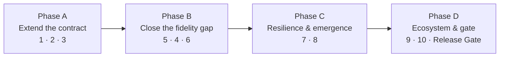

# 13 · Roadmap

The forward plan for cratelab: the open findings against the current build, the ten concept specs that extend the manifest spine, and the phased sequence that turns a passive bench into an active conformance engine.

> **cratelab docs** · SPDX `MIT` · security: this file must never contain credentials, tokens, private-repo content, or absolute user paths.

**Status:** design · **Last verified:** 2026-11-04 · **Related:** [00-index](00-index.md), [03-cli-and-workflows](03-cli-and-workflows.md), [06-crate-intelligence](06-crate-intelligence.md), [12-operations](12-operations.md)

## 1. Where we are

The v0.1 bench is genuinely sound: one manifest drives the UI, the runner, the coverage ledger and the conformance suite; "generated proposes, authored disposes" works via id-or-variant matching; refusals are treated as data end-to-end. The conformance crate — manifest-as-generator plus a zero-panic property suite with tier-aware reporting — is the standout.

The real risk at this stage is not the engine; it is the **harness around it** (no CI, no LICENSE) and the **reporting layer** (two small correctness bugs). Both are addressed first below.

## 2. Open findings

Every finding from the independent code review of the v0.1 build is listed here, ordered by severity. All remain open unless noted; none are yet closed by a commit.

| # | Sev | Finding | Location (verified) |
|---|---|---|---|
| F1 | should-fix | `lab coverage` is a no-op — the ledger is in-memory only and is never serialized, so it always prints `0.0%`. | `lab.rs` `coverage` arm |
| F2 | should-fix | The ledger's "reject lab-internal errors" guard never fires — it matches prose prefixes (`"manifest:"`) that the real `Display` (`manifest {path}: {problem}`) never produces, so manifest errors get booked as `Failed`. | `lab-coverage` `Ledger::record` |
| F3 | soon | Scenario `rhai` paths resolve against the process CWD, not the scenario file's directory. | `lab-scenarios` runner |
| F4 | soon | Coverage buckets are computed from **pre-substitution** args, so `$vars.*` steps collapse into one bucket. | `lab-scenarios` runner |
| F5 | soon | Cross-workspace scenarios misattribute coverage: one manifest is picked from the scenario's first command and the whole scenario books under it. | `lab-engine` `run_scenario` |
| F6 | soon | The crates.io sparse-index path is wrong for 1–2 char crate names; version resolution also falls back to the inherited version where cargo's default is `0.0.0`. | `lab-engine` `registry` + `discovery` |
| F7 | soon | `build_mapped` shoehorns a message into wrong fields (e.g. command text where a command id is expected; `RateLimited` "retry after 0 ms"). | `lab-errors` mapping |
| F8 | soon | `MockFleet` state update has a TOCTOU window: the device is cloned, mutated, then re-locked and overwritten. Harmless while the runner is serial. | `lab-mocks` `execute` |
| F9 | soon | `conform` exits 0 even with violations, so CI cannot gate on the property suite alone. | `lab.rs` `conform` arm |
| F10 | soon | Repo platform hygiene: no CI, no LICENSE file, no repo description/topics, stale committed `dist/`, stale `shell/README.md`, `csp: null`, rustfmt not clean. **Partially addressed** — manifest load errors are now surfaced in the shell. | repo root, `shell/` |
| F11 | later | `CommandSpec.mock` is declared but consumed by nothing; declared mock scripts do not exist. | `lab-manifest` + `lab-mocks` |
| F12 | later | A batch of smaller notes: cross-package `include_str!` fixtures, `per_second = 0` saturation, stale `lab-mocks` module doc, dead `clock_ms`, `at_ms: 0` on `invoke`, O(commands × cells) heatmap, silent manifest-skip in the shell, `csp: null`, generated `version = "TODO"`. | spread |

**Suggested order of attack:** (1) CI first — one workflow covering test + clippy + fmt + gate makes everything else cheaper; (2) F2 + F1 — fix the guard via error kinds, then add `--ledger` persistence to make `lab coverage` meaningful; (3) F3 + F4 — make the scenario feature honest; (4) F10 leftovers + F7 + F11. Then v0.2 (a hardware `CommandSink`) becomes genuinely additive, because the port and the IPC test already exist.

## 3. The ten concept specs

Each concept is a merge of at least two existing mechanisms plus one new idea. They are built *on* the manifest spine, never beside it.

| # | Concept | Thesis | Introduces |
|---|---|---|---|
| 1 | **Semantic contract evolution** | When the crate's surface changes, cratelab drafts the override instead of just warning about drift. | LLM-assisted override authoring (advisory only). |
| 2 | **Property-based conformance** | The input schema is already a generator; pair it with invariants and every command gets a free proptest suite. | Declared invariants as executable properties. |
| 3 | **Adversarial generative UI (red-team mode)** | The widget table that renders a form can render an attacker. | Boundary/hostile input mode over generated forms. |
| 4 | **Mock fidelity shadow engine** | The mock fleet should be measured against reality, and the gap should close itself. | A per-workspace mock-fidelity score + drafted mock patches. |
| 5 | **Golden cassette regression** | Real-hardware behaviour becomes a checked-in artifact that fails loudly on change. | Record/replay cassettes in CI. |
| 6 | **Quirk round-trip discovery** | The lab can find the quirks the workspaces currently hand-maintain. | Candidate quirk rows from device-specific failures. |
| 7 | **Remedy autopilot (self-healing playlists)** | Errors already carry a routing table; the runner should be able to follow it. | A `healed` coverage cell state + healing playbooks. |
| 8 | **Cross-workspace confluence engine** | The interesting bugs live between workspaces, and no single-crate suite can express them. | Seeded event-timing fuzzing across manifests. |
| 9 | **Federated manifest registry** | cratelab stops being a bench for a few workspaces and becomes a bench for any workspace. | A published manifest (+ optional WASM adapter) → a newly testable workspace. |
| 10 | **Provisioning bundle validator** | The installer's worst moment becomes a panel. | A claim-versus-reality bundle/backend report. |

The concepts converge on one **integration capstone**: a **Continuous Conformance Release Gate**, where drift + coverage + conformance + cassette-replay all feed a single go/no-go decision on publish.

## 4. Phased sequence

| Phase | Concepts | Why this order | Exit signal |
|---|---|---|---|
| **A — Extend the contract** | 1 · 2 · 3 | Builds directly on manifest + fuzz + UI already present; low risk, immediate leverage. | Drift becomes a reviewable patch; every `must` command has live properties. |
| **B — Close the fidelity gap** | 5 · 4 · 6 | The cassette must exist before the shadow engine can measure against it. | A mock-fidelity score per workspace; hardware results auto-populated. |
| **C — Resilience & emergence** | 7 · 8 | Depends on the remedy vocabulary and the shared bus being data. | A seeded cross-workspace race reproduced; healing counted in coverage. |
| **D — Ecosystem & gate** | 9 · 10 · gate | Depends on a stable schema and everything upstream feeding CI. | An unknown crate adopted with zero lab changes; publish gated on conformance. |

**Dependency notes:** build the record/replay cassette format once, correctly, before concepts 4 and 5. Concepts 2, 3 and 6 all consume the same type-directed generation engine. Concept 7 introduces the only genuinely new manifest block (healing playbooks) — keep it data, behind the same refusal discipline. Concept 8 is the highest-leverage and hardest to bound; give it seeded, shrinkable campaigns from day one.

## 5. Open questions to decide before committing

1. **How much autonomy do we trust?** Concepts 1, 4 and 7 propose or act automatically. The line: *propose freely; act only on `safe`/`mutating`; never on destructive; never past the hardware guard.*
2. **Is the ledger the single source of truth for all new states?** Healing, fidelity gaps and quirk candidates all want to be first-class ledger citizens — yes keeps them diffable; no fragments them.
3. **Where does the LLM live?** Concept 1 needs a model. The safe answer: advisory only, never writes the generated layer, every output carries a human-edited `why`.
4. **Which workspace proves the confluence story first?** The sensor → audio → panel chain is the natural demo; picking it now shapes the fixtures.
5. **Do we gate releases from day one, or report only first?** The capstone can start as a PR comment (report) and graduate to a hard block (gate) once the signals are trusted.

## 6. Consolidation notes

- Merged the standalone concept plan and the `F1–F12` review findings into one forward document; the concept plan previously lived as a separate top-level file and the findings as a separate review document.
- Every finding is carried as **open** because none is closed by a commit at the time of writing; F10 is marked partially addressed (the shell now surfaces manifest load errors) to avoid overstating progress.
- The through-line is preserved: cratelab's manifest is not a map of the API — it is a living behavioural contract, and each phase makes that contract self-maintaining, self-proving, self-healing, cross-cutting, and open to the ecosystem.
- Concepts that depend on external, non-repo-verifiable scripts or datasets are described as design intent, matching the honesty rules of this doc set.
