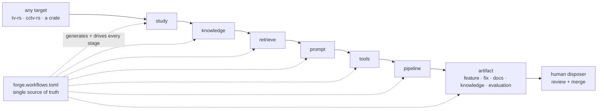

# 13 · Roadmap

The forward plan for cratelab: what exists in the forge scaffold today, the goal of a registry-driven evolution *factory*, the phased path from the scaffold to dynamic generated scripting, and the open findings that stand in the way.

> **cratelab docs** · SPDX `MIT` · security: this file must never contain credentials, tokens, private-repo content, or absolute user paths.

**Status:** design · **Last verified:** 2026-11-04 · **Related:** [00-index](00-index.md), [06-crate-intelligence](06-crate-intelligence.md), [07-the-forge](07-the-forge.md), [09-the-workflow-model](09-the-workflow-model.md), [12-operations](12-operations.md)

## 1 · Where we are (live)

The forge scaffold is real and tested. Everything below exists in the repository today:

- **The SDK** (`forge-core`): the `WorkflowRegistry` over one authored `forge.workflows.toml` (embedded and validated), the seven `StageKind`s and three `Gate`s, the deterministic `Pipeline`, `Artifact`/`EvidenceRef`, the `ProviderPort` + `MockProvider`, and the `ForgeError → LabError` vocabulary ([08](08-forge-sdk-and-sidecar.md), [09](09-the-workflow-model.md)).
- **The retrieval plane** (`forge-rag`): ingest/chunking, the BM25 index (`k1 = 1.2`, `b = 0.75`), evidence packets with citations, and the embedded crate-evolution research prompt ([10](10-knowledge-base-and-retrieval.md)).
- **The bridge** (`forge-sidecar`): a pure, tested stdio JSON-RPC router serving `forge.ping` / `forge.workflows` / `forge.tokenize`, plus two declared remotes ([08](08-forge-sdk-and-sidecar.md)).
- **The shell wiring**: the `forge_*` IPC commands, crate-hosted assets addressed by `engine_asset()`, and the gitignored `forge/` runtime home ([12](12-operations.md)).

The crate bench underneath is also sound: one manifest drives the UI, the runner, the coverage ledger and the conformance suite; "generated proposes, authored disposes" works end-to-end; refusals are treated as data throughout.

**What is *not* yet done:** the pipeline's default rule set is `AllowAll`, so the gates are declarative; the registry does not yet generate per-target scripting; and the field test has not been run end-to-end. Those are the point of the plan below.

## 2 · The goal: the factory (design)

The reframe is **the forge is a factory**. Any target project — `tv-rs`, `cctv-rs`, or any crate — enters **one** pipeline and exits as a reviewed *evolution*:

**study sources → build a knowledge base → retrieve grounded evidence → render scripted prompts → give the agent tools → run the staged pipeline → land a feature or fix.**

The defining property is that everything after the reframe is **dynamic, generated scripting driven by the registry** — not hand-written per target. Today a target's task catalog is a hand-maintained frontend table and the corpus builders live in the shell; the factory goal is that the authored `forge.workflows.toml` is the *only* thing a human edits, and the study/knowledge/retrieve/prompt/tools/pipeline/artifact stages are generated and driven from it.

## 3 · The phased plan (design)

Each phase makes one or more of the seven stages real and generated, moving from the scaffold toward the factory. **Status** is honest: **live** = exists today; **design** = proposed.

| Phase | Stages | What it adds | Status |
|---|---|---|---|
| **0 · Scaffold** | all seven | The registry, the stage/gate vocabulary, the deterministic pipeline, artifacts, the provider port, the retrieval plane, the sidecar and the shell wiring. | **live** |
| **1 · Study & Knowledge** | `study`, `knowledge` | Generate the corpus + index from the sources the registry declares, instead of hand-run shell builders: one chunker, one ingest path, provenance stamped from the target's revision. | design |
| **2 · Retrieve & Prompt** | `retrieve`, `prompt` | Produce committed evidence packets, render them into scripted prompts, and replace `AllowAll` with real deterministic refusal rules (e.g. "refuse to propose when the packet is empty"). Populate `Artifact::draft` from the packet. | design |
| **3 · Tools & Pipeline** | `tools`, `pipeline` | Arm the agent with the registry-declared tool ids and run the gated step pipeline for real — one generated script per run, driven by the registry, not per-target frontend code. | design |
| **4 · Artifact / Evolution** | `artifact` | Emit and review real evolutions (feature / fix / docs / knowledge / evaluation), each claim carrying an `EvidenceRef`, landing only through human review. Extend the factory to any crate. | design |
| **5 · The factory gate** | all | Feed drift, coverage, conformance and retrieval evaluation into a single continuous go/no-go — the release gate at the end of the factory line. | design |

**Dependency notes.** Phase 2 depends on Phase 1's generated corpus; Phase 3 depends on Phase 2's populated evidence; Phase 4 depends on Phase 3's real gated pipeline. The single highest-leverage move is **Phase 2's refusal rules**: they turn the declarative gates into an auditable contract and are the precondition for trusting any artifact the factory emits.

## 4 · Open findings

Every finding from the independent code review of the v0.1 bench is carried **open** (none is closed by a commit at the time of writing); the forge-level findings are added below. Ordering is by severity.

| # | Sev | Finding | Location (verified) |
|---|---|---|---|
| F1 | should-fix | `lab coverage` is a no-op — the ledger is in-memory only and is never serialized, so it always prints `0.0%`. | `lab.rs` `coverage` arm |
| F2 | should-fix | The ledger's "reject lab-internal errors" guard never fires — it matches prose prefixes the real `Display` never produces, so manifest errors get booked as `Failed`. | `lab-coverage` `Ledger::record` |
| F3 | soon | Scenario `rhai` paths resolve against the process CWD, not the scenario file's directory. | `lab-scenarios` runner |
| F4 | soon | Coverage buckets are computed from **pre-substitution** args, so `$vars.*` steps collapse into one bucket. | `lab-scenarios` runner |
| F5 | soon | Cross-workspace scenarios misattribute coverage: one manifest is picked from the scenario's first command and the whole scenario books under it. | `lab-engine` `run_scenario` |
| F6 | soon | The crates.io sparse-index path is wrong for 1–2 char crate names; version resolution falls back to the inherited version where cargo's default is `0.0.0`. | `lab-engine` `registry` + `discovery` |
| F7 | soon | `build_mapped` shoehorns a message into wrong fields (e.g. command text where a command id is expected; `RateLimited` "retry after 0 ms"). | `lab-errors` mapping |
| F8 | soon | `MockFleet` state update has a TOCTOU window: the device is cloned, mutated, then re-locked and overwritten. Harmless while the runner is serial. | `lab-mocks` `execute` |
| F9 | soon | `conform` exits 0 even with violations, so CI cannot gate on the property suite alone. | `lab.rs` `conform` arm |
| F10 | soon | Repo platform hygiene: no CI, no LICENSE file, no repo description/topics, stale committed `dist/`, stale `shell/README.md`, `csp: null`, rustfmt not clean. **Partially addressed** — manifest load errors are now surfaced in the shell. | repo root, `shell/` |
| F11 | later | `CommandSpec.mock` is declared but consumed by nothing; declared mock scripts do not exist. | `lab-manifest` + `lab-mocks` |
| F12 | later | A batch of smaller notes: cross-package `include_str!` fixtures, `per_second = 0` saturation, stale `lab-mocks` module doc, dead `clock_ms`, `at_ms: 0` on `invoke`, O(commands × cells) heatmap, silent manifest-skip in the shell, `generated version = "TODO"`. | spread |
| F13 | should-fix | `crates/forge-core/forge.config.json` still embeds absolute user paths (`control_center`, `target.workspace_root`, `repositories[].default_root`, `knowledge_sources[].path`); these should be repo-relative or env-resolved. | `forge.config.json` |
| F14 | soon | The `Pipeline` default rule set is `AllowAll`, so every authored gate is declarative; no real refusal rule is wired yet (Phase 2). | `forge-core` `pipeline` |
| F15 | soon | The engine's seven-stage pipeline and the shell's task catalog are two separate models; the registry does not yet drive generated scripting per target (Phases 1–3). | `forge-core` + `shell/src/forge-workflows.ts` |
| F16 | later | The field test has not been executed end-to-end, and runs collide on the same `{repo}-{crate}-{task}` report filename in the untracked `forge/reports/`. | `shell` + `forge/` |
| F17 | later | Chunking is duplicated: `forge-rag::ingest::chunk_lines` and the shell's builder both implement 80/12 windows; Phase 1 should collapse them into one path. | `forge-rag` + `shell/src-tauri/src/forge_knowledge.rs` |

**Suggested order of attack:** (1) F13 — the config hygiene item is small and removes the committed absolute user paths; (2) F14 + F1/F2 — real refusal rules and a meaningful ledger make the forge auditable; (3) F15/F17 with Phase 1 — one generated corpus path; (4) CI first among the leftovers (F10) so everything downstream is cheaper.

## 5 · The bench concepts still on the table (design)

The manifest spine remains a living behavioural contract, and these concepts extend it *on* the spine, never beside it. They are design intent and depend on the bench, not the forge.

| # | Concept | Thesis |
|---|---|---|
| 1 | Semantic contract evolution | When the crate surface changes, cratelab drafts the override instead of only warning about drift. |
| 2 | Property-based conformance | The input schema is already a generator; pair it with declared invariants for a free proptest suite. |
| 3 | Adversarial generative UI | The widget table that renders a form can render an attacker. |
| 4 | Mock fidelity shadow engine | Measure the mock fleet against reality; close the gap with drafted mock patches. |
| 5 | Golden cassette regression | Real-hardware behaviour becomes a checked-in record/replay artifact that fails loudly on change. |
| 6 | Quirk round-trip discovery | Surface the quirks the workspaces currently hand-maintain. |
| 7 | Remedy autopilot | Errors already carry a routing table; the runner should be able to follow it (healing playbooks as data). |
| 8 | Cross-workspace confluence engine | The interesting bugs live between workspaces; seeded event-timing fuzzing across manifests. |
| 9 | Federated manifest registry | A published manifest (+ optional WASM adapter) makes a new workspace testable with zero lab changes. |
| 10 | Provisioning bundle validator | A claim-versus-reality bundle/backend report. |

The capstone is the **Continuous Conformance Release Gate** — the same gate the forge's Phase 5 feeds.

## 6 · Design vs live ledger

| Item | Status |
|---|---|
| `forge-core` registry / stages / pipeline / artifacts / provider port | live |
| `forge-rag` ingest / BM25 / evidence packets / prompt templates | live |
| `forge-sidecar` JSON-RPC router and declared remotes | live |
| Shell `forge_*` commands and the `forge/` runtime home | live |
| Real refusal rules replacing `AllowAll` | design |
| Generated corpus/index driven by the registry | design |
| Generated per-target scripting / tools | design |
| Cross-target factory and the release gate | design |
| The ten bench concepts and the capstone gate | design |

## 7 · Open questions to decide before committing

1. **How much autonomy do we trust?** Phases 2–4 propose and (with a human) act. The line: *propose freely; act only on safe/mutating stages; never on destructive; never past the "target writes off" guard.*
2. **Is the registry the only source?** If the task catalog stays a separate frontend table, the factory is not registry-driven; generating it from `forge.workflows.toml` is the real test of the reframe.
3. **Where does the model live?** The provider port is the only network boundary; keep it advisory, behind preview + confirmation, and never let a stage fall back silently.
4. **Which target proves the factory first?** `extern-workspace-evolution` on `tv-rs` is the natural demo and shapes the fixtures.
5. **Do we gate releases from day one, or report first?** The factory gate can start as a report and graduate to a hard block once the signals are trusted.

## Consolidation notes

- **Improved rather than replaced** the roadmap: kept the filename and the open-findings discipline, but reframed the goal as **the factory** and made the phased plan a path from the forge scaffold to dynamic generated scripting rather than a bench-only sequence.
- **Labelled every phase design vs live** and added a design-vs-live ledger so the forge scaffold, the design goals and the bench concepts are never conflated.
- **Added forge findings F13–F17** grounded in the code (config hygiene, the `AllowAll` default rule set, the split between the registry and the shell task catalog, the unexecuted field test, and duplicated chunking), keeping the bench's F1–F12 open.
- **Condensed the ten bench concept specs** into one table and tied their capstone (the Continuous Conformance Release Gate) to the forge's Phase 5.
